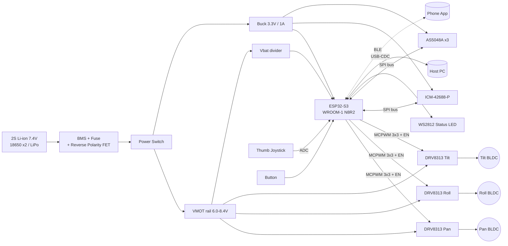
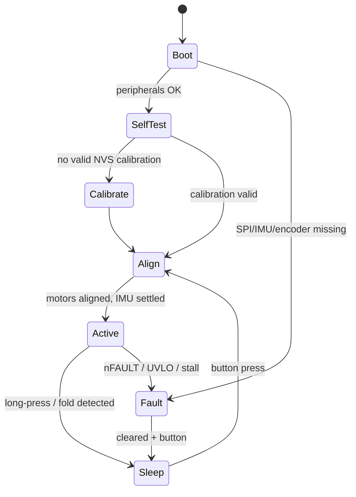

# Note before you use this

I don't have access to the `osmo-pocket-esp32-gimbal` repository or to the earlier "cycles." I wrote this README as a **complete reference design**. It uses a sensible, internally consistent hardware and firmware architecture: an ESP32-S3, three gimbal BLDCs, AS5048A encoders, an ICM-42688-P IMU, and SimpleFOC.

Before you commit it, check every pin number, part number, constant, and command against your actual schematic and source tree. I marked the values most likely to differ with `⚠️ VERIFY`.

---

```markdown
# osmo-pocket-esp32-gimbal

> An open-source, 3-axis handheld camera gimbal inspired by the DJI Osmo Pocket form factor.
> It is built on the ESP32-S3 with Field-Oriented Control (FOC) of brushless gimbal motors.


%20%7C%20CERN--OHL--S%20(hardware)-lightgrey)

---

## Table of Contents

1. [Features](#features)
2. [System Architecture](#system-architecture)
3. [Hardware](#hardware)
4. [Wiring & Pinout](#wiring--pinout)
5. [Bill of Materials](#bill-of-materials)
6. [Firmware: Build & Flash](#firmware-build--flash)
7. [First Power-Up Checklist](#first-power-up-checklist)
8. [FOC Tuning Procedure](#foc-tuning-procedure)
9. [Stabilization Loop Tuning](#stabilization-loop-tuning)
10. [Serial Command Reference](#serial-command-reference)
11. [Operating Modes](#operating-modes)
12. [Troubleshooting](#troubleshooting)
13. [Safety](#safety)
14. [Repository Layout](#repository-layout)
15. [Roadmap](#roadmap)
16. [Contributing](#contributing)
17. [License](#license)

---

## Features

- **3-axis stabilization**: pan (yaw), roll, and tilt (pitch).
- **Closed-loop FOC** on every axis, using absolute magnetic encoders.
  - The control loop runs at about 10 kHz per motor.
- **Cascaded control**: IMU attitude loop → per-motor angle loop → velocity loop → FOC voltage/torque.
- **IMU sensor fusion**:
  - ICM-42688-P sampled over SPI at 1 kHz.
  - Mahony filter with gyro-bias estimation.
- **Modes**: Follow, Pan-Follow, Lock, FPV, Recenter, and Sleep.
- **Control input**: on-board thumb joystick and multifunction button.
- **BLE configuration interface**: live tuning from a phone or PC.
- **Persistent calibration**: encoder offsets, IMU bias, and PID gains are stored in NVS.
- **Safety**:
  - Driver fault detection.
  - Undervoltage cutoff.
  - Stall/over-temperature heuristics.
  - Watchdog.
- **Battery**: 2S Li-ion, with voltage telemetry.

---

## System Architecture

### Hardware block diagram



### Control architecture (per axis)

```
                 ┌──────────────────────── 500 Hz ───────────────────────┐  ┌──────── ~10 kHz ────────┐
 Joystick/Mode ─►│ Setpoint   ┌──────────┐  q_err  ┌────────────┐ θ_ref ─►│ Angle P ─► Velocity PI ─►│─► Uq ─► SVPWM ─► Motor
                 │ Generator ─►│ Attitude │────────►│ Inverse    │         │  (+LPF)                  │        │
 IMU (1 kHz) ───►│            │ Error    │         │ Kinematics │         │      ▲                   │        │
  Mahony filter  └────────────┴──────────┘         └────────────┘         └──────┼───────────────────┘        │
                                                                                 └──── encoder θ, ω ◄──────────┘
```

| Loop | Rate | Core | Owner (source file) |
|---|---|---|---|
| FOC commutation + velocity/angle | ~10 kHz per motor (round-robin) | Core 1 | `src/motor/foc_task.cpp` |
| IMU read + Mahony fusion | 1 kHz | Core 0 | `src/imu/imu_task.cpp` |
| Attitude / stabilization | 500 Hz | Core 0 | `src/control/stabilizer.cpp` |
| UI, BLE, telemetry, battery | 50 Hz | Core 0 | `src/app/ui_task.cpp` |

> **Why voltage-mode FOC?** Gimbal motors are high-resistance (about 5–15 Ω).
> Phase current is therefore roughly `Uq / R`, so current sensing adds cost with little benefit.
> The firmware estimates current from `Uq` and `phase_resistance`.

### Firmware state machine



---

## Hardware

### Mechanical axis order (camera → handle)

`Camera ─ Tilt motor ─ Roll motor ─ Pan motor ─ Handle`

This order matches the Osmo Pocket kinematics. The inverse-kinematics block in `stabilizer.cpp` assumes this order. If you change the mechanical stack-up, update `config/kinematics.h`.

### Motor selection

Pocket-sized payloads (about 30–80 g, e.g. a small action-camera module) work well with these motors:

| Axis | Recommended motor | Pole pairs | Phase R | Notes |
|---|---|---|---|---|
| Pan | 2204 260KV gimbal | 7 | ~10 Ω | Largest inertia |
| Roll | 2204 260KV gimbal | 7 | ~10 Ω | |
| Tilt | 1806 / 2204 gimbal | 7 | ~8–12 Ω | Hollow shaft for cable routing |

⚠️ VERIFY: Always confirm the pole-pair count with the `M?P` auto-detect routine (see [Step 2](#step-2--pole-pairs--sensor-direction)).

---

## Wiring & Pinout

### ESP32-S3 pin assignment

Target module: ESP32-S3-WROOM-1 N8R2. ⚠️ VERIFY these pins against `include/pins.h`.

| Function | GPIO | Peripheral | Notes |
|---|---|---|---|
| **Pan A / B / C** | 4 / 5 / 6 | MCPWM0 | |
| **Pan EN** | 7 | GPIO | Shared enable for all 3 half-bridges |
| **Roll A / B / C** | 15 / 16 / 17 | MCPWM0 / MCPWM1 | |
| **Roll EN** | 18 | GPIO | |
| **Tilt A / B / C** | 38 / 39 / 40 | MCPWM1 | |
| **Tilt EN** | 41 | GPIO | |
| **DRV nFAULT** (wired-OR) | 47 | GPIO in, pull-up | Open-drain from all 3 drivers |
| **SPI SCK** | 12 | FSPI | Shared bus |
| **SPI MOSI** | 11 | FSPI | |
| **SPI MISO** | 13 | FSPI | |
| **CS IMU** | 10 | GPIO | ICM-42688-P, SPI mode 3, up to 24 MHz |
| **CS ENC Pan** | 9 | GPIO | AS5048A, SPI mode 1, up to 10 MHz |
| **CS ENC Roll** | 14 | GPIO | |
| **CS ENC Tilt** | 21 | GPIO | |
| **IMU INT1** | 46* | GPIO in | *Strapping pin. Input only after boot; see note below. |
| **VBAT sense** | 1 | ADC1_CH0 | 100 kΩ / 33 kΩ divider + 100 nF |
| **Joystick X** | 2 | ADC1_CH1 | |
| **Joystick Y** | 8 | ADC1_CH7 | |
| **Button** | 42 | GPIO in, pull-up | Active-low |
| **Status LED** | 48 | RMT | WS2812 |
| **USB D− / D+** | 19 / 20 | USB-OTG/CDC | Flashing + console |
| **UART0 TX / RX** | 43 / 44 | UART0 | Debug header |

**Pins deliberately avoided:**

- **GPIO 0, 3, 45, 46**: strapping pins.
  - IMU INT1 on GPIO 46 is optional and can be left unconnected.
  - The firmware polls the IMU by default.
- **GPIO 26–32**: SPI flash.
- **GPIO 33–37**: octal PSRAM on N8R8/N16R8 modules.
- **ADC2**: unusable while Wi-Fi/BLE is active.

### Driver connections (each of 3 boards: SimpleFOC Mini / DRV8313)

```
 SimpleFOC Mini            ESP32-S3 / Power
 ┌──────────────┐
 │ IN1  ────────┼──── Phase-A GPIO
 │ IN2  ────────┼──── Phase-B GPIO
 │ IN3  ────────┼──── Phase-C GPIO
 │ EN   ────────┼──── EN GPIO
 │ nFT  ────────┼──── GPIO47 (wired-OR, 10k pull-up to 3V3)
 │ nRT  ────────┼──── 3V3 (or MCU GPIO for remote reset)
 │ GND  ────────┼──── GND (star point at battery −)
 │ VM   ────────┼──── VMOT (6.0–8.4 V), 47 µF low-ESR local bulk cap
 │ M1/M2/M3 ────┼──── Motor phases (order arbitrary; firmware detects)
 └──────────────┘
```

### Encoder connections (AS5048A, each axis)

| AS5048A pin | Connection |
|---|---|
| VDD3V / VDD5V | 3V3 (tie both together for 3.3 V operation) |
| GND | GND |
| CLK | GPIO 12 |
| MOSI | GPIO 11 |
| MISO | GPIO 13 (33 Ω series resistor recommended) |
| CSn | Per-axis CS (9 / 14 / 21) |

**Magnet**: diametrically magnetized, 6 × 2.5 mm, mounted on the rotor axis. The air gap should be 0.5–2.5 mm. Check `AGC` and `MAG` diagnostics with the `E?` command.

### Power wiring rules

1. **Star ground at the battery negative terminal.**
   - Motor return currents must not flow through the logic ground of the IMU or encoders.
2. **Fuse.** Place a 3 A slow-blow fuse directly after the battery.
3. **Reverse-polarity protection.** Use a P-FET (e.g. AO3401A) ahead of the switch.
4. **Keep the IMU away from noise.**
   - Mount it on the camera side of the tilt motor, rigidly coupled to the camera.
   - Keep it at least 15 mm from motor windings and switching nodes.
5. **SPI wiring and cable routing.**
   - Use twisted pairs or a shielded FFC for SPI lines that run through the axes.
   - Keep the bus under about 25 cm and drop to 4 MHz if you see CRC/parity errors.
   - Route cables through hollow shafts or slip rings.
   - Leave service loops that allow ±170° of pan