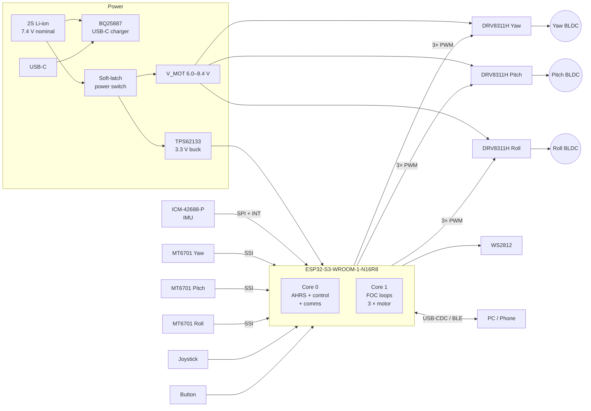

# osmo-pocket-esp32-gimbal: README.md (Cycle 12)

> **Note on this draft:** I can't see the repository's contents, so this README is built on a coherent reference design: an ESP32-S3, three gimbal BLDCs, DRV8311H drivers, MT6701 encoders, an ICM-42688-P IMU, a 2S Li-ion pack and SimpleFOC. Before merging, check every value marked `⚠️ VERIFY` and the pin map against your schematic (`hardware/`) and `include/board_pins.h`. Everything else is ready to commit.

---

````markdown
# 🎥 osmo-pocket-esp32-gimbal

**An open-source, pocket-sized 3-axis stabilized gimbal inspired by the DJI Osmo Pocket, built around the ESP32-S3 and Field-Oriented Control (FOC) of gimbal BLDC motors.**

[](#-building--flashing)
[](#-hardware-overview)
[](#-foc-tuning-procedure)
[](#-license)

---

## Table of Contents

1. [Features](#-features)
2. [Project Status](#-project-status)
3. [Repository Layout](#-repository-layout)
4. [System Architecture](#-system-architecture)
5. [Hardware Overview](#-hardware-overview)
6. [Wiring & Pinouts](#-wiring--pinouts)
7. [Power System](#-power-system)
8. [Building & Flashing](#-building--flashing)
9. [First Boot & Calibration](#-first-boot--calibration)
10. [FOC Tuning Procedure](#-foc-tuning-procedure)
11. [Stabilization Loop Tuning](#-stabilization-loop-tuning)
12. [Operating Modes & Controls](#-operating-modes--controls)
13. [Serial / BLE Command Reference](#-serial--ble-command-reference)
14. [Bill of Materials](#-bill-of-materials)
15. [Troubleshooting](#-troubleshooting)
16. [Safety](#-safety)
17. [Contributing](#-contributing)
18. [License](#-license)

---

## ✨ Features

- **3-axis stabilization** (yaw / pitch / roll) using closed-loop FOC on all three axes
- **Absolute magnetic encoders** (MT6701, 14-bit) for each motor, so the gimbal needs no homing sweep at power-on
- **High-rate IMU fusion**: ICM-42688-P at 1 kHz with a Mahony AHRS and gyro-bias auto-calibration
- **Cascaded control**: attitude loop (500 Hz) → joint angle loop → FOC voltage/current loop (~10 kHz)
- **Follow modes**: Lock, Pan-Follow, FPV (full follow), and Recenter
- **Joystick + single-button UI** with WS2812 status LED
- **Live tuning** over USB-CDC serial (SimpleFOC Commander) and BLE (NimBLE)
- **Persistent configuration** in NVS, with versioned schema and factory reset
- **Protection**: driver fault latch, under-voltage cutoff, motor thermal model and stall detection
- **2S Li-ion** with USB-C charging and soft-latch power

---

## 🚦 Project Status

| Area                     | Status       | Notes                                        |
|--------------------------|--------------|----------------------------------------------|
| Hardware rev             | **Rev C**    | Rev A/B are not pin-compatible (see `hardware/CHANGELOG.md`) |
| FOC motor control        | ✅ Stable     | Voltage-mode FOC with estimated current      |
| Inline current sensing   | 🧪 Experimental | Rev C has the footprints; firmware flag `USE_CURRENT_SENSE` |
| AHRS / stabilization     | ✅ Stable     |                                              |
| BLE app control          | 🟡 Beta      | Characteristic map may change                |
| Camera module integration| 🔜 Planned   | Payload is currently any camera ≤ 60 g       |

**Current development cycle:** Cycle 12

---

## 📁 Repository Layout

```
osmo-pocket-esp32-gimbal/
├── firmware/
│   ├── platformio.ini
│   ├── include/
│   │   ├── board_pins.h          # ← single source of truth for GPIO mapping
│   │   ├── config_defaults.h     # default PID / FOC parameters
│   │   └── version.h
│   ├── src/
│   │   ├── main.cpp
│   │   ├── foc/                  # motor + driver + encoder wrappers
│   │   ├── ahrs/                 # IMU driver, Mahony filter, bias cal
│   │   ├── control/              # stabilization, follow modes, kinematics
│   │   ├── io/                   # joystick, button, LED, battery
│   │   ├── comms/                # serial commander, BLE service
│   │   └── storage/              # NVS config schema
│   └── test/                     # Unity unit tests (host + target)
├── hardware/
│   ├── kicad/                    # schematic + PCB (KiCad 8)
│   ├── gerbers/
│   ├── bom/                      # BOM.csv + JLCPCB CPL
│   └── CHANGELOG.md
├── mechanical/
│   ├── step/                     # arm + handle STEP files
│   └── stl/                      # printable parts
├── tools/
│   ├── tune_plot.py              # live plot of commander monitor stream
│   └── step_response.py          # automated step-response analysis
├── docs/
│   └── images/
└── README.md
```

---

## 🧭 System Architecture

### Top-level block diagram



### Control architecture (cascaded loops)

```
                   ┌──────────────────────── Core 0 @ 500 Hz ───────────────────────┐
 Joystick / Mode ─►│ Setpoint     ┌──────────┐   q_err   ┌──────────┐  joint_cmd    │
                   │ generator ──►│ Attitude │──────────►│ Inverse  │──────────────┐│
                   │  (follow,    │  error   │           │ kinematics│             ││
                   │   smoothing) └────▲─────┘           └──────────┘              ││
                   │                   │ q_cam (estimated)                         ││
 IMU 1 kHz ───────►│ Mahony AHRS ──────┘                                           ││
                   └───────────────────────────────────────────────────────────────┘│
                                                                                    ▼
                   ┌──────────────────────── Core 1 @ ~10 kHz per motor ────────────┐
                   │  angle_target ─► [ P_angle ] ─► vel_target ─► [ PI_vel + LPF ] │
                   │        ▲                                          │            │
                   │        │ encoder angle                            ▼ Uq         │
                   │   MT6701 ◄──────────── motor ◄── SVPWM ◄── [ FOC (Park⁻¹) ]   │
                   └────────────────────────────────────────────────────────────────┘
```

| Loop                | Rate        | Core | Input            | Output             |
|---------------------|-------------|------|------------------|--------------------|
| FOC commutation     | ~10 kHz     | 1    | electrical angle | phase PWM duty     |
| Velocity (PI + LPF) | ~10 kHz     | 1    | velocity error   | Uq voltage         |
| Joint angle (P)     | 1–2 kHz     | 1    | angle error      | velocity target    |
| Attitude            | 500 Hz      | 0    | quaternion error | joint angle target |
| AHRS                | 1 kHz       | 0    | g