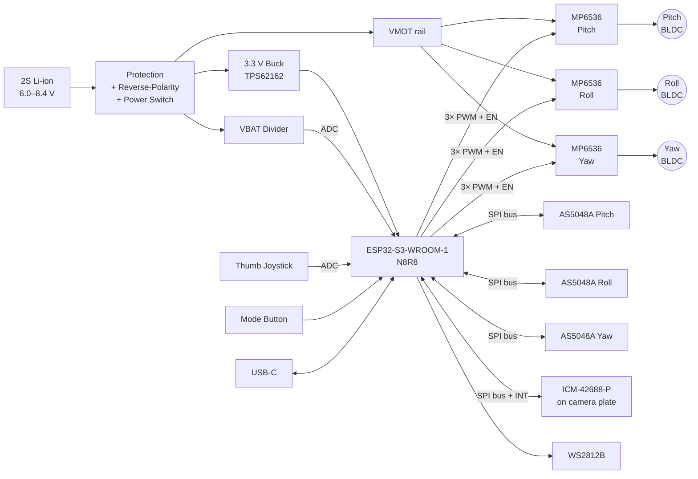
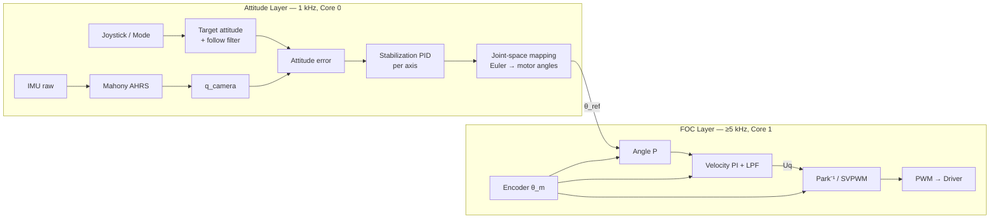

I don't have access to the actual contents of `osmo-pocket-esp32-gimbal` or the prior 14 cycles. This README is a **complete reference design** built on standard, well-documented parts: an ESP32-S3, SimpleFOC, AS5048A encoders, an ICM-42688-P IMU, and MP6536 drivers. Before merging, check the pin map, part numbers and gains against your schematic and firmware. The parts most likely to differ are marked **⚠ VERIFY**.

---

```markdown
# osmo-pocket-esp32-gimbal

> Open-source, pocket-format 3-axis brushless camera gimbal built on the ESP32-S3,
> using field-oriented control (FOC), absolute magnetic encoders, and a high-rate
> IMU attitude loop.


---

## Table of Contents

1. [Overview](#1-overview)
2. [Feature Summary](#2-feature-summary)
3. [System Architecture](#3-system-architecture)
4. [Hardware](#4-hardware)
5. [Wiring & Pinouts](#5-wiring--pinouts)
6. [Bill of Materials](#6-bill-of-materials)
7. [Firmware Build & Flash](#7-firmware-build--flash)
8. [First Power-Up & Commissioning](#8-first-power-up--commissioning)
9. [FOC Tuning Procedure](#9-foc-tuning-procedure)
10. [Stabilization Loop Tuning](#10-stabilization-loop-tuning)
11. [Operating Modes & Controls](#11-operating-modes--controls)
12. [Serial Command Reference](#12-serial-command-reference)
13. [Configuration Reference](#13-configuration-reference)
14. [Troubleshooting](#14-troubleshooting)
15. [Safety](#15-safety)
16. [Repository Layout](#16-repository-layout)
17. [Contributing](#17-contributing)
18. [License](#18-license)

---

## 1. Overview

`osmo-pocket-esp32-gimbal` is a handheld 3-axis stabilizer inspired by the
DJI Osmo Pocket form factor. It is designed for small camera modules such as
the OV5640 or ESP32-CAM-class sensors, and for micro action cameras up to about 60 g.

A single ESP32-S3 handles all of the following:

- 3× sensored FOC motor loops (one per axis)
- IMU sensor fusion (Mahony filter, 1 kHz)
- Attitude/follow controller
- User I/O: joystick, button, RGB status LED and battery monitor
- Optional Wi-Fi/BLE telemetry and tuning

This project is **not affiliated with or endorsed by DJI**.

---

## 2. Feature Summary

| Feature                    | Specification                                         |
|----------------------------|-------------------------------------------------------|
| Axes                       | Pan (yaw), Roll, Tilt (pitch)                         |
| Motor control              | Voltage-mode FOC, SVPWM, sensored                     |
| Encoders                   | AS5048A, 14-bit absolute, SPI                         |
| IMU                        | ICM-42688-P, SPI @ 10 MHz, 1 kHz ODR                  |
| FOC loop rate              | ≥ 5 kHz per axis (≈ 7–9 kHz typical)                  |
| Attitude loop rate         | 1 kHz                                                 |
| Supply                     | 2S Li-ion/LiPo (6.0–8.4 V)                            |
| Runtime                    | ~2.5 h @ 1000 mAh, balanced payload                   |
| Payload                    | ≤ 60 g, balanced                                      |
| Modes                      | Follow, Pan-Follow, Lock, FPV, Recenter, Sleep        |
| Interfaces                 | USB-C (CDC + flashing), BLE tuning, Wi-Fi telemetry   |

---

## 3. System Architecture

### 3.1 Hardware Block Diagram



### 3.2 Control Architecture



### 3.3 Task Layout (FreeRTOS)

| Task            | Core | Priority | Rate      | Responsibility                       |
|-----------------|------|----------|-----------|--------------------------------------|
| `foc_task`      | 1    | 24 (max) | free-run  | `loopFOC()` + `move()` × 3 axes      |
| `imu_task`      | 0    | 22       | 1 kHz     | IMU read (INT-driven), AHRS update   |
| `control_task`  | 0    | 20       | 1 kHz     | Mode logic, stabilization PID        |
| `ui_task`       | 0    | 5        | 50 Hz     | Joystick, button, LED, battery       |
| `comms_task`    | 0    | 3        | async     | Serial Commander, BLE, telemetry     |

Cross-core data is exchanged through lock-free double buffers. Setpoints use
`std::atomic<float>`. Do not take a mutex in `foc_task`.

### 3.4 Shared SPI Bus Arbitration

The encoders and the IMU share one SPI bus (SPI2/FSPI). Access rules:

- `foc_task` reads the encoders.
- `imu_task` reads the IMU.
- A SPI bus mutex is held **only for the transaction**, which takes about 4 µs per encoder at 10 MHz.
- If `foc_task` jitter exceeds 20 µs on your board, set `IMU_ON_SEPARATE_BUS=1`.
  The IMU then moves to SPI3 using the alternate pins in §5.4.

---

## 4. Hardware

### 4.1 Mechanical

- Arm geometry follows a standard Yaw → Roll → Pitch chain. The yaw motor sits in the handle.
- The camera must be **statically balanced** on pitch and roll before power-on.
  FOC compensates for imbalance, but at the cost of current, heat and runtime.
- Each encoder magnet (diametric, 6×2.5 mm) is glued to the rear of the motor shaft.
  Required geometry:
  - Air gap: **0.5–2.0 mm**
  - Concentricity: **≤ 0.25 mm**

### 4.2 Motors

The reference motor is a 2204 260 KV gimbal motor with a 12N14P stator (**7 pole pairs**),
wound at ~10 Ω phase resistance. **⚠ VERIFY** these values against your motor.

Lower-KV, higher-resistance windings are preferred. They give smoother low-speed
torque in voltage mode and keep current safe without current sensing.

### 4.3 Drivers

The MP6536 operates from 5–26 V, so it covers the full 2S range. The DRV8313
requires ≥ 8 V and is not suitable for 2S.

| Signal | Function                                                        |
|--------|-----------------------------------------------------------------|
| INx    | PWM for each half-bridge                                        |
| ENx    | Per-phase enable. Phases are tied together per axis (one EN line) |
| nFAULT | Open-drain fault output, wired-OR across all three drivers      |

---

## 5. Wiring & Pinouts

### 5.1 ESP32-S3 Pin Map (ESP32-S3-WROOM-1 N8R8)

> **⚠ VERIFY** against `firmware/include/pins.h` and the KiCad schematic.
>
> Pins avoided on purpose:
> - GPIO 0, 3, 45, 46: strapping pins
> - GPIO 19/20: native USB
> - GPIO 26–37: flash and octal PSRAM

| Function              | GPIO | Peripheral      | Notes                                  |
|-----------------------|------|-----------------|----------------------------------------|
| **Pitch** PWM A       | 5    | MCPWM0 / Op0    |                                        |
| **Pitch** PWM B       | 