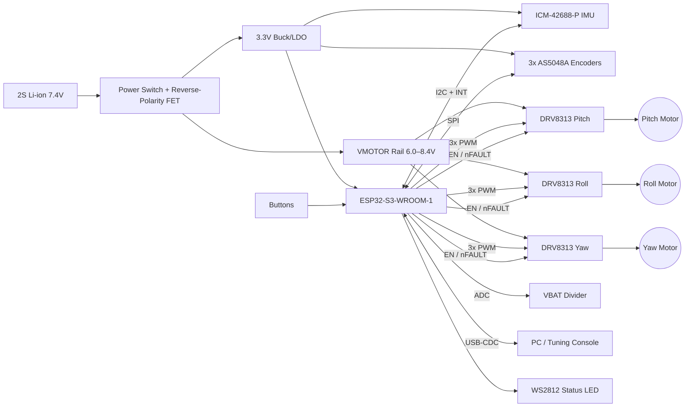
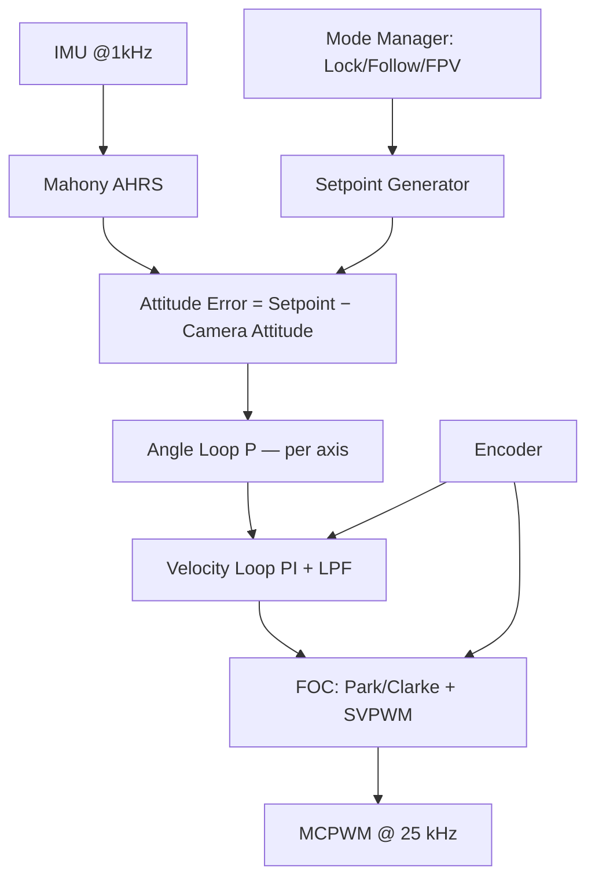

> **Note:** I don't have access to the `osmo-pocket-esp32-gimbal` repository or the earlier "cycles," so I can't see your schematic, firmware, or prior README drafts. This README is a complete, self-consistent reference design based on common choices for this class of project: ESP32-S3, SimpleFOC, DRV8313, AS5048A, and ICM-42688-P. Items marked **⚠ VERIFY** must be checked against your actual hardware before publishing. If you share your schematic, `platformio.ini`, or pin header file, I can reconcile everything exactly.

---

```markdown
# osmo-pocket-esp32-gimbal

> Open-source, 3-axis brushless gimbal stabilizer for the DJI Osmo Pocket form factor,
> built on the ESP32-S3 with field-oriented control (FOC) via SimpleFOC.


---

## Table of Contents

1. [Overview](#overview)
2. [Features](#features)
3. [System Architecture](#system-architecture)
4. [Hardware](#hardware)
5. [Wiring & Pinout](#wiring--pinout)
6. [Firmware Build & Flash](#firmware-build--flash)
7. [First Power-Up Checklist](#first-power-up-checklist)
8. [FOC Tuning Procedure](#foc-tuning-procedure)
9. [Stabilization Loop Tuning](#stabilization-loop-tuning)
10. [Serial Command Reference](#serial-command-reference)
11. [Bill of Materials](#bill-of-materials)
12. [Troubleshooting](#troubleshooting)
13. [Safety](#safety)
14. [Contributing](#contributing)
15. [License](#license)

---

## Overview

This project implements a pocket-sized 3-axis camera gimbal (pitch / roll / yaw).
Each axis uses a low-KV gimbal BLDC motor driven by sinusoidal FOC. The control
loop runs closed-loop on absolute magnetic encoders, and an IMU provides the
attitude reference.

The control architecture is cascaded:

    IMU attitude error → Angle loop (P) → Velocity loop (PI) → FOC (voltage/current) → Motor

## Features

- 3 × closed-loop FOC BLDC axes using SimpleFOC with SVPWM
- 14-bit absolute magnetic encoders, so no homing sweep is needed at boot
- 6-DoF IMU fused using a Mahony filter at 1 kHz (default)
- Operating modes: **Lock**, **Pan-Follow**, **FPV**, and **Recenter**
- Native USB-CDC serial console for live tuning, using the SimpleFOC Commander
- Gains stored in NVS (flash), so tuning survives a power cycle
- Battery monitoring with low-voltage cutoff
- Driver fault detection with automatic safe-disable

---

## System Architecture

### Hardware Block Diagram



### Firmware Control Architecture



### Task / Core Allocation

| Core | Task               | Rate          | Priority |
|------|--------------------|---------------|----------|
| 1    | `loopFOC()` × 3    | free-running (≥ 5 kHz each target) | highest |
| 1    | `move()` × 3       | 1 kHz         | high     |
| 0    | IMU read + AHRS    | 1 kHz (INT-driven) | high |
| 0    | Mode / UI / buttons| 100 Hz        | normal   |
| 0    | Commander / NVS / telemetry | 50 Hz | low     |

> Keep the FOC on Core 1, isolated from Wi-Fi/BT. Radio stacks run on Core 0. If you
> enable BLE, re-verify the FOC loop rate.

---

## Hardware

| Subsystem   | Part                         | Notes |
|-------------|------------------------------|-------|
| MCU         | ESP32-S3-WROOM-1-N16R8       | Dual-core 240 MHz, native USB |
| Motor driver| TI DRV8313 (×3)              | 8–60 V, 2.5 A peak, integrated FETs |
| Motors      | 2204 gimbal BLDC, 12N14P (×3)| **7 pole pairs**, ~10 Ω phase ⚠ VERIFY |
| Encoders    | AMS AS5048A (×3), SPI        | 14-bit; diametric magnet on the motor shaft |
| IMU         | TDK ICM-42688-P              | Mounted on the camera plate, not the handle |
| Battery     | 2S 18350 / 18650 Li-ion      | Protected cells or external BMS |

> ⚠ VERIFY: DRV8313 minimum VM is 8 V per datasheet. A 2S pack drops to ~6.4 V when
> depleted, so either use 3S, or substitute the **TMC6300** (2–11 V) / **DRV8316**.
> Update this table to match your board.

---

## Wiring & Pinout

### ESP32-S3 Pin Map

Pins were chosen to avoid strapping pins (0, 3, 45, 46), flash/PSRAM pins
(26–37 on N16R8), and USB D−/D+ (19/20).

| Function            | GPIO | Direction | Notes |
|---------------------|------|-----------|-------|
| **Pitch PWM A**     | 4    | OUT | MCPWM0 |
| **Pitch PWM B**     | 5    | OUT | MCPWM0 |
| **Pitch PWM C**     | 6    | OUT | MCPWM0 |
| **Yaw PWM A**       | 8    | OUT | MCPWM0 |
| **Yaw PWM B**       | 9    | OUT | MCPWM0 |
| **Yaw PWM C**       | 10   | OUT | MCPWM0 |
| **Roll PWM A**      | 15   | OUT | MCPWM1 |
| **Roll PWM B**      | 16   | OUT | MCPWM1 |
| **Roll PWM C**      | 17   | OUT | MCPWM1 |
| Driver EN (shared)  | 7    | OUT | 10 kΩ pull-down, so drivers stay off during boot |
| Driver nFAULT (wired-OR) | 18 | IN | Open-drain, 10 kΩ pull-up to 3.3 V |
| SPI SCK             | 12   | OUT | Encoders, 1 MHz |
| SPI MISO            | 13   | IN  | |
| SPI MOSI            | 11   | OUT | |
| CS Pitch encoder    | 38   | OUT | 10 kΩ pull-up |
| CS Roll encoder     | 39   | OUT | 10 kΩ pull-up |
| CS Yaw encoder      | 40   | OUT | 10 kΩ pull-up |
| IMU SDA             | 47   | I/O | 4.7 kΩ pull-up, 400 kHz–1 MHz |
| IMU SCL             | 48   | OUT | 4.7 kΩ pull-up |
| IMU INT1            | 14   | IN  | Data-ready interrupt |
| VBAT sense          | 1    | ADC1_CH0 | Divider 100 kΩ / 33 kΩ + 100 nF |
| Button MODE         | 41   | IN  | Internal pull-up, active low |
| Button TRIGGER      | 42   | IN  | Internal pull-up, active low |
| Status LED (WS2812) | 21   | OUT | RMT |
| USB D− / D+         | 19 / 20 | — | Native USB-CDC |

> ⚠ VERIFY: GPIO 47/48 run at 3.3 V only on modules **without** 1.8 V octal flash
> (e.g., N16R8 is fine, R16V is not).

### Motor Driver Connections (per axis)

```
ESP32-S3            DRV8313                 Motor
-----------         ----------------        -------
PWM A  ──────────►  IN1        OUT1 ─────►  Phase U
PWM B  ──────────►  IN2        OUT2 ─────►  Phase V
PWM C  ──────────►  IN3        OUT3 ─────►  Phase W
EN     ──────────►  EN1/EN2/EN3
                    nRESET, nSLEEP ── 3.3 V (or GPIO for low-power)
nFAULT ◄──────────  nFAULT (open-drain)
                    VM ── VMOTOR + 10 µF ceramic + 100 µF bulk
                    V3P3OUT ── 0.47 µF (do NOT use to power the MCU)
                    CPL/CPH ── 0.01 µF
                    VCP ── 0.1 µF to VM
```

### Encoder Connections

```
AS5048A (×3)        ESP32-S3
---------           --------
VDD5V + VDD3V ─┬──  3.3 V   (3.3 V mode: tie both together)
GND ───────────┴──  GND
CLK ──────────────  GPIO12 (shared)
MISO ─────────────  GPIO13 (shared)
MOSI ─────────────  GPIO11 (shared)
CSn ──────────────  GPIO38 / 39 / 40
```

- Magnet: 6 × 2.5 mm diametrically magnetized N35, with a **0.5–2.5 mm air gap**.
- Center the magnet within ±0.25 mm of the sensor axis. Off-axis mounting causes
  periodic torque ripple.
- Keep motor phase wires away from the encoder flex. Twist each phase triplet.

### Power

```
BAT+ ─► Switch ─► P-FET reverse-polarity ─