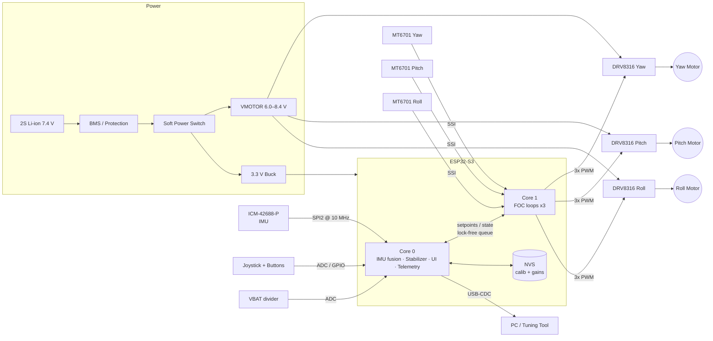

# README.md

A note before the file: I don't have access to the contents of your `osmo-pocket-esp32-gimbal` repository or to earlier "cycles," so I wrote this as a complete reference README for a typical build. That build is an ESP32-S3, three DRV8316 drivers, MT6701 encoders, an ICM-42688-P IMU and SimpleFOC. Anything that must match your actual hardware or code is marked **⚠ VERIFY**. Replace those values with your real ones before publishing.

---

````markdown
# osmo-pocket-esp32-gimbal

> Open-source, pocket-sized 3-axis handheld camera gimbal built on the ESP32-S3,
> driven by field-oriented control (FOC) of brushless gimbal motors with absolute
> magnetic encoders and a high-rate IMU.


---

## Table of Contents

1. [Features](#features)
2. [System Architecture](#system-architecture)
3. [Hardware Overview](#hardware-overview)
4. [Wiring & Pinout](#wiring--pinout)
5. [Power System](#power-system)
6. [Firmware: Build & Flash](#firmware-build--flash)
7. [First Power-Up & Calibration](#first-power-up--calibration)
8. [FOC Tuning Procedure](#foc-tuning-procedure)
9. [Stabilization Loop Tuning](#stabilization-loop-tuning)
10. [User Controls & Modes](#user-controls--modes)
11. [Serial Command Reference](#serial-command-reference)
12. [Bill of Materials (BOM)](#bill-of-materials-bom)
13. [Troubleshooting](#troubleshooting)
14. [Safety](#safety)
15. [Contributing](#contributing)
16. [License](#license)

---

## Features

- **3-axis stabilization**: pan (yaw), tilt (pitch) and roll.
- **Sensor-based FOC** on all axes using 14-bit absolute magnetic encoders. Calibration is not needed after the first boot because the zero offsets are stored in NVS.
- **1 kHz IMU attitude estimation** using an ICM-42688-P with a Mahony filter. Gyro bias is calibrated at startup.
- **Dual-core scheduling**:
  - Core 1 runs the FOC inner loops at about 8–10 kHz.
  - Core 0 runs the attitude estimation, stabilization, UI and telemetry.
- **Operating modes**: Follow, Pan-Follow, Lock, FPV and Recenter.
- **Analog joystick** for manual pan and tilt, plus a multi-function button.
- **2S Li-ion power** with battery monitoring, low-voltage cutoff and soft motor ramp-up.
- **Runtime tuning over USB-CDC** through the SimpleFOC `Commander` interface. Gains are persisted to NVS.
- **Fail-safes**:
  - Encoder fault detection
  - Over-temperature fault (driver nFAULT)
  - Motor stall detection
  - IMU watchdog

---

## System Architecture

### Block Diagram



### Control Loop Hierarchy

```
 ┌──────────────────── Core 0 (1 kHz) ────────────────────┐   ┌──────────── Core 1 (~10 kHz) ─────────────┐
 │                                                         │   │                                            │
 │ IMU ──► Mahony ──► q_cam ──► Mode logic ──► Stabilizer ─┼──►│ θ_target ─► Angle P ─► Velocity PI ─► Uq   │
 │ (gyro+acc)  filter   (camera     (follow/    (per-axis  │   │                 ▲            ▲         │   │
 │                       attitude)   lock)     PID + FF)  │   │            encoder θ    encoder ω       ▼   │
 │                                                         │   │                                  SVPWM ─► PWM
 └─────────────────────────────────────────────────────────┘   └────────────────────────────────────────────┘
```

| Loop | Rate | Location | Input | Output |
|---|---|---|---|---|
| FOC commutation (`loopFOC`) | 8–10 kHz | Core 1 | Encoder electrical angle | Phase voltages (SVPWM) |
| Motion control (`move`) | 2–5 kHz | Core 1 | Target joint angle | Uq (voltage-mode torque) |
| Attitude estimation | 1 kHz | Core 0 | Gyro and accelerometer | Camera quaternion |
| Stabilizer | 1 kHz | Core 0 | Attitude error | Joint angle targets |
| UI / battery / telemetry | 50 Hz | Core 0 | Joystick, buttons, ADC | Mode, LED, logs |

The motors run in **voltage-mode torque control**, meaning there is no phase current sensing. This is the standard approach for high-resistance gimbal motors (about 10 Ω or more), where current is limited mainly by winding resistance.

---

## Hardware Overview

| Subsystem | Component | Notes |
|---|---|---|
| MCU | ESP32-S3-WROOM-1-N8R8 | Dual-core 240 MHz, native USB, MCPWM ×2 |
| Motor driver | TI DRV8316CT (hardware variant) ×3 | 4.5–35 V, 3x-PWM mode, integrated FETs, nFAULT |
| Motors | 2204 260KV gimbal BLDC ×3 (12N14P) | 7 pole pairs, about 10–12 Ω phase-to-phase ⚠ VERIFY |
| Encoders | MagnTek MT6701 ×3 (SSI mode) | 14-bit absolute, diametric magnet on motor shaft |
| IMU | TDK ICM-42688-P | Mounted on the **camera plate**, not the handle |
| Battery | 2S 18350 or 2S LiPo 800–1200 mAh | With 2S BMS |
| Regulator | TPS62162 (3.3 V, 1 A buck) | Or equivalent |

### Mechanical Axis Order

The axes are ordered from the handle to the camera:

```
Handle ─► [YAW motor] ─► arm ─