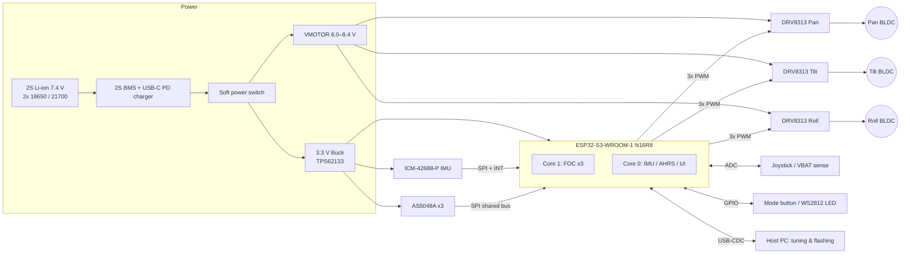
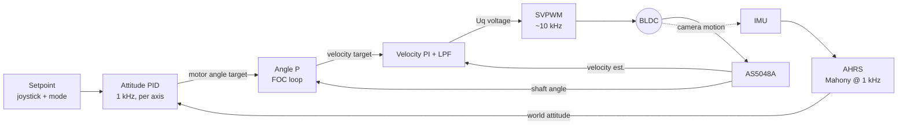

# README.md

> **Note:** I don't have access to this repository's prior cycles, schematics, or source tree. This README uses a coherent reference design: ESP32-S3, three gimbal BLDCs, DRV8313 drivers, AS5048A encoders, an ICM-42688-P IMU, and the SimpleFOC library. **Before you merge, replace any pin, part, or parameter that differs from your actual hardware.** Every assumption is collected in [Appendix A](#appendix-a--design-assumptions-to-verify).

---

```markdown
# osmo-pocket-esp32-gimbal

> Open-source, pocket-sized 3-axis handheld gimbal stabilizer built on the ESP32-S3,
> using field-oriented control (FOC) of gimbal BLDC motors with absolute magnetic encoders.


> ⚠️ **Disclaimer:** This is an independent hobbyist/research project. It is **not affiliated with,
> endorsed by, or derived from DJI**. "Osmo Pocket" refers only to the target form factor.

---

## Table of Contents

1. [Features](#features)
2. [System Architecture](#system-architecture)
3. [Hardware](#hardware)
4. [Wiring & Pinout](#wiring--pinout)
5. [Bill of Materials](#bill-of-materials)
6. [Firmware: Build & Flash](#firmware-build--flash)
7. [First Power-Up Checklist](#first-power-up-checklist)
8. [FOC Tuning Procedure](#foc-tuning-procedure)
9. [Stabilization Loop Tuning](#stabilization-loop-tuning)
10. [Serial Command Reference](#serial-command-reference)
11. [Operating Modes](#operating-modes)
12. [Troubleshooting](#troubleshooting)
13. [Safety](#safety)
14. [Repository Layout](#repository-layout)
15. [Contributing](#contributing)
16. [License](#license)
17. [Appendix A — Design Assumptions to Verify](#appendix-a--design-assumptions-to-verify)

---

## Features

- **3-axis stabilization** (pan / tilt / roll) with an inner FOC loop at ~10 kHz and an outer attitude loop at 1 kHz.
- **Absolute 14-bit magnetic encoders** (AS5048A, SPI). The gimbal knows its position at boot with no homing sweep.
- **6-DoF IMU** (ICM-42688-P), using a Mahony complementary filter with gyro bias auto-calibration.
- **Dual-core task split:** Core 1 runs FOC and Core 0 runs the IMU, attitude, UI and telemetry.
- **Modes:** Follow, Pan-Follow, Lock, FPV, and Recenter (triple-click).
- **Live tuning** over USB-CDC serial (SimpleFOC Commander), with parameters stored in NVS flash.
- **Protections:** driver fault latch, battery under-voltage cutoff, stall detection, and a motor over-temperature estimate.
- **Optional:** BLE remote control and a camera shutter trigger output.

---

## System Architecture

### Hardware Block Diagram



### ASCII Fallback (for viewers without Mermaid)

```
 2S Li-ion ──► BMS/Charger ──► Soft Switch ──┬──► VMOTOR (6.0–8.4 V) ──► DRV8313 x3 ──► BLDC x3
                                              │                                ▲ PWM (9 ch)
                                              └──► 3V3 Buck ──► ESP32-S3 ──────┘
                                                                  │  ▲
                                         SPI (shared) ────────────┘  │
                                   ┌──────────┬──────────┬───────────┤
                               ICM-42688  AS5048A    AS5048A     AS5048A
                                 (IMU)     (Pan)      (Tilt)      (Roll)
```

### Control Architecture (Cascaded)



The **inner loops** (angle, velocity, and SVPWM) run per motor on Core 1 and use encoder feedback. The **outer loop** runs on Core 0. It turns the world-frame attitude error into joint-angle targets through the gimbal's inverse kinematics (yaw-roll-pitch joint order).

### Firmware Task Map

| Task              | Core | Rate     | Priority | Notes                              |
|-------------------|------|----------|----------|------------------------------------|
| `foc_task`        | 1    | ~10 kHz  | max      | `loopFOC()` + `move()` for 3 motors |
| `imu_task`        | 0    | 1 kHz    | high     | Triggered by IMU INT1 (data-ready)  |
| `attitude_task`   | 0    | 1 kHz    | high     | AHRS → PID → joint targets          |
| `ui_task`         | 0    | 100 Hz   | low      | Buttons, joystick, LED, VBAT        |
| `telemetry_task`  | 0    | 50 Hz    | lowest   | Commander + optional BLE            |

Inter-task data uses lock-free double buffers. Targets cross cores as `std::atomic<float>`.

---

## Hardware

| Subsystem   | Reference Part                   | Notes |
|-------------|----------------------------------|-------|
| MCU         | ESP32-S3-WROOM-1-N16R8           | 16 MB flash, 8 MB octal PSRAM. GPIO 26–37 are reserved. |
| Motor driver| TI DRV8313 (x3)                  | 2.5 A peak, 65 V, has 3 independent half-bridges |
| Motors      | GBM2804H-100T (x3)               | 7 pole pairs, ~10 Ω phase, hollow shaft |
| Encoders    | ams AS5048A (x3)                 | 14-bit, SPI, diametric magnet 6×2.5 mm |
| IMU         | TDK ICM-42688-P                  | Mounted on the **camera plate**, not the handle |
| Power       | 2S Li-ion + IP2326 / BQ25887     | USB-C 5 V in, 2S balance charging |
| 3V3 rail    | TPS62133 buck                    | Low noise, ≥1 A |

### Mechanical Notes

- Seat the encoder magnet **0.5–2.0 mm** from the AS5048A die. Check the AGC value with the `E` command; the target is 60–200.
- Balance the payload **before** tuning. A balanced axis should stay put at any angle with the motors disabled.
- Route the encoder SPI wiring through the slip ring or flex PCB **away from** motor phase wires. Twist each phase triplet.

---

## Wiring & Pinout

### ESP32-S3 GPIO Assignment

| GPIO | Function          | Direction | Connected To              | Notes |
|------|-------------------|-----------|---------------------------|-------|
| 0    | BTN_MODE          | In        | Mode button → GND         | Strapping pin. Hold at boot = download mode |
| 1    | VBAT_SENSE        | ADC1_CH0  | Divider 100k/33k          | Ratio 0.248; 8.4 V → 2.08 V |
| 2    | JOY_X             | ADC1_CH1  | Thumbstick X              | |
| 9    | JOY_Y             | ADC1_CH8  | Thumbstick Y              | |
| 4    | PAN_PWM_A         | Out       | DRV8313 (Pan) IN1         | MCPWM0 |
| 5    | PAN_PWM_B         | Out       | DRV8313 (Pan) IN2         | MCPWM0 |
| 6    | PAN_PWM_C         | Out       | DRV8313 (Pan) IN3         | MCPWM0 |
| 15   | TILT_PWM_A        | Out       | DRV8313 (Tilt) IN1        | MCPWM0/1 |
| 16   | TILT_PWM_B        | Out       | DRV8313 (Tilt) IN2        | |
| 17   | TILT_PWM_C        | Out       | DRV8313 (Tilt) IN3        | |
| 38   | ROLL_PWM_A        | Out       | DRV8313 (Roll) IN1        | MCPWM1 |
| 39   | ROLL_PWM_B        | Out       | DRV8313 (Roll) IN2        | |
| 40   | ROLL_PWM_C        | Out       | DRV8313 (Roll) IN3        | |
| 41   | DRV_EN            | Out       | All DRV8313 EN1/2/3 + nSLEEP | 100k pull-down, so motors