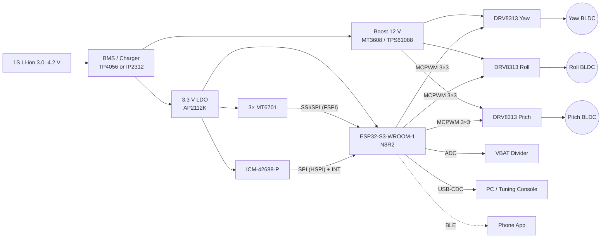

I can't see the `osmo-pocket-esp32-gimbal` repository or earlier "cycles," so I wrote this README from a coherent reference design: an ESP32-S3 with three DRV8313 drivers, MT6701 magnetic encoders, an ICM-42688-P IMU, and SimpleFOC. Any line marked `<!-- VERIFY -->` should be checked against your actual schematic and firmware. If you share your existing README, pin map or `platformio.ini`, I'll reconcile it.

---

````markdown
# osmo-pocket-esp32-gimbal

> Open-source, pocket-sized 3-axis brushless camera gimbal built on the ESP32-S3 with field-oriented control (FOC). Its form factor is inspired by the DJI Osmo Pocket.

[](#building-the-firmware)
[](#hardware-overview)
[](#license)

---

## Table of Contents

1. [Features](#features)
2. [Safety Notice](#safety-notice)
3. [System Architecture](#system-architecture)
4. [Hardware Overview](#hardware-overview)
5. [Wiring & Pinouts](#wiring--pinouts)
6. [Bill of Materials](#bill-of-materials)
7. [Building the Firmware](#building-the-firmware)
8. [First Power-Up & Calibration](#first-power-up--calibration)
9. [FOC Tuning Procedure](#foc-tuning-procedure)
10. [Stabilization Loop Tuning](#stabilization-loop-tuning)
11. [Serial Command Reference](#serial-command-reference)
12. [Troubleshooting](#troubleshooting)
13. [Contributing](#contributing)
14. [License](#license)

---

## Features

- **3-axis stabilization** (yaw / roll / pitch) using gimbal BLDC motors.
- **Closed-loop FOC** on every axis with absolute 14-bit magnetic encoders (MT6701).
- **6-DoF IMU fusion** (ICM-42688-P), using a Mahony/Madgwick filter at 1 kHz.
- **Cascaded control**: attitude PID, then velocity PID, then FOC voltage/current.
- **Operating modes**: Follow, Pan-Follow, Lock, FPV, Recenter (via button gestures).
- **USB-CDC tuning console** with live parameter changes and persistence to NVS.
- **BLE telemetry and control** (optional, `-DENABLE_BLE`).
- **1S Li-ion powered** through a boost converter to the motor bus, with battery monitoring.

---

## Safety Notice

> ⚠️ Gimbal motors can heat to **>80 °C** within minutes if they are mis-tuned or stalled. Always:
> - Start tuning with `voltage_limit` ≤ 2 V.
> - Keep a hand on the power switch during first runs.
> - Never run the motors with the camera module mechanically blocked.
> - Use a protected 18650/21700 cell, or a cell paired with a BMS.

---

## System Architecture

### Block Diagram



### Control Loop Hierarchy

```
            ┌─────────────────────────── Core 1 (high-priority) ───────────────────────────┐
 IMU 1 kHz  │  Attitude Estimator ─► Attitude PID (per axis) ─► Velocity Setpoint          │
            │                                   │                                          │
            │                                   ▼                                          │
 Encoder    │  Velocity PID (per motor) ─► Uq voltage ─► SVPWM (FOC) ─► MCPWM @ 25 kHz    │
 ~10 kHz    │        ▲                                                                     │
            │        └──── Encoder angle / velocity (LPF)                                  │
            └──────────────────────────────────────────────────────────────────────────────┘
            ┌─────────────────────────── Core 0 (low-priority) ────────────────────────────┐
            │  USB console · BLE · Button FSM · Battery monitor · NVS persistence          │
            └──────────────────────────────────────────────────────────────────────────────┘
```

| Loop              | Rate        | Runs on | Source file                   |
|-------------------|-------------|---------|-------------------------------|
| FOC (`loopFOC`)   | ~8–12 kHz   | Core 1  | `src/motor/foc_task.cpp`      |
| Velocity PID      | 2 kHz       | Core 1  | `src/motor/foc_task.cpp`      |
| IMU + fusion      | 1 kHz       | Core 1  | `src/imu/ahrs_task.cpp`       |
| Attitude PID      | 1 kHz       | Core 1  | `src/control/stabilizer.cpp`  |
| UI / comms        | 50–100 Hz   | Core 0  | `src/app/ui_task.cpp`         |

<!-- VERIFY: file paths -->

---

## Hardware Overview

| Subsystem      | Part                         | Notes                                                    |
|----------------|------------------------------|----------------------------------------------------------|
| MCU            | ESP32-S3-WROOM-1-N8R2        | Dual core at 240 MHz, MCPWM ×2, native USB               |
| Motor drivers  | TI DRV8313 (×3)              | 3-half-bridge, 2.5 A peak, 8–60 V                        |
| Motors         | 2204 260KV gimbal BLDC (×3)  | 12N14P, so **7 pole pairs**, ~10 Ω phase resistance       |
| Encoders       | MT6701 (×3)                  | 14-bit SSI, diametric magnet 6×2.5 mm                    |
| IMU            | ICM-42688-P                  | Mounted on the **camera plate**, not the base            |
| Power          | 1S 18650 → 12 V boost        | Boost must supply ≥1.5 A continuous                       |

> **Note:** The DRV8313 has no integrated current-sense amplifiers. The firmware therefore uses **voltage-mode FOC with estimated current** (`TorqueControlType::voltage` plus `phase_resistance`). Hardware current sensing is planned for Rev C.

---

## Wiring & Pinouts

### ESP32-S3 Pin Map

Pins avoid strapping pins (GPIO0, 3, 45, 46), USB (GPIO19/20), and flash/PSRAM pins (GPIO26–37).

| Function            | GPIO | Peripheral      | Direction | Notes                         |
|---------------------|------|-----------------|-----------|-------------------------------|
| **Yaw** PWM A       | 8    | MCPWM0 op0      | OUT       | DRV8313 IN1                   |
| **Yaw** PWM B       | 9    | MCPWM0 op1      | OUT       | DRV8313 IN2                   |
| **Yaw** PWM C       | 10   | MCPWM0 op2      | OUT       | DRV8313 IN3                   |
| **Yaw** EN          | 11   | GPIO            | OUT       | EN1/2/3 tied together         |
| **Roll** PWM A      | 15   | MCPWM1 op0      | OUT       |                               |
| **Roll** PWM B      | 16   | MCPWM1 op1      | OUT       |                               |
| **Roll** PWM C      | 17   | MCPWM1 op2      | OUT       |                               |
| **Roll** EN         | 18   | GPIO            | OUT       |                               |
| **Pitch** PWM A     | 4    | MCPWM0 op0 (B)  | OUT       | Shares timer with yaw         |
| **Pitch** PWM B     | 5    | MCPWM0 op1 (B)  | OUT       |                               |
| **Pitch** PWM C     | 6    | MCPWM0 op2 (B)  | OUT       |                               |
| **Pitch** EN        | 7    | GPIO            | OUT       |                               |
| DRV nFAULT (wired-OR)| 2   | GPIO + pull-up  | IN        | Open-drain from all 3 drivers |
| Encoder SCK         | 12   | FSPI CLK        | OUT       | SSI mode, 4 MHz               |
| Encoder DO (MISO)   | 13   | FSPI MISO       | IN        |                               |
| Encoder CS Yaw      | 14   | GPIO            | OUT       |                               |
| Encoder CS Roll     | 21   | GPIO            | OUT       |                               |
| Encoder CS Pitch    | 47   | GPIO            | OUT       |                               |
| IMU SCK             | 39   | HSPI CLK        | OUT       | 10 MHz                        |
| IMU MOSI            | 40   | HSPI MOSI       | OUT       |                               |
| IMU MISO            | 41   | HSPI MISO       | IN        |                               |
| IMU CS              | 42   | GPIO            | OUT       |                               |
| IMU INT1            | 38   | GPIO (ISR)      | IN        | Data-ready, 1 kHz             |
| VBAT sense          | 1    | ADC1_CH0        | IN        | 100k/47k divider              |
| Mode button         | 43   | GPIO + pull-up  | IN        | Active low                    |
| Status LED (WS2812) | 48   | RMT             | OUT       |                               |
| USB D− / D+         | 19/20| USB-OTG         | —         | Console and flashing          |

<!-- VERIFY: all GPIO assignments against schematic Rev B -->

> **MCPWM note:** Each ESP32-S3 MCPWM unit has 3 operators × 2 generators. Yaw and pitch share MCPWM0 (generators A/B), and roll uses MCPWM1. In practice SimpleFOC's ESP32 driver allocates these automatically. If you get an `MCPWM allocation failed` error, check `src/config/pins.h`.

### DRV8313 Wiring (per axis)

```
            ESP32-S3                DRV8313                 BLDC
         ┌───────────┐        ┌─────────────────┐
  PWM_A ─┤           ├────────┤ IN1        OUT1 ├───────── Phase U
  PWM_B ─┤           ├────────┤ IN2        OUT2 ├───────── Phase V
  PWM_C ─┤           ├────────┤ IN3        OUT3 ├───────── Phase W
  EN    ─┤           ├────────┤ EN1/EN2/EN3     │
 nFAULT ─┤ (pull-up) ├────────┤ nFAULT          │
         └───────────┘   3V3 ─┤ nRESET, nSLEEP  │
                        12V ──┤ VM  (100 µF + 0.1 µF close to pin)
                        GND ──┤ GND, PGND (star ground)
                              └─────────────────┘
```

### MT6701 Encoder Wiring (per axis)

| MT6701 Pin  | Connect to             | Notes                                       |
|-------------|------------------------|---------------------------------------------|
| VDD         | 3V3                    | 100 nF decoupling                           |
| GND         | GND                    |                                             |
| CSN         | Axis CS GPIO           | 10 kΩ pull-up                               |
| CLK         | GPIO12                 | Shared                                      |
| DO          | GPIO13                 | Shared                                      |
| MODE        | GND                    | Selects SSI interface                       |

The magnet-to-chip air gap should be **0.5–1.5 mm**. Center the magnet within ±0.3 mm.

### IMU Mounting

Mount the ICM-42688-P on the **camera plate** (after the pitch motor), with axes aligned as follows:

| IMU axis | Gimbal axis |
|----------|-------------|
| +X       | Roll (lens forward) |
| +Y       | Pitch (left)        |
| +Z       | Yaw (up)            |

If your board orientation differs, set `imu.axis_remap` (see [Serial Commands](#serial-command-reference)).

---

## Bill of Materials

### Electronics

| # | Ref         | Part                         | Package     | Qty | Approx. Unit (USD) | Source (example)       |
|---|-------------|------------------------------|-------------|-----|--------------------|------------------------|
| 1 | U1          | ESP32-S3-WROOM-1-N8R2        | Module      | 1   | 3.50               | LCSC C2913202          |
| 2 | U2–U4       | DRV8313PWPR                  | HTSSOP-28   | 3   | 2.80               | Mouser / LCSC          |
| 3 | U5–U7       | MT6701CT-STD                 | SOP-8       | 3   | 0.90               | LCSC                   |
| 4 | U8          | ICM-42688-P                  | LGA-14      | 1   |