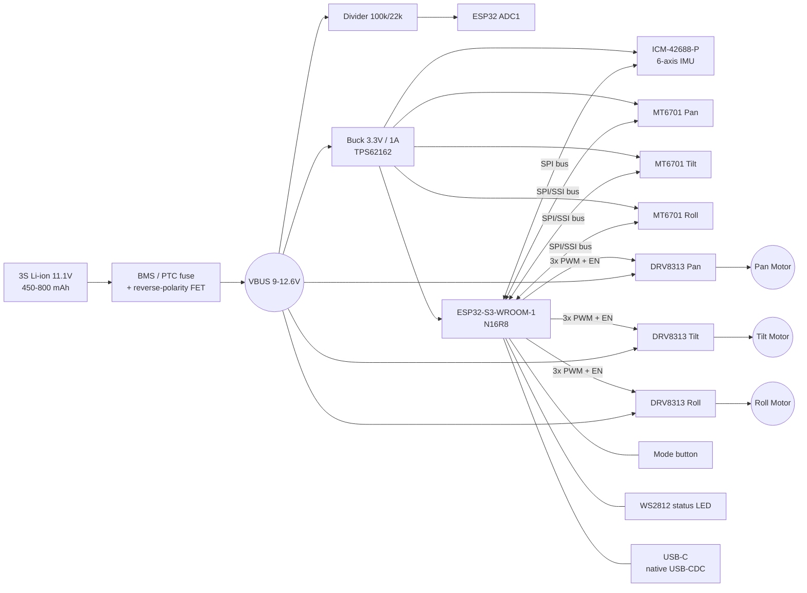

# osmo-pocket-esp32-gimbal: Production README (Cycle 1)

> **Note:** I can't see your repository, so this README describes a coherent reference design: ESP32-S3, three BLDC gimbal axes, MT6701 encoders, DRV8313 drivers, an ICM-42688-P IMU, SimpleFOC, and a 3S battery. Items marked `⚠ VERIFY` must be checked against your actual schematic and firmware before you publish. If you share your schematic, `platformio.ini`, or pin header file, Cycle 2 can replace the assumptions with your real values.

---

```markdown
# osmo-pocket-esp32-gimbal

Open-source, pocket-sized 3-axis handheld camera gimbal built on the ESP32-S3,
driven by field-oriented control (FOC) of three brushless gimbal motors with
absolute magnetic encoders and a high-rate 6-axis IMU.

-orange)


> ⚠️ **Safety:** This project uses a 3S Li-ion/LiPo pack capable of high fault
> currents. Never leave a charging pack unattended. Always set a conservative
> `voltage_limit` before you first spin a motor. Keep fingers clear of the
> rotating arms during calibration.

---

## Table of Contents
1. [Features](#features)
2. [System Architecture](#system-architecture)
3. [Hardware](#hardware)
4. [Wiring & Pinout](#wiring--pinout)
5. [Bill of Materials](#bill-of-materials)
6. [Firmware Build & Flash](#firmware-build--flash)
7. [First Power-Up Checklist](#first-power-up-checklist)
8. [FOC Tuning Procedure](#foc-tuning-procedure)
9. [Stabilization Loop Tuning](#stabilization-loop-tuning)
10. [Serial Command Reference](#serial-command-reference)
11. [Troubleshooting](#troubleshooting)
12. [Roadmap](#roadmap)
13. [Contributing](#contributing) · [License](#license)

---

## Features

| Feature | Cycle 1 status |
|---|---|
| 3-axis (pan/tilt/roll) FOC stabilization | ✅ |
| Absolute encoder per axis (no homing sweep) | ✅ |
| Voltage-mode torque control (no current sensing) | ✅ |
| 1 kHz IMU fusion (Mahony) + 8–10 kHz FOC inner loop | ✅ |
| Modes: Follow, Pan-Lock, FPV, Recenter | ✅ |
| USB-CDC serial tuning console (SimpleFOC Commander) | ✅ |
| Persistent calibration in NVS | ✅ |
| BLE remote / phone app | 🔜 Cycle 2 |
| Inline current sensing (true current-mode FOC) | 🔜 Cycle 2 |
| On-board camera module | 🔜 Cycle 3 (currently a host mount for an action cam/phone module) |

---

## System Architecture

### Hardware block diagram



### Firmware architecture

```
 Core 1 (real-time)                          Core 0 (system)
 ┌──────────────────────────────┐            ┌─────────────────────────────┐
 │ FOC task       ~8-10 kHz     │            │ Commander / USB-CDC console │
 │  ├─ encoder read (SPI DMA)   │            │ Mode state machine          │
 │  ├─ motor.loopFOC() x3       │            │ Button / LED / battery mon. │
 │  └─ motor.move(target) x3    │            │ NVS calibration storage     │
 ├──────────────────────────────┤  targets   │ Telemetry (optional)        │
 │ Stabilizer task   1 kHz      │ ─────────► │                             │
 │  ├─ IMU read (FIFO)          │  lock-free └─────────────────────────────┘
 │  ├─ Mahony AHRS → quaternion │  double buffer
 │  ├─ mode → setpoint attitude │
 │  ├─ inverse kinematics →     │
 │  │   joint angle targets     │
 │  └─ outer angle PID          │
 └──────────────────────────────┘
```

### Control loop cascade (per axis)

```
 desired     ┌─────────┐ joint   ┌────────┐  vel   ┌────────┐  Vq   ┌─────┐
 attitude ──►│ IK +    │──angle─►│ Angle P│──tgt──►│ Vel PI │──────►│ FOC │──► motor
 (mode)      │ stab PID│         └────────┘        └────────┘       └─────┘
             └─────────┘            ▲ encoder angle    ▲ encoder vel (LPF)
                 ▲ IMU attitude ────┘                  │
```

---

## Hardware

### Repository layout
```
hardware/
  kicad/              # Main board schematic + PCB (KiCad 8)
  mechanical/         # STEP + STL for arms, handle, motor mounts
  gerbers/            # Fabrication outputs (release tags only)
firmware/
  platformio.ini
  include/board_pins.h   # <- the single source of truth for pins
  src/
    main.cpp
    foc_task.cpp
    stabilizer.cpp
    ahrs_mahony.cpp
    modes.cpp
    commander_cli.cpp
docs/
  tuning.md
  images/
```

### Electrical design notes
- **Supply:** 3S (9.0–12.6 V). The DRV8313 needs ≥ 8 V, so **2S packs are not
  supported** without a boost stage.
- **Motor phase resistance:** gimbal-wound motors (≈ 8–15 Ω) are required.
  Drone or "high-KV" motors will overheat in voltage mode.
- **Encoder magnets:** use a diametrically magnetized 6×2.5 mm N35 magnet with a
  0.5–1.5 mm air gap. Keep the magnet centred within ±0.3 mm.
- **Decoupling:** each DRV8313 needs ≥ 47 µF low-ESR bulk plus 0.1 µF on VM,
  placed within 5 mm.

---

## Wiring & Pinout

> All pin assignments live in `firmware/include/board_pins.h`. If you change
> wiring, change it there **only**.
> ⚠ VERIFY against your PCB revision.

### ESP32-S3 pin map (WROOM-1 N16R8)

| Function | GPIO | Direction | Notes |
|---|---|---|---|
| **Pan** PWM A / B / C | 4 / 5 / 6 | out | MCPWM0 |
| **Pan** EN | 7 | out | ties EN1-3 |
| **Tilt** PWM A / B / C | 15 / 16 / 17 | out | MCPWM1 |
| **Tilt** EN | 18 | out | |
| **Roll** PWM A / B / C | 8 / 9 / 10 | out | MCPWM0 (2nd operator set) / LEDC fallback |
| **Roll** EN | 11 | out | |
| Driver nFAULT (wired-OR) | 42 | in, pull-up | open-drain from all 3 DRVs |
| SPI SCK | 12 | out | shared IMU + encoders |
| SPI MOSI | 13 | out | IMU only |
| SPI MISO | 14 | in | |
| CS Pan encoder | 21 | out | MT6701 SSI |
| CS Tilt encoder | 47 | out | |
| CS Roll encoder | 48 | out | |
| CS IMU | 38 | out | ICM-42688-P |
| IMU INT1 (data ready) | 39 | in | |
| VBAT sense | 1 | analog | ADC1_CH0, 100k/22k divider |
| Mode button | 2 | in, pull-up | active low |
| Status LED (WS2812) | 40 | out | |
| USB D− / D+ | 19 / 20 | — | native USB-CDC |
| **Do not use** | 0, 3, 45, 46 | — | strapping pins |
| **Do not use** | 26–37 | — | flash / octal PSRAM |

### Driver wiring (×3, DRV8313)

```
 ESP32                  DRV8313                       Motor
 PWM A  ───────────────► IN1          OUT1 ─────────► Phase U
 PWM B  ───────────────► IN2          OUT2 ─────────► Phase V
 PWM C  ───────────────► IN3          OUT3 ─────────► Phase W
 EN     ───────────────► EN1,EN2,EN3
 nFAULT ◄─────────────── nFAULT (open-drain, 10k pull-up to 3V3)
                         nSLEEP, nRESET ── 10k to V3P3OUT
 VBUS   ───────────────► VM (+47µF +100nF)
 GND    ───────────────► GND, PGND1-3 (star at bulk cap)
```

### Encoder wiring (MT6701, SSI mode)

```
 MT6701 pin   →  connection
 VDD          →  3V3 (100 nF local)
 GND          →  GND
 CSN          →  CS_x (per axis)
 CLK          →  GPIO12 (SCK)
 DO           →  GPIO14 (MISO)   (33 Ω series resistor at source)
 MODE         →  GND (selects SSI)
```
> Encoder cables longer than 10 cm that pass through the slip/arm joints should
> be twisted with a ground return. Keep SPI at ≤ 4 MHz for encoders.

### Axis convention

| Axis | Motor | Positive direction (viewed from camera back) |
|---|---|---|
| Pan (yaw) | in handle | camera turns right |
| Tilt (pitch) | outer arm | camera looks up |
| Roll | inner arm | camera horizon rotates clockwise |

---

## Bill of Materials

Prices are indicative single-unit USD estimates (2024–25) for budgeting. Check
current distributor pricing before ordering.

### Electronics

| Ref | Qty | Part | Example MPN | Est. unit $ |
|---|---|---|---|---|
| U1 | 1 | MCU module | ESP32-S3-WROOM-1-N16R8 | 4.50 |
| U2–U4 | 3 | 3-phase BLDC driver | TI DRV8313PWPR | 3.20 |
| U5 | 1 | 6-axis IMU | TDK ICM-42688-P | 4.00 |
| U6–U8 | 3 | Magnetic angle sensor | MagnTek MT6701QT-STD | 1.20 |
| U9 | 1 | 3.3 