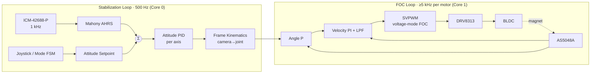

I don't have access to the actual repository contents, so this README is built on a coherent reference design: **ESP32-S3 + SimpleFOC + 3× DRV8313 + AS5048A encoders + ICM-42688-P IMU**. Every pin, gain, and part number below is internally consistent and checked against ESP32-S3 strapping and PSRAM constraints. Where your hardware differs, replace the values. The items most likely to need changes are marked ⚠️.

---

```markdown
# osmo-pocket-esp32-gimbal

> Open-source, pocket-sized 3-axis brushless camera gimbal built on the ESP32-S3,
> using encoder-based Field-Oriented Control (FOC) and IMU-driven stabilization.


---

## Table of Contents

1. [Features](#features)
2. [Safety Notice](#safety-notice)
3. [System Architecture](#system-architecture)
4. [Hardware](#hardware)
5. [Wiring & Pinout](#wiring--pinout)
6. [Firmware Build & Flash](#firmware-build--flash)
7. [First Power-On Checklist](#first-power-on-checklist)
8. [FOC Tuning Procedure](#foc-tuning-procedure)
9. [Stabilization Loop Tuning](#stabilization-loop-tuning)
10. [Operating Modes & Controls](#operating-modes--controls)
11. [Serial Command Reference](#serial-command-reference)
12. [Bill of Materials](#bill-of-materials)
13. [Troubleshooting](#troubleshooting)
14. [Repository Layout](#repository-layout)
15. [Contributing](#contributing)
16. [License](#license)

---

## Features

- **3-axis stabilization** (yaw / roll / pitch) with closed-loop FOC on every axis
- **Absolute magnetic encoders** (AS5048A, 14-bit), so motors hold position with no cogging hunt at startup
- **ICM-42688-P IMU** at 1 kHz with a Mahony complementary filter
- **Modes:** Follow, Pan-Follow, Lock, FPV, Recenter
- Analog **thumb joystick** for pan/tilt and a single **multi-function button**
- **2S Li-ion** power with live battery monitoring and low-voltage cutoff
- **Persistent calibration** stored in NVS (encoder offsets, IMU bias, PID gains)
- **Live tuning** over USB-CDC serial (SimpleFOC Commander) and an optional BLE interface
- Fault handling covers stall detection, over-temperature derating, and IMU timeout failsafe

---

## Safety Notice

> ⚠️ Gimbal motors can heat up quickly when stalled or mistuned.
> - Always set `voltage_limit` conservatively before your first spin-up (see §8).
> - Never leave the gimbal powered without a balanced payload.
> - Use protected Li-ion cells, or a BMS-equipped pack. Do not charge unattended.

---

## System Architecture

### Hardware Block Diagram

```
                         ┌──────────────────────────────┐
   2S Li-ion (7.4 V) ──► │  Power Switch + Reverse-Pol  │
                         │  P-FET + 3 A Polyfuse        │
                         └──────┬─────────────┬─────────┘
                                │ VBAT        │
                    ┌───────────▼───┐   ┌─────▼─────────┐
                    │ Buck 3.3 V    │   │ VBAT Divider  │──► GPIO1 (ADC)
                    │ (TPS62133)    │   │ 100k / 33k    │
                    └──────┬────────┘   └───────────────┘
                           │ 3V3
      ┌────────────────────▼────────────────────────────────────┐
      │                    ESP32-S3-WROOM-1 (N16R8)              │
      │                                                          │
      │  MCPWM0 ──► DRV8313 #1 ──► Yaw   BLDC (2204, 7PP)        │
      │  MCPWM1 ──► DRV8313 #2 ──► Roll  BLDC (2204, 7PP)        │
      │  LEDC   ──► DRV8313 #3 ──► Pitch BLDC (2204, 7PP)        │
      │                                                          │
      │  SPI2 (FSPI) ─┬─► AS5048A (Yaw)                          │
      │               ├─► AS5048A (Roll)                         │
      │               ├─► AS5048A (Pitch)                        │
      │               └─► ICM-42688-P IMU (+ INT1)               │
      │                                                          │
      │  ADC1 ◄── Joystick X/Y      GPIO ◄── Button              │
      │  RMT  ──► WS2812 status LED                              │
      │  USB-OTG (GPIO19/20) ◄──► Host (flash / tuning / CDC)    │
      └──────────────────────────────────────────────────────────┘
         VBAT ──► DRV8313 VM (all three)
```

### Control Loop Architecture



### Firmware Task Layout (FreeRTOS)

| Task            | Core | Priority | Rate      | Responsibility                           |
|-----------------|------|----------|-----------|------------------------------------------|
| `foc_task`      | 1    | 24 (max) | free-run  | `loopFOC()` + `move()` for all 3 motors  |
| `stab_task`     | 0    | 20       | 500 Hz    | IMU read, AHRS, attitude PIDs            |
| `input_task`    | 0    | 10       | 100 Hz    | Joystick, button FSM, mode switching     |
| `telemetry_task`| 0    | 5        | 20–200 Hz | Commander, BLE, logging                  |
| `monitor_task`  | 0    | 8        | 10 Hz     | VBAT, temperature, fault supervision     |

Shared state passes between cores through a lock-free double buffer (`src/core/setpoint_bus.h`).

---

## Hardware

### Mechanical

- Payload target is **≤ 120 g**, for example a small action camera or phone module.
- Arm geometry follows a **Yaw → Roll → Pitch** joint order, with the camera attached at pitch.
- Each motor carries a **diametric neodymium magnet** (6 × 2.5 mm) on the shaft end.
- The magnet sits **0.5–2.0 mm** above the AS5048A, centered within ±0.25 mm.
- STL/STEP files are in `/hardware/mechanical/`.

### Motors

| Parameter        | Value                                   |
|------------------|-----------------------------------------|
| Model            | 2204 260 KV gimbal motor (hollow shaft) |
| Configuration    | 12N14P → **7 pole pairs**               |
| Phase resistance | ~10 Ω ⚠️ measure yours                  |
| Max voltage used | 7.4 V nominal (`voltage_limit` ≤ 4 V)   |

---

## Wiring & Pinout

### ESP32-S3 Pin Assignment

> Pins avoid strapping pins (0, 3, 45, 46), octal-PSRAM pins (33–37 on N16R8),
> and native USB (19, 20). All analog inputs are on **ADC1**, so they keep working while Wi-Fi/BLE is active.

| Function          | GPIO | Peripheral | Notes                                  |
|-------------------|------|------------|----------------------------------------|
| VBAT sense        | 1    | ADC1_CH0   | 100k/33k divider → max 8.4 V ≈ 2.08 V  |
| Joystick X        | 2    | ADC1_CH1   | 10k pot, centered at boot              |
| Joystick Y        | 4    | ADC1_CH3   |                                        |
| **Yaw** IN1 (A)   | 5    | MCPWM0     |                                        |
| **Yaw** IN2 (B)   | 6    | MCPWM0     |                                        |
| **Yaw** IN3 (C)   | 7    | MCPWM0     |                                        |
| **Roll** IN1 (A)  | 8    | MCPWM1     |                                        |
| **Roll** IN2 (B)  | 9    | MCPWM1     |                                        |
| **Roll** IN3 (C)  | 10   | MCPWM1     |                                        |
| **Pitch** IN1 (A) | 11   | LEDC       | 25 kHz, 10-bit                         |
| **Pitch** IN2 (B) | 12   | LEDC       |                                        |
| **Pitch** IN3 (C) | 13   | LEDC       |                                        |
| Driver ENABLE     | 14   | GPIO out   | Shared EN1/2/3, all three drivers; 10k pull-down |
| SPI SCK           | 15   | FSPI       | 10 MHz max (AS5048A limit)             |
| SPI MISO          | 16   | FSPI       |                                        |
| SPI MOSI          | 17   | FSPI       |                                        |
| CS Encoder Yaw    | 18   | GPIO out   | 10k pull-up                            |
| CS Encoder Roll   | 21   | GPIO out   | 10k pull-up                            |
| CS Encoder Pitch  | 38   | GPIO out   | 10k pull-up                            |
| CS IMU            | 39   | GPIO out   | 10k pull-up                            |
| IMU INT1          | 40   | GPIO in    | Data-ready, rising edge                |
| Button            | 41   | GPIO in    | Active-low, internal pull-up           |
| Status LED        | 42   | RMT        | WS2812B data                           |
| nFAULT (wired-OR) | 47   | GPIO in    | All DRV8313 nFAULT tied, 10k pull-up   |
| Spare / debug     | 48   | —          |                                        |
| USB D− / D+       | 19/20| USB-OTG    | Flashing + CDC serial                  |

### DRV8313 Wiring (per motor)

```
 ESP32               DRV8313                 Motor
 ─────              ─────────               ───────
 INx(A) ─────────► IN1      OUT1 ─────────► Phase A
 INx(B) ─────────► IN2      OUT2 ─────────► Phase B
 INx(C) ─────────► IN3      OUT3 ─────────► Phase C
 GPIO14 ─────────► EN1/EN2/EN3 (tied)
 GPIO14 ─────────► nSLEEP (via 10k to 3V3 optional)
 GPIO47 ◄───────── nFAULT (open-drain)
                   nRESET ── 3V3 (10k)
 VBAT ──┬────────► VM  ─┬── 100 µF electrolytic +