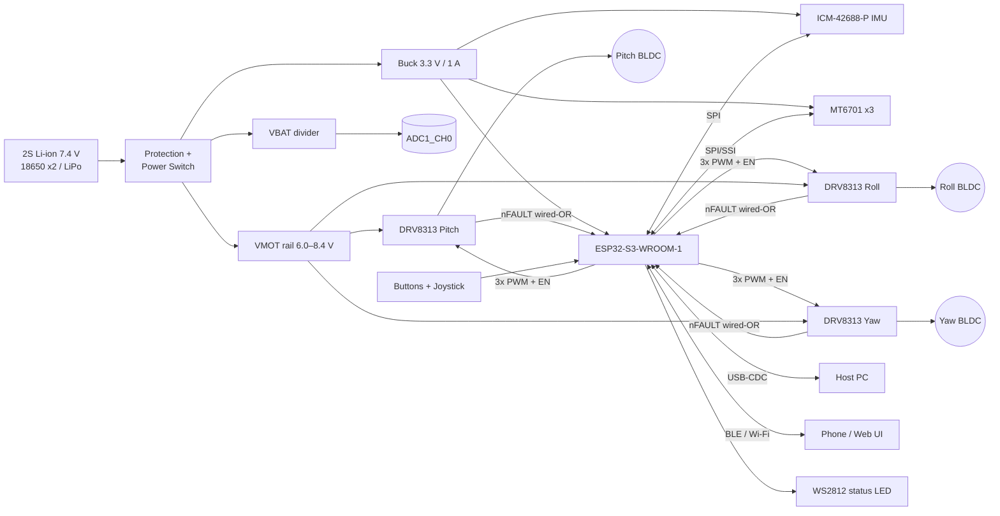

I don't have access to this repository's source, schematics, or the earlier "cycles" of this work. The README below is a **complete reference design** built on common, well-documented choices: ESP32-S3, SimpleFOC, DRV8313, MT6701, and ICM-42688-P.

Before publishing, replace any pin, part, or gain value that differs from your actual hardware or firmware. Items you are most likely to need to check are marked `⚠ verify`.

---

````markdown
# osmo-pocket-esp32-gimbal

> An open-source, pocket-sized 3-axis handheld camera gimbal built on the ESP32-S3 with field-oriented control (FOC) of brushless gimbal motors. It is inspired by the DJI Osmo Pocket form factor.


%20%2F%20CERN--OHL--S%20(hw)-lightgrey)

---

## Table of Contents

1. [Features](#features)
2. [System Overview](#system-overview)
3. [Hardware](#hardware)
4. [Wiring & Pinout](#wiring--pinout)
5. [Bill of Materials](#bill-of-materials)
6. [Firmware Build & Flash](#firmware-build--flash)
7. [First Power-Up Checklist](#first-power-up-checklist)
8. [FOC Tuning Procedure](#foc-tuning-procedure)
9. [Stabilization Loop Tuning](#stabilization-loop-tuning)
10. [Operating Modes & Controls](#operating-modes--controls)
11. [Serial Command Reference](#serial-command-reference)
12. [Troubleshooting](#troubleshooting)
13. [Safety](#safety)
14. [Roadmap](#roadmap)
15. [Contributing](#contributing)
16. [License](#license)

---

## Features

- **3-axis stabilization** (pitch / roll / yaw) using closed-loop FOC on each axis
- **Absolute magnetic encoders** on every motor, so there is no startup calibration sweep after the first alignment
- **6-axis IMU fusion** (Mahony/Madgwick, 1 kHz) for camera attitude estimation
- **Modes:** Follow, Pan-Lock, Full-Lock (FPV), Recenter, Sleep
- **Wireless control** via BLE (phone app / gamepad) and a Wi-Fi web tuning UI
- **Runtime tuning** over USB-CDC serial (SimpleFOC Commander-compatible)
- **Persistent config** stored in NVS: gains, sensor offsets, and motor direction
- **Protection:** driver fault detection, under-voltage cutoff, stall/over-temperature derating

---

## System Overview

### Block Diagram



### ASCII Fallback

```
            +-----------------------------------------------+
 2S Batt -->| Protection --+--> VMOT (6.0-8.4V) --+--> DRV8313 x3 --> BLDC x3
            |              |                      |
            |              +--> Buck 3V3 ---------+--> ESP32-S3, IMU, MT6701 x3
            +-----------------------------------------------+

 ESP32-S3 core 1 (control, 1 kHz+)        ESP32-S3 core 0 (comms)
 +----------------------------------+     +------------------------+
 | IMU read -> AHRS fusion          |     | BLE / Wi-Fi / web UI   |
 | Mode logic -> axis setpoints     |<--->| Serial Commander       |
 | FOC loop x3 (encoder -> SVPWM)   |     | NVS config, telemetry  |
 +----------------------------------+     +------------------------+
```

### Control Architecture

```
 Setpoint (mode / joystick)
        |
        v
 +-------------+   angle err   +-------------+  vel err  +-------------+  Uq   +-----------+
 | Attitude    |-------------->| Angle P     |---------->| Velocity PI |------>| FOC/SVPWM |--> Motor
 | (IMU, 1kHz) |               | (per axis)  |           | (per axis)  |       | (voltage) |
 +-------------+               +-------------+           +-------------+       +-----------+
        ^                                                      ^                      |
        |                                                      +----- encoder ------- +
        +------------------------- camera attitude (IMU) ------------------------------+
```

- **Inner loops** (`loopFOC` + velocity) run at about 5–10 kHz per axis on core 1.
- **Outer loop** (IMU attitude → per-axis angle target) runs at 1 kHz.
- **Torque mode** is voltage-based (`TorqueControlType::voltage`) using measured phase resistance. The DRV8313 has no per-phase current sensing, so current-mode FOC is not used in this revision.

---

## Hardware

| Subsystem | Part | Notes |
|---|---|---|
| MCU | ESP32-S3-WROOM-1-N8R2 | Quad PSRAM keeps GPIO35–37 free. On N8R8 (octal) modules, do not use 35–37. |
| Motor drivers | TI DRV8313 (×3) | 2.5 A peak, 8–60 V. A 2S pack is near the low edge. See note below. |
| Encoders | MagnTek MT6701 (×3) | 14-bit absolute, SSI mode on a shared SPI bus |
| IMU | TDK ICM-42688-P | SPI, 32 kHz ODR capable, low noise |
| Motors | GBM2804H-100T (pitch/roll), GBM2804H-100T or 2204-260KV (yaw) | 7 pole pairs (14 poles) ⚠ verify |
| Power | 2S Li-ion, TPS62162 3.3 V buck | |

> **Driver voltage note:** The DRV8313's minimum VM is 8 V. A 2S pack (6.0–8.4 V) will hit UVLO late in discharge. Pick one of these options:
> - Set the firmware low-voltage cutoff to ≥ 7.0 V and accept reduced runtime.
> - Substitute **TMC6300** (2–11 V) or **DRV8316** (4.5–35 V).
> - Use a 3S pack and reduce `voltage_limit` accordingly.

---

## Wiring & Pinout

### ESP32-S3 GPIO Assignment

Strapping pins (0, 3, 45, 46), USB (19, 20), UART0 (43, 44), and flash/PSRAM pins (26–32, 33–37 on octal parts) are intentionally avoided.

| Function | Signal | GPIO | Peripheral | Notes |
|---|---|---|---|---|
| **Pitch motor** | PWM A / B / C | 4 / 5 / 6 | MCPWM0 | |
| | EN (all phases) | 7 | GPIO | |
| **Roll motor** | PWM A / B / C | 15 / 16 / 17 | MCPWM0/1 | |
| | EN | 18 | GPIO | |
| **Yaw motor** | PWM A / B / C | 8 / 9 / 10 | MCPWM1 | |
| | EN | 11 | GPIO | |
| **Driver fault** | nFAULT (wired-OR) | 42 | GPIO IRQ | 10 kΩ pull-up to 3V3, open-drain from all 3 DRVs |
| **SPI bus** | SCK | 12 | SPI2 (FSPI) | Shared by IMU + encoders |
| | MISO | 13 | | |
| | MOSI | 14 | | IMU only (MT6701 SSI is read-only) |
| **Chip selects** | CS_IMU | 21 | | |
| | CS_ENC_PITCH | 38 | | |
| | CS_ENC_ROLL | 39 | | |
| | CS_ENC_YAW | 40 | | |
| **IMU** | INT1 (data-ready) | 41 | GPIO IRQ | Triggers 1 kHz control tick |
| **Power** | VBAT sense | 1 | ADC1_CH0 | Divider 100 k / 33 k → 8.4 V ≈ 2.08 V |
| **UI** | Mode button | 2 | GPIO | Active-low, internal pull-up |
| | Joystick X | 47 → *see note* | | ADC unavailable on 47; use I²C ADC or swap to GPIO 1–10 |
| | Status LED (WS2812) | 48 | RMT | |
| **USB** | D− / D+ | 19 / 20 | USB-OTG/CDC | Native USB for flashing + console |

> ⚠ verify: If you need an analog joystick, move it to a free ADC1 pin (GPIO 1–10). ADC2 conflicts with Wi-Fi.

### Motor Driver Wiring (per axis, DRV8313)

```
 ESP32-S3                    DRV8313                       Motor
 --------                    -------                       -----
 PWM_A  ───────────────────► IN1          OUT1 ──────────► Phase A
 PWM_B  ───────────────────► IN2          OUT2 ──────────► Phase B
 PWM_C  ───────────────────► IN3          OUT3 ──────────► Phase C
 EN     ───────────────────► EN1,EN2,EN3
 3V3 ──[10k]──┬────────────► nSLEEP (tie high, or to EN for low-power sleep)
              │              nRESET (tie high)
 nFAULT ◄─────┴──────────────nFAULT (open-drain)
                             VM  ◄── VMOT  (+ 100 µF bulk + 0.1 µF ceramic per driver)
                             V3P3OUT ── 1 µF to GND (do not load)
                             CPL/CPH ── 0.01 µF
                             VCP ── 0.1 µF to VM
```

### Encoder Wiring (MT6701, SSI mode)

```
 MT6701 pin   ->  ESP32-S3
 ----------       --------
 VDD          ->  3V3 (100 nF local decoupling)
 GND          ->  GND
 CSN          ->  CS_ENC_x (38 / 39 / 40)
 CLK          ->  SCK (12)
 DO           ->  MISO (13)
 MODE         ->  GND (selects SSI)  ⚠ verify against your breakout
```

- Diametric magnet: **6 × 2.5 mm N35**, glued to the motor shaft end.
- Air gap: **0.5–1.5 mm**, centered within ±0.25 mm.

### IMU Wiring (ICM-42688-P)

| IMU | ESP32-S3 |
|---|---|
| VDD / VDDIO | 3V3 |
| SCLK | 12 |
| SDO (MISO) | 13 |
| SDI (MOSI) | 14 |
| CS | 21 |
| INT1 | 41 |

Mount the IMU on the **camera plate**, not the handle, and align its axes with the camera frame. The axis remap is set in `config.h` (`IMU_AXIS_MAP`).

### Connector Summary

| Connector | Type | Pins |
|---|---|---|
| Battery | JST-PH 2.0 2-pin (or XT30 for >2 A) | VBAT+, GND |
| Motor ×3 | JST-SH 1.0 3-pin | A, B, C |
| Encoder ×3 | JST-SH 1.0 5-pin | 3V3, GND, CS, CLK, DO |
| IMU flex | FPC 0.5 mm 8-pin | 3V3