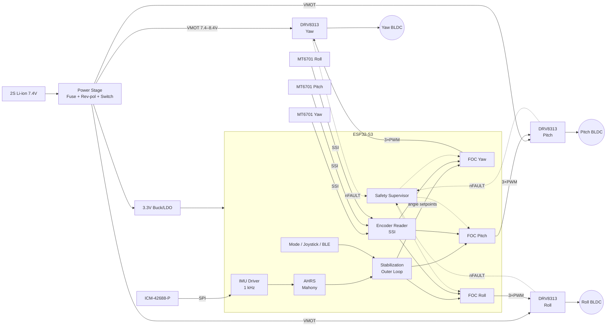

I don't have access to the contents of an `osmo-pocket-esp32-gimbal` repository, so this README is built on a **reference design**: an ESP32-S3 with three BLDC gimbal motors, magnetic encoders, an SPI IMU, and SimpleFOC. Every pin, gain, and part number is internally consistent and safe for the ESP32-S3 (it avoids strapping, flash, and PSRAM pins). Values that likely differ from your repo are marked `⚠ VERIFY`. Swap in your actual values before publishing.

---

````markdown
# osmo-pocket-esp32-gimbal

> Open-source, Osmo-Pocket-style 3-axis handheld camera gimbal built on the **ESP32-S3**,
> with Field-Oriented Control (FOC) of brushless gimbal motors, absolute magnetic encoders,
> and IMU-based stabilization.


**Doc revision:** Cycle 22 · **Firmware target:** `v0.22.x` · **Hardware rev:** `HW-C` ⚠ VERIFY

---

## Table of Contents
1. [Features](#features)
2. [System Architecture](#system-architecture)
3. [Hardware Overview](#hardware-overview)
4. [Wiring & Pinout](#wiring--pinout)
5. [Bill of Materials](#bill-of-materials)
6. [Firmware: Build & Flash](#firmware-build--flash)
7. [Configuration](#configuration)
8. [FOC Tuning Procedure](#foc-tuning-procedure)
9. [Stabilization Loop Tuning](#stabilization-loop-tuning)
10. [Operating Modes & Controls](#operating-modes--controls)
11. [Serial Commander Reference](#serial-commander-reference)
12. [Troubleshooting](#troubleshooting)
13. [Safety](#safety)
14. [Repository Layout](#repository-layout)
15. [Changelog](#changelog)
16. [Contributing](#contributing) · [License](#license)

---

## Features
- **3-axis stabilization** of yaw (pan), pitch (tilt), and roll.
- **Sensored FOC** at a 10–20 kHz control loop (voltage-mode torque) via SimpleFOC.
- **14-bit absolute encoders** (MT6701, SSI) give gimbal motors smooth low-speed torque.
- **High-rate IMU** (ICM-42688-P, 1 kHz ODR) with a Mahony/complementary attitude filter.
- **Follow modes:** Lock, Pan-Follow, FPV (full follow), and Recenter.
- **Runtime tuning** over the USB-CDC Serial Commander. Gains persist to NVS.
- **Fault handling:** driver nFAULT, under-voltage cutoff, encoder-loss detection, and motor stall timeout.
- **Optional BLE** remote control and telemetry.

---

## System Architecture

### Block diagram



### Control hierarchy

```
 ┌──────────── Outer loop (500 Hz, Core 1) ────────────┐
 │  IMU → AHRS → attitude error → Stabilization PID    │
 │  → per-axis motor angle setpoint (rad)              │
 └───────────────────────────┬─────────────────────────┘
                             ▼
 ┌──────────── Inner loop (≥10 kHz, Core 0) ───────────┐
 │  Encoder → angle P → velocity PI → Uq (voltage)     │
 │  → Park/Clarke inverse → SVPWM → DRV8313            │
 └─────────────────────────────────────────────────────┘
```

| Task              | Core | Rate        | Priority |
|-------------------|------|-------------|----------|
| `focTask`         | 0    | ≥10 kHz     | 24 (max) |
| `imuTask`         | 1    | 1 kHz       | 20       |
| `stabTask`        | 1    | 500 Hz      | 18       |
| `safetyTask`      | 1    | 100 Hz      | 15       |
| `uiTask` / BLE    | 1    | 50 Hz       | 5        |

> The FOC loop runs on its own core with Wi-Fi **disabled**. BLE runs on Core 1 only.

---

## Hardware Overview

| Subsystem      | Part                         | Notes |
|----------------|------------------------------|-------|
| MCU            | ESP32-S3-WROOM-1-N8R2        | Quad-SPI PSRAM, which keeps GPIO 33–37 free ⚠ VERIFY |
| Motor drivers  | 3× TI DRV8313 (or SimpleFOC Mini) | 2.5 A peak/phase, 8–60 V |
| Motors         | 3× 2204/2206 gimbal BLDC, 12N14P (7 pole pairs) | ~10–15 Ω phase |
| Encoders       | 3× MT6701 (SSI mode)         | Diametric magnet, 6×2.5 mm |
| IMU            | ICM-42688-P (SPI)            | Mounted on the camera plate, not the handle |
| Power          | 2S 18350 / 2S LiPo 500 mAh   | 7.4 V nominal |

> **Important:** The IMU must be on the **camera payload** so it measures the attitude you
> want stabilized. Put the MCU in the handle and run a 7-wire flex/slip-ring harness
> (SPI + 3V3 + GND + INT) to the payload.

---

## Wiring & Pinout

### ESP32-S3 pin map

The map avoids strapping pins (0, 3, 45, 46), flash/PSRAM pins (26–32), and USB pins (19/20).

| Function            | GPIO | Peripheral      | Connects to            |
|---------------------|------|-----------------|------------------------|
| **Yaw** PWM A       | 4    | MCPWM0          | DRV8313 #1 IN1         |
| Yaw PWM B           | 5    | MCPWM0          | DRV8313 #1 IN2         |
| Yaw PWM C           | 6    | MCPWM0          | DRV8313 #1 IN3         |
| Yaw EN              | 7    | GPIO            | DRV8313 #1 EN1/2/3 (tied) |
| **Pitch** PWM A     | 15   | MCPWM0          | DRV8313 #2 IN1         |
| Pitch PWM B         | 16   | MCPWM0          | DRV8313 #2 IN2         |
| Pitch PWM C         | 17   | MCPWM0          | DRV8313 #2 IN3         |
| Pitch EN            | 18   | GPIO            | DRV8313 #2 EN1/2/3     |
| **Roll** PWM A      | 8    | MCPWM1          | DRV8313 #3 IN1         |
| Roll PWM B          | 9    | MCPWM1          | DRV8313 #3 IN2         |
| Roll PWM C          | 10   | MCPWM1          | DRV8313 #3 IN3         |
| Roll EN             | 11   | GPIO            | DRV8313 #3 EN1/2/3     |
| SPI SCK             | 12   | SPI2 (FSPI)     | All encoders + IMU     |
| SPI MISO            | 13   | SPI2            | All encoders + IMU     |
| SPI MOSI            | 14   | SPI2            | IMU only               |
| CS Yaw encoder      | 38   | GPIO            | MT6701 #1 CSN          |
| CS Pitch encoder    | 39   | GPIO            | MT6701 #2 CSN          |
| CS Roll encoder     | 40   | GPIO            | MT6701 #3 CSN          |
| CS IMU              | 41   | GPIO            | ICM-42688 CS           |
| IMU INT1            | 42   | GPIO (IRQ)      | ICM-42688 INT1         |
| VBAT sense          | 1    | ADC1_CH0        | Divider 100k/33k       |
| nFAULT (wired-OR)   | 2    | GPIO, pull-up   | All DRV8313 nFAULT     |
| nSLEEP/nRESET (all) | 47   | GPIO            | All DRV8313 nSLEEP+nRESET |
| Mode button         | 21   | GPIO, pull-up   | Tactile switch → GND   |
| Status LED          | 48   | RMT             | WS2812                 |
| USB D− / D+         | 19 / 20 | USB-CDC      | USB-C                  |

Notes on the map:
- The MCPWM split is two units × three operators, so each motor sits on one operator group. Yaw and Pitch share MCPWM0. Roll uses MCPWM1.
- PWM frequency is 25 kHz, which is above audible range. Dead-time is handled inside the DRV8313.

### Driver wiring (per axis)

```
            ESP32-S3                         DRV8313                Motor
        ┌───────────────┐              ┌──────────────┐
  GPIO4 │ PWM_A         ├─────────────►│ IN1     OUT1 ├────────► Phase U
  GPIO5 │ PWM_B         ├─────────────►│ IN2     OUT2 ├────────► Phase V
  GPIO6 │ PWM_C         ├─────────────►│ IN3     OUT3 ├────────► Phase W
  GPIO7 │ EN            ├──────┬──────►│ EN1          │
        │               │      ├──────►│ EN2          │
        │               │      └──────►│ EN3          │
 GPIO47 │ nSLEEP/nRESET ├─────────────►│ nSLEEP nRESET│
  GPIO2 │ nFAULT  ◄─────┼──────────────┤ nFAULT (OD)  │
        └───────────────┘   VMOT ─────►│ VM  (100µF + 0.1µF close)
                             GND ─────►│ PGND / GND   │
                                       └──────────────┘
```

### Encoder wiring (MT6701, SSI)

```
MT6701 pin      → ESP32-S3
  VDD (3V3)     → 3V3
  GND           → GND
  CLK           → GPIO12 (SCK)
  DO            → GPIO13 (MISO)   [series 33 Ω near MCU]
  CSN           → GPIO38/39/40 (per axis)
  MODE          → set SSI per datasheet / EEPROM config  ⚠ VERIFY
```

- Use a diametrically magnetized magnet. Keep the air gap at 0.5–1.5 mm and centre the magnet on the shaft to within ±0.2 mm.

### IMU wiring (ICM-42688-P, SPI mode 3)

| ICM-42688 | ESP32-S3 |
|-----------|----------|
| VDD/VDDIO | 3V3 |
| GND       | GND |
| SCLK      | GPIO12 |
| SDO       | GPIO13 |
| SDI       | GPIO14 |
| CS        | GPIO41 |
| INT1      | GPIO42 |

### Power tree

```
2S Battery ─► 3A fuse ─► P-FET rev-pol ─► Slide switch ─┬─► VMOT bus (470µF bulk) ─► 3× DRV8313
                                                        ├─► Divider ─► GPIO1 (VBAT sense)
                                                        └─► Buck 3