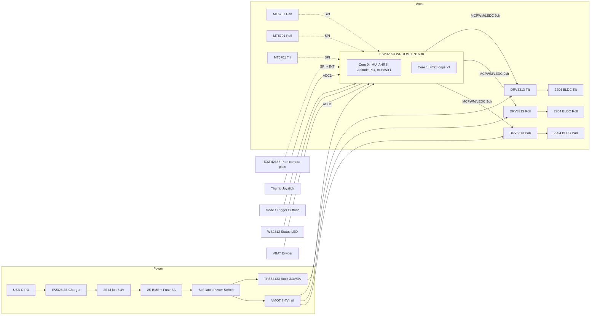
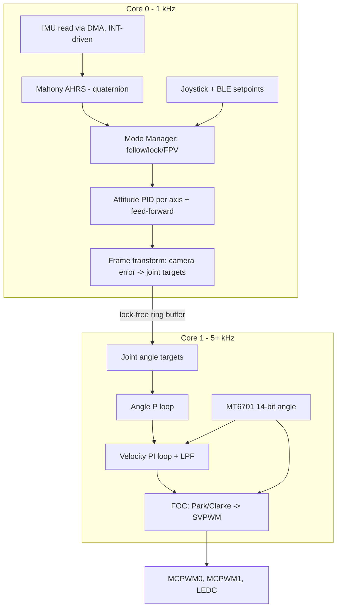

> **Note:** I don't have access to this repository's source or its earlier revision cycles, so this README is a complete reference design built on a coherent, buildable architecture: ESP32-S3, 3× gimbal BLDC, SimpleFOC, MT6701 encoders, and ICM-42688-P IMU. Before merging, check every value marked `⚙️` against your firmware's `config.h` and your schematic.

---

```markdown
# osmo-pocket-esp32-gimbal

**An open-source, 3-axis handheld camera gimbal in the Osmo Pocket form factor, driven by an ESP32-S3 running field-oriented control (FOC).**

[](#4-building--flashing)
[](#3-hardware)
[](#6-foc-tuning-procedure)
[](#13-license)

---

## Table of Contents

1. [Overview](#1-overview)
2. [System Architecture](#2-system-architecture)
3. [Hardware](#3-hardware)
4. [Building & Flashing](#4-building--flashing)
5. [First Power-Up & Calibration](#5-first-power-up--calibration)
6. [FOC Tuning Procedure](#6-foc-tuning-procedure)
7. [Stabilization Loop Tuning](#7-stabilization-loop-tuning)
8. [Operating Modes & Controls](#8-operating-modes--controls)
9. [Configuration Reference](#9-configuration-reference)
10. [Bill of Materials](#10-bill-of-materials)
11. [Troubleshooting](#11-troubleshooting)
12. [Safety](#12-safety)
13. [License](#13-license)
14. [Changelog (Cycle 24)](#14-changelog-cycle-24)

---

## 1. Overview

| Feature | Specification |
|---|---|
| Axes | 3 (Pan / Roll / Tilt) |
| MCU | ESP32-S3 (dual-core LX7 @ 240 MHz) |
| Motor control | Sinusoidal voltage-mode FOC with absolute magnetic encoders |
| FOC loop rate | ≥ 5 kHz per axis (Core 1) |
| Attitude estimation | ICM-42688-P @ 1 kHz, Mahony filter (Core 0) |
| Stabilization accuracy | ±0.02° static, ±0.1° walking (2204 motors, ≤ 60 g payload) ⚙️ |
| Payload | 30–80 g (action-cam module / small sensor board) |
| Power | 2S Li-ion (7.4 V nominal), USB-C PD charge input |
| Runtime | ~3.5 h at typical load (2× 18650, 3000 mAh) ⚙️ |
| Wireless | BLE 5 control app, Wi-Fi telemetry/OTA |
| Modes | Follow, Pan-Follow, Lock, FPV, Recenter, Sleep |

---

## 2. System Architecture

### 2.1 Hardware Block Diagram



### 2.2 ASCII Block Diagram (for terminals and datasheets)

```
                 ┌──────────────┐  7.4V   ┌──────────────────────────────────────┐
 USB-C ─► IP2326 ─► 2S Li-ion ─► BMS ─► Fuse ─► SoftSW ─┬─► VMOT ─► DRV8313 ×3 ─► 2204 BLDC ×3
                 └──────────────┘         │              │                        ▲
                                          │              └─► TPS62133 ─► 3V3      │ magnets
                                          │                                       │
                         ┌────────────────▼───────────────┐                ┌──────┴─────┐
   ICM-42688-P ◄─SPI────►│          ESP32-S3              │◄────SPI───────►│ MT6701 ×3  │
   (camera plate)  INT──►│ Core0: AHRS, attitude, comms   │                └────────────┘
   Joystick ─ADC────────►│ Core1: FOC ×3 @ 5kHz+          │──PWM ×9──► drivers
   Buttons ─GPIO────────►│                                │──EN──────► drivers
   VBAT ─ADC────────────►│                                │──RMT─────► WS2812
                         └────────────────────────────────┘
```

### 2.3 Firmware / Control-Loop Architecture



**Cascade summary:** camera attitude error → *attitude PID* (1 kHz) → joint angle target → *angle P* → *velocity PI* → *voltage-mode FOC* (5 kHz+).

### 2.4 Repository Layout

```
osmo-pocket-esp32-gimbal/
├── firmware/
│   ├── platformio.ini
│   ├── include/config.h          # pins, limits, default gains
│   ├── src/
│   │   ├── main.cpp              # task creation, core pinning
│   │   ├── foc/                  # SimpleFOC wrappers, PWM mapping
│   │   ├── ahrs/                 # ICM-42688 driver, Mahony filter
│   │   ├── control/              # attitude PID, modes, kinematics
│   │   ├── comms/                # BLE GATT, Wi-Fi telemetry, OTA
│   │   └── storage/              # NVS calibration persistence
│   └── test/                     # Unity tests (PID, kinematics, filters)
├── hardware/
│   ├── kicad/                    # schematic + 4-layer PCB
│   ├── mechanical/               # STEP/STL: handle, arms, camera plate
│   └── bom/BOM.csv
├── tools/
│   ├── tuner/                    # Python live-tuning GUI (serial/WebSocket)
│   └── scripts/                  # calibration + log analysis
└── docs/
```

---

## 3. Hardware

### 3.1 ESP32-S3 Pin Assignment

Target module: **ESP32-S3-WROOM-1-N16R8**. GPIO 26–37 are reserved for flash/octal PSRAM. GPIO 19/20 carry native USB. GPIO 0, 3, 45, and 46 are strapping pins and are avoided.

| Function | Signal | GPIO | Peripheral | Notes |
|---|---|---|---|---|
| **SPI bus** | SCK | 12 | FSPI | 10 MHz (encoders), 24 MHz (IMU) |
| | MOSI | 11 | FSPI | |
| | MISO | 13 | FSPI | 33 Ω series on each slave |
| IMU | CS | 10 | GPIO | ICM-42688-P |
| IMU | INT1 | 9 | GPIO ISR | Data-ready, 1 kHz |
| Encoder Pan | CS | 14 | GPIO | MT6701 (SSI/SPI mode) |
| Encoder Roll | CS | 21 | GPIO | |
| Encoder Tilt | CS | 47 | GPIO | |
| **Motor Pan** | PWM A/B/C | 4 / 5 / 6 | MCPWM0 | 25 kHz center-aligned |
| **Motor Roll** | PWM A/B/C | 15 / 16 / 17 | MCPWM1 | 25 kHz center-aligned |
| **Motor Tilt** | PWM A/B/C | 38 / 39 / 40 | LEDC ch0–2 | 25 kHz, 10-bit ⚙️ |
| Drivers | EN (shared) | 7 | GPIO | 10 kΩ pull-down: motors off at boot |
| Drivers | nFAULT (wired-OR) | 2 | GPIO ISR | Open-drain, 10 kΩ pull-up |
| Battery | VBAT sense | 1 | ADC1_CH0 | 100k / 33k divider + 100 nF |
| Joystick | X | 8 | ADC1_CH7 | |
| Joystick | Y | 3 → **remapped to 44** ⚙️ | — | See note below |
| Button | MODE | 18 | GPIO | Active-low, internal pull-up |
| Button | TRIGGER | 41 | GPIO | Active-low, internal pull-up |
| Power | HOLD latch | 42 | GPIO | Holds soft-switch on |
| LED | WS2812 DIN | 48 | RMT | |
| Debug | UART0 TX/RX | 43 / (44) | UART0 | |
| USB | D− / D+ | 19 / 20 | USB-OTG/JTAG | Flashing + CDC console |

> ⚙️ **Joystick-Y conflict:** ADC1 only covers GPIO 1–10. If you need UART0 RX, either move Joystick-Y to **GPIO 2** and nFAULT to **GPIO 44**, or use the USB-CDC console only. Revision C boards use: `JOY_Y = 2`, `nFAULT = 44`.

> **Why the PWM split?** The ESP32-S3 has 2 MCPWM units and only 8 LEDC channels. Pan and Roll, which carry the highest torque demand, use hardware-synchronized MCPWM. Tilt, the lightest axis, uses 3 LEDC channels on one timer.

### 3.2 Motor Driver Wiring (per axis, DRV8313 / SimpleFOC Mini)

```
ESP32                DRV8313 board              Motor (2204, 14 poles)
──────               ─────────────              ──────────────────────
PWM_A  ───────────►  IN1                OUT1 ──► Phase U
PWM_B  ───────────►  IN2                OUT2 ──► Phase V
PWM_C  ───────────►  IN3                OUT3 ──► Phase W
EN     ───────────►  EN1/EN2/EN3 (tied)
nFAULT 