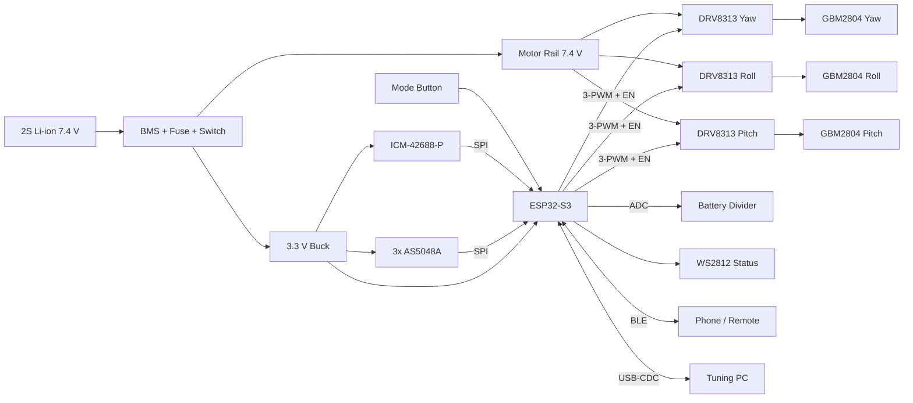
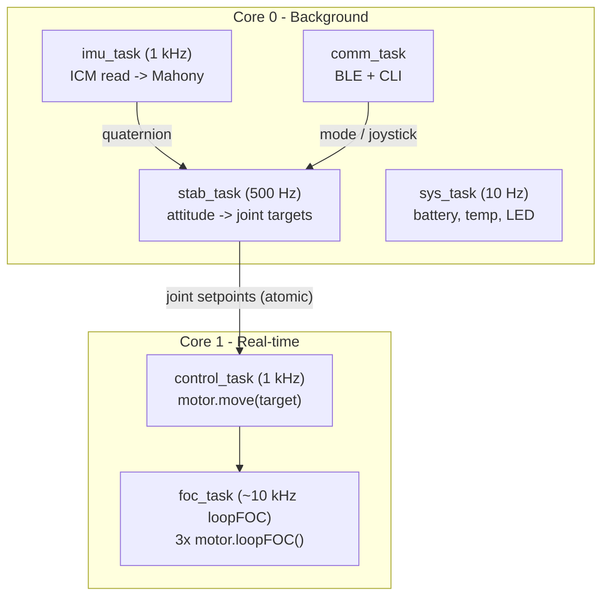

I don't have access to the actual contents of `osmo-pocket-esp32-gimbal`, so this README is a complete **reference design**. Before you merge it, check the pin assignments, part numbers, and tuning values against your firmware and schematic. Items marked `⚠ VERIFY` depend on your hardware.

---

````markdown
# osmo-pocket-esp32-gimbal

> Open-source, 3-axis handheld camera stabilizer in the spirit of the DJI Osmo Pocket, built on the **ESP32-S3**, **brushless gimbal motors**, **14-bit magnetic encoders**, and **Field-Oriented Control (FOC)** via [SimpleFOC](https://simplefoc.com).


---

## Table of Contents

1. [Features](#features)
2. [System Architecture](#system-architecture)
3. [Hardware](#hardware)
4. [Wiring & Pinout](#wiring--pinout)
5. [Bill of Materials](#bill-of-materials)
6. [Firmware Build & Flash](#firmware-build--flash)
7. [First Power-Up Checklist](#first-power-up-checklist)
8. [FOC Tuning Procedure](#foc-tuning-procedure)
9. [Stabilization Loop Tuning](#stabilization-loop-tuning)
10. [Operating Modes](#operating-modes)
11. [Serial / BLE Command Reference](#serial--ble-command-reference)
12. [Troubleshooting](#troubleshooting)
13. [Safety](#safety)
14. [Repository Layout](#repository-layout)
15. [Contributing](#contributing)
16. [License](#license)

---

## Features

- **3-axis stabilization** (yaw / roll / pitch) with closed-loop FOC on every axis
- **Absolute magnetic encoders** (AS5048A, SPI) give jitter-free low-speed torque control
- **6-DoF IMU** (ICM-42688-P) at 1 kHz with a Mahony AHRS filter
- **Follow modes**: Lock, Pan-Follow, FPV (full follow), Recenter
- **Smooth follow** using configurable deadband and exponential easing
- **BLE control** (joystick, mode, recenter) plus USB-CDC CLI for tuning
- **Persistent calibration** stored in NVS (encoder offsets, PID gains, IMU bias)
- **Safety**: motor over-temperature cutoff, stall detection, low-battery shutdown
- **Dual-core scheduling**: Core 1 runs FOC, Core 0 runs AHRS, comms, and UI

---

## System Architecture

### Hardware block diagram



### Firmware task architecture



### Control loop cascade (per axis)

```
 Camera attitude      Stabilization          FOC (SimpleFOC)
 setpoint (IMU) ──►  [ PID_att ] ──► θ_joint ─► [ P_angle ] ─► ω ─► [ PI_vel ] ─► Uq ─► SVPWM ─► Motor
                         ▲                         ▲                   ▲
                    IMU attitude            Encoder angle        Encoder velocity (LPF)
```

---

## Hardware

| Subsystem | Choice | Rationale |
|---|---|---|
| MCU | ESP32-S3-WROOM-1 (N8R8) | Dual-core 240 MHz, 2× MCPWM units, BLE 5, native USB |
| Motors | GBM2804H-100T (7 pole pairs, ~10 Ω) | High-resistance gimbal winding; voltage-mode FOC is safe |
| Drivers | DRV8313 (×3) | 3-phase, 65 V / 2.5 A, independent EN, 3.3 V logic |
| Encoders | AS5048A (14-bit, SPI) | Absolute, low noise, shareable SPI bus |
| IMU | ICM-42688-P | Low noise and drift; SPI at 24 MHz |
| Power | 2S 18650 or 2S LiPo 1000 mAh | 7.4 V nominal suits 100T windings |

> ⚠ **VERIFY** the pole pairs and phase resistance of your motors. Clone GBM2804 motors vary.

---

## Wiring & Pinout

### ESP32-S3 pin assignment

Strapping pins (0, 3, 45, 46), USB (19, 20), and octal flash/PSRAM pins (26–37) are deliberately avoided.

| Function | Signal | GPIO | Notes |
|---|---|---|---|
| **Yaw motor** | PWM A / B / C | 4 / 5 / 6 | MCPWM0 |
| | EN | 7 | Active high |
| **Roll motor** | PWM A / B / C | 15 / 16 / 17 | MCPWM0 / MCPWM1 |
| | EN | 18 | |
| **Pitch motor** | PWM A / B / C | 8 / 9 / 10 | MCPWM1 |
| | EN | 11 | |
| **SPI bus (shared)** | SCK | 12 | 10 MHz for encoders, 24 MHz for IMU |
| | MISO | 13 | |
| | MOSI | 14 | |
| **Encoder CS** | Yaw / Roll / Pitch | 21 / 38 / 39 | 10 kΩ pull-ups to 3.3 V |
| **IMU** | CS | 40 | |
| | INT1 (data-ready) | 41 | |
| **Battery sense** | ADC1_CH0 | 1 | 100 k / 33 k divider |
| **Driver fault** | nFAULT (wired-OR) | 2 | Open-drain, 10 kΩ pull-up |
| **Mode button** | BTN | 42 | Internal pull-up, active low |
| **Status LED** | WS2812 DIN | 48 | Onboard LED on DevKitC-1 |
| **USB** | D− / D+ | 19 / 20 | Native USB-CDC |

> ⚠ **VERIFY** MCPWM operator mapping in `src/config/pins.h`. Each MCPWM unit has 3 operators × 2 outputs, so 9 PWM lines fit across the 2 units.

### DRV8313 wiring (per axis)

```
ESP32-S3                 DRV8313                 GBM2804
---------                -------                 -------
PWM_A  ───────────────►  IN1          OUT1 ────► Phase U
PWM_B  ───────────────►  IN2          OUT2 ────► Phase V
PWM_C  ───────────────►  IN3          OUT3 ────► Phase W
EN     ───────────────►  EN1+EN2+EN3 (tied)
nFAULT ◄───────────────  nFAULT (open-drain, wired-OR)
3V3    ───────────────►  nRESET, nSLEEP (pull-up 10k)
                         VM ◄── 7.4 V rail (100 µF low-ESR + 0.1 µF per driver)
GND    ────────────────  GND (star ground at battery negative)
```

### Encoder mounting

```
          ┌──────────────┐
          │  AS5048A IC  │   Air gap: 0.5 – 2.0 mm
          └──────┬───────┘   Magnet: 6 × 2.5 mm diametric N35
                 │ ◄── gap
          ═══════╪═══════   Motor shaft end (magnet glued, centered ±0.25 mm)
```

### Battery divider

```
VBAT ──[100k]──┬──[33k]── GND        V_adc = VBAT × 0.248
               │                     8.4 V → 2.08 V (within ADC 11 dB range)
               └──[100nF]── GND
               └────────► GPIO1
```

---

## Bill of Materials

Prices are approximate single-unit USD estimates. Quantities are for one gimbal.

| # | Part | Qty | Example Source / MPN | Est. Unit | Est. Total |
|---|---|---|---|---|---|
| 1 | ESP32-S3-DevKitC-1 N8R8 | 1 | Espressif | $15.00 | $15.00 |
| 2 | GBM2804H-100T brushless gimbal motor | 3 | iFlight / generic | $14.00 | $42.00 |
| 3 | DRV8313 breakout (or SimpleFOC Mini v1.1) | 3 | TI DRV8313PWPR | $6.00 | $18.00 |
| 4 | AS5048A magnetic encoder board | 3 | ams AS5048A-HTSP | $12.00 | $36.00 |
| 5 | Diametric magnet 6 × 2.5 mm | 3 | Included with encoder / K&J | $0.80 | $2.40 |
| 6 | ICM-42688-P breakout | 1 | TDK | $9.00 | $9.00 |
| 7 | 2S BMS 8.4 V, 5 A | 1 | HX-2S-JH20 | $2.00 | $2.00 |
| 8 | 18650 cell, 3000 mAh | 2 | Samsung 30Q / Molicel P28A | $5.00 | $10.00 |
| 9 | 3.3 V buck, 1 A (e.g., TPS62160 module) | 1 | TI | $3.00 | $3.00 |
| 10 | Blade fuse 3 A + holder | 1 | Littelfuse | $1.50 | $1.50 |
| 11 | Slide power switch, 3 A | 1 | C&K | $1.00 | $1.00 |
| 12 | Electrolytic 100 µF / 25 V low-ESR | 3 | Panasonic FR | $0.40 | $1.20 |
| 13 | Ceramic 0.1 µF / 50 V | 10 | Generic X7R | $0.02 | $0.20 |
| 14 | Resistors 10 k, 33 k, 100 k (1%) | 10 | Generic | $0.02 | $0.20 |
| 15 | Tactile button | 1 | Omron B3F | $0.30 | $0.30 |
| 16 | Silicone wire 26 AWG / 22 AWG | 1 set | — | $5.00 | $5.00 |
| 17 | JST-GH connectors (motor/encoder) | 6 | JST | $0.50 | $3.00 |
| 18 | 3D-printed arms and handle (PETG) | 1 set | `hardware/cad/` | $4.00 | $4.00 |
| 19 | M2/M2.5 screws, heat-set inserts | 1 kit | — | $3.00 | $3.00 |
| 20 | Slip ring (optional, yaw 360°) | 1 | 12 mm, 6-wire | $8.00 | $8.00 |
| | **Total (excluding optional slip ring)** | | | | **≈ $156** |

A machine-readable BOM is available at `hardware/bom.csv`, and a KiCad project at `hardware/pcb/`.

---

## Firmware Build & Flash

### Prerequisites
- [PlatformIO](https://platformio.org) (VS Code extension or CLI)
- USB-C cable (data-capable)

### Build

```bash
git clone https://github.com/<org>/osmo-pocket-esp32-gimbal.git
cd osmo-pocket-esp32-gimbal
pio run -e esp32s3
pio run -e esp32s3 -t upload
pio device monitor -b 115200
```

### `platformio.ini` (excerpt)

```ini
[env:esp32s3]
platform = espressif32@^6.5.0
board = esp32-s3-devkitc-1
framework = arduino
board_build.arduino.memory_type = qio_opi
build_flags =
    -DARDUINO_USB_CDC_ON_BOOT=1
    -DCORE_DEBUG_LEVEL=2
    -O2
lib_deps =
    askuric/Simple FOC@