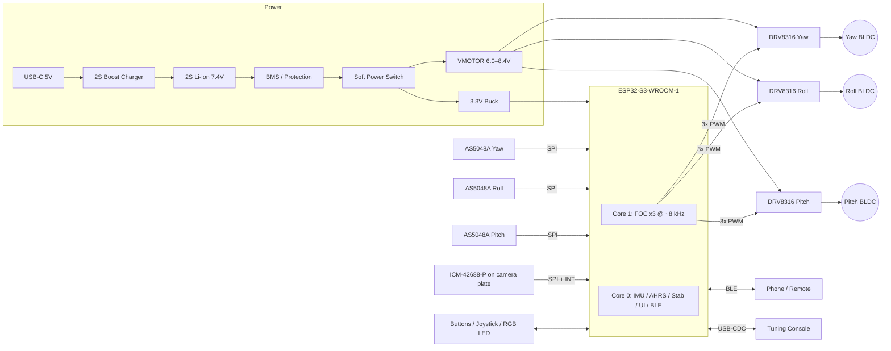

I don't have access to your repository's actual files or earlier cycles, so this README is a complete, internally consistent **reference design**. Before you merge it, reconcile the pin numbers, part choices, and gains with your actual schematic and firmware. Items marked `⚠️ VERIFY` are the ones most likely to differ.

---

```markdown
# osmo-pocket-esp32-gimbal

> A pocket-sized, open-source, 3-axis brushless camera gimbal built on the ESP32-S3,
> running field-oriented control (FOC) with absolute magnetic encoders and an
> ICM-42688-P IMU. Inspired by the DJI Osmo Pocket form factor.


---

## Table of Contents

1. [Features](#features)
2. [System Overview](#system-overview)
3. [Hardware](#hardware)
4. [Wiring & Pinout](#wiring--pinout)
5. [Firmware Architecture](#firmware-architecture)
6. [Building & Flashing](#building--flashing)
7. [First Power-Up & Calibration](#first-power-up--calibration)
8. [FOC Tuning Procedure](#foc-tuning-procedure)
9. [Stabilization Loop Tuning](#stabilization-loop-tuning)
10. [Operating Modes & Controls](#operating-modes--controls)
11. [Serial / BLE Command Reference](#serial--ble-command-reference)
12. [Bill of Materials](#bill-of-materials)
13. [Troubleshooting](#troubleshooting)
14. [Safety](#safety)
15. [Contributing](#contributing)
16. [License](#license)

---

## Features

- **3-axis stabilization** (yaw / roll / pitch) with true FOC on all three motors
- **Absolute 14-bit magnetic encoders** (AS5048A), so no homing sweep is needed at boot
- **ICM-42688-P IMU** at 1 kHz with a Mahony/complementary attitude filter
- **Dual-core scheduling**: core 1 runs the FOC loops and core 0 runs the IMU, attitude, UI and BLE
- **Modes:** Follow, Pan-Follow, Lock, FPV and Recenter (double-tap)
- **BLE control and telemetry**, plus a USB-CDC tuning console (SimpleFOC Commander)
- **Persistent calibration** stored in NVS (encoder offsets, IMU bias, PID gains)
- **Protection:** driver fault latch, battery undervoltage cutoff, motor stall and thermal derating
- **2S Li-ion supply** (6.0–8.4 V) with USB-C charging

---

## System Overview

### Block Diagram



### Control Hierarchy

```
                ┌──────────────────────────────────────────────┐
 Joystick/BLE ─▶│ Setpoint generator (mode logic, follow LPF)  │
                └───────────────┬──────────────────────────────┘
                                │ target camera attitude (q_ref)
                ┌───────────────▼──────────────────────────────┐
 IMU 1 kHz ────▶│ AHRS (Mahony) → q_cam                        │
                │ Attitude error → joint-space error (IK)      │  core 0, 1 kHz
                │ Stabilization PID (per axis)                 │
                └───────────────┬──────────────────────────────┘
                                │ joint velocity / angle targets
                ┌───────────────▼──────────────────────────────┐
 Encoders ─────▶│ SimpleFOC: angle P → velocity PI → Uq        │  core 1, ~8 kHz
                │ SVPWM → DRV8316                              │
                └──────────────────────────────────────────────┘
```

The IMU sits **on the camera plate**, so the gimbal measures the quantity it is
stabilizing. The encoders provide commutation and joint angles for the
kinematic mapping and for Follow modes.

---

## Hardware

### Mechanical Axis Order

Handle → **Yaw (pan)** → **Roll** → **Pitch (tilt)** → Camera

### Key Components

| Function       | Part                         | Notes |
|----------------|------------------------------|-------|
| MCU            | ESP32-S3-WROOM-1-N16R8       | Octal PSRAM. GPIO35–37 are reserved. |
| Motor driver   | TI DRV8316 (×3), hardware-interface variant | 4.5–35 V, 3x PWM mode ⚠️ VERIFY variant |
| Motors         | 2204 gimbal BLDC, 12N14P (7 PP), ~10 Ω | Pitch can use a 1806 to save weight |
| Encoders       | AMS AS5048A (SPI, 14-bit)    | Diametric magnet, 6×2.5 mm |
| IMU            | TDK ICM-42688-P (SPI)        | Mounted on camera plate |
| Power          | 2S 18350 Li-ion (or 2S LiPo 800 mAh) | |
| Charger        | IP2326 / BQ25887 (2S boost from USB-C) ⚠️ VERIFY | |
| 3.3 V rail     | TPS62162 buck                | 1 A, low noise |

---

## Wiring & Pinout

### ESP32-S3 Pin Assignment

| GPIO | Function            | Direction | Connected to            | Notes |
|------|---------------------|-----------|-------------------------|-------|
| 4    | PITCH_INA           | Out PWM   | DRV8316 #P INHA         | MCPWM0 |
| 5    | PITCH_INB           | Out PWM   | DRV8316 #P INHB         | MCPWM0 |
| 6    | PITCH_INC           | Out PWM   | DRV8316 #P INHC         | MCPWM0 |
| 7    | ROLL_INA            | Out PWM   | DRV8316 #R INHA         | MCPWM1 |
| 15   | ROLL_INB            | Out PWM   | DRV8316 #R INHB         | MCPWM1 |
| 16   | ROLL_INC            | Out PWM   | DRV8316 #R INHC         | MCPWM1 |
| 17   | YAW_INA             | Out PWM   | DRV8316 #Y INHA         | LEDC fallback ⚠️ |
| 18   | YAW_INB             | Out PWM   | DRV8316 #Y INHB         | |
| 8    | YAW_INC             | Out PWM   | DRV8316 #Y INHC         | |
| 9    | DRV_nSLEEP          | Out       | All 3 drivers           | Global motor enable |
| 10   | DRV_nFAULT          | In (PU)   | All 3 drivers (wired-OR)| Open-drain, 10 kΩ pull-up |
| 12   | SPI_SCLK            | Out       | IMU + 3× encoder        | FSPI |
| 11   | SPI_MOSI            | Out       | IMU + 3× encoder        | |
| 13   | SPI_MISO            | In        | IMU + 3× encoder        | |
| 14   | CS_IMU              | Out       | ICM-42688-P             | |
| 21   | CS_ENC_PITCH        | Out       | AS5048A pitch           | |
| 47   | CS_ENC_ROLL         | Out       | AS5048A roll            | |
| 48   | CS_ENC_YAW          | Out       | AS5048A yaw             | |
| 1    | IMU_INT1            | In        | ICM-42688-P INT1        | Data-ready, 1 kHz |
| 2    | VBAT_SENSE          | ADC1_CH1  | Divider 100k/22k        | Scale = 5.545 |
| 41   | I2C_SCL             | I/O       | Fuel gauge / OLED (opt.)| 4.7 kΩ PU |
| 42   | I2C_SDA             | I/O       | Fuel gauge / OLED (opt.)| 4.7 kΩ PU |
| 40   | BTN_MODE            | In (PU)   | Mode / power button     | Active low |
| 39   | BTN_SHUTTER         | In (PU)   | Shutter / recenter      | Active low |
| 38   | LED_RGB             | Out       | WS2812B-2020            | |
| 19   | USB_D-              | —         | USB-C                   | Native USB-CDC |
| 20   | USB_D+              | —         | USB-C                   | |
| 0    | BOOT                | Strap     | Boot button             | Do not reuse |
| 3, 45, 46 | Strapping      