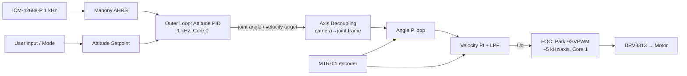

I don't have access to this repository's contents or to the prior 27 cycles, so this README is a **complete, self-consistent reference draft** built on a common, sound architecture for a 3-axis pocket gimbal:

- ESP32-S3
- SimpleFOC-style voltage-mode FOC
- DRV8313 drivers
- MT6701 magnetic encoders
- ICM-42688-P IMU

Items marked `⚠️ VERIFY` are the places where your actual hardware or code may differ. Diff them against the repo before merging.

---

````markdown
# osmo-pocket-esp32-gimbal

> Open-source, 3-axis handheld camera gimbal in the spirit of the DJI Osmo Pocket.
> ESP32-S3 · Field-Oriented Control (FOC) · Absolute magnetic encoders · 1 kHz IMU stabilization

[]() []() []()

---

## Table of Contents
1. [Features](#features)
2. [Safety](#safety)
3. [System Architecture](#system-architecture)
4. [Hardware](#hardware)
5. [Wiring & Pinout](#wiring--pinout)
6. [Bill of Materials](#bill-of-materials)
7. [Firmware: Build & Flash](#firmware-build--flash)
8. [First Power-Up Checklist](#first-power-up-checklist)
9. [FOC Tuning Procedure](#foc-tuning-procedure)
10. [Stabilization Loop Tuning](#stabilization-loop-tuning)
11. [Operating Modes & Controls](#operating-modes--controls)
12. [Serial Command Reference](#serial-command-reference)
13. [Configuration Reference](#configuration-reference)
14. [Troubleshooting](#troubleshooting)
15. [Repository Layout](#repository-layout)
16. [Contributing](#contributing)
17. [License](#license)

---

## Features
- **3-axis stabilization** for pitch, roll, and yaw, using brushless gimbal motors.
- **Voltage-mode FOC.** Each axis runs at 10–20 kHz PWM, with the inner FOC loop at about 5 kHz per axis.
- **Absolute encoders.** MT6701 sensors on SSI mean no homing dance at boot and no re-index after a stall.
- **High-rate IMU.** An ICM-42688-P runs at 1 kHz and feeds a Mahony/complementary attitude filter.
- **Operating modes:** Follow, Pan-Lock, Full-Lock, FPV, and Recenter. A triple-click recenters the gimbal.
- **Wireless interfaces:** BLE control and telemetry, plus Wi-Fi OTA updates.
- **Persistent calibration.** Tuning and calibration are stored in NVS.
- **Built-in safeguards:**
  - Battery protection.
  - Motor thermal estimation.
  - Stall detection.
  - Watchdog.

## Safety
> ⚠️ **Read before powering motors.**
- Gimbal motors can heat to **>80 °C** if the voltage limit is set too high or a stall persists. Always tune with `voltage_limit` ≤ 3 V first.
- LiPo cells must be protected. Never bypass the BMS or the low-voltage cutoff.
- Keep fingers clear of the arms during sensor alignment, because the motors move without warning.
- Disconnect motor power before re-wiring. The DRV8313 is not hot-plug safe on the phase outputs.

---

## System Architecture

### Block Diagram

```
                         ┌──────────────────────────────────────────────┐
   3S LiPo 11.1 V ──┬──► │  Power Board                                 │
   (w/ BMS)         │    │  • Reverse-polarity P-FET  • 3 A polyfuse    │
                    │    │  • VMOT bus (9.0–12.6 V)   • 3V3 buck (1 A)  │
                    │    │  • VBAT divider → ADC                        │
                    │    └───────┬──────────────────────────┬───────────┘
                    │        VMOT│                      3V3 │
                    ▼            ▼                          ▼
              ┌───────────────────────┐        ┌──────────────────────────────┐
              │ DRV8313 ×3            │◄─PWM───│         ESP32-S3             │
              │ (Pitch / Roll / Yaw)  │◄─EN────│  Core 1: FOC loops (3 axes)  │
              │ nFAULT ───────────────┼──────► │  Core 0: IMU, AHRS, outer    │
              └──┬────────┬────────┬──┘        │          loop, BLE, UI       │
                 │        │        │           └──┬────────┬─────────┬────────┘
                 ▼        ▼        ▼              │SPI     │GPIO     │USB-CDC
             ┌──────┐ ┌──────┐ ┌──────┐           │        │         │
             │Motor │ │Motor │ │Motor │           ▼        ▼         ▼
             │Pitch │ │Roll  │ │Yaw   │   ┌────────────┐ ┌───────┐ ┌──────────┐
             └──┬───┘ └──┬───┘ └──┬───┘   │ICM-42688-P │ │Buttons│ │ Host PC  │
                │magnet  │magnet  │magnet │  (camera   │ │WS2812 │ │ / Tuner  │
             ┌──▼───┐ ┌──▼───┐ ┌──▼───┐   │  plate)    │ └───────┘ └──────────┘
             │MT6701│ │MT6701│ │MT6701│   └────────────┘
             └──┬───┘ └──┬───┘ └──┬───┘
                └────────┴────────┴──── SSI (shared CLK/DO, per-axis CS) ──► ESP32-S3
```

### Control Loop Hierarchy



| Loop | Rate | Core | Input | Output |
|---|---|---|---|---|
| FOC commutation | ~5 kHz / axis | 1 | electrical angle, Uq | 3× PWM duty |
| Velocity PI | ~1–2 kHz | 1 | encoder velocity | Uq (V) |
| Angle P | ~1 kHz | 1 | encoder angle | velocity target |
| Attitude (stabilization) | 1 kHz | 0 | AHRS quaternion | joint targets |
| UI / BLE / telemetry | 50–100 Hz | 0 | buttons, BLE | mode, setpoints |

### Task Layout (FreeRTOS)

| Task | Core | Priority | Period |
|---|---|---|---|
| `foc_task` | 1 | 24 (max) | free-running, `loopFOC()` ×3 |
| `imu_task` | 0 | 20 | 1 ms (IMU INT1-driven) |
| `control_task` | 0 | 18 | 1 ms |
| `ui_task` | 0 | 5 | 10 ms |
| `ble_task` | 0 | 4 | 20 ms |
| `telemetry_task` | 0 | 3 | 10 ms (when enabled) |

---

## Hardware

### Mechanical Overview
- **Axis order (camera → handle):** Pitch → Roll → Yaw.
- **Balance the payload mechanically** on every axis before tuning. FOC can compensate for imbalance, but at the cost of heat and battery life.
- **Encoder magnets:** Use 6×2.5 mm diametrically magnetized N35 magnets. Keep the magnet-to-IC gap at **0.5–1.5 mm** and centered within ±0.3 mm.

### Recommended Motors

| Axis | Motor | KV | Pole pairs | Phase R |
|---|---|---|---|---|
| Pitch | 2204 gimbal (hollow shaft) | ~100 | 7 | ~10 Ω |
| Roll | 2204 gimbal (hollow shaft) | ~100 | 7 | ~10 Ω |
| Yaw | 2804 gimbal (hollow shaft) | ~100 | 7 | ~6 Ω |

`⚠️ VERIFY` pole pairs. The firmware auto-detects them, but `config.h` defaults assume 7.

---

## Wiring & Pinout

### ESP32-S3 Pin Assignment (ESP32-S3-WROOM-1-N16R8)

> GPIO 26–32 are reserved for flash. GPIO 33–37 are reserved for octal PSRAM on R8 modules.
> GPIO 0, 3, 45, and 46 are strapping pins and are avoided for outputs.
> GPIO 19/20 are reserved for native USB.

| Function | GPIO | Peripheral | Notes |
|---|---|---|---|
| **Pitch PWM A / B / C** | 4 / 5 / 6 | MCPWM0 | DRV8313 IN1/IN2/IN3 |
| **Pitch EN** | 7 | GPIO | EN1–3 tied together |
| **Roll PWM A / B / C** | 15 / 16 / 17 | MCPWM0/1 | |
| **Roll EN** | 18 | GPIO | |
| **Yaw PWM A / B / C** | 8 / 9 / 10 | MCPWM1 | |
| **Yaw EN** | 11 | GPIO | |
| DRV nFAULT (wired-OR, all 3) | 2 | GPIO in, pull-up | Open-drain, active-low |
| DRV nSLEEP (all 3) | 47 | GPIO | High = awake |
| **SPI SCK** (IMU + encoders) | 12 | SPI2 (FSPI) | 10 MHz IMU / 4 MHz encoders |
| **SPI MOSI** | 13 | SPI2 | IMU only |
| **SPI MISO** / MT6701 DO | 14 | SPI2 | Shared |
| IMU CS | 21 | GPIO | |
| IMU INT1 | 1 | GPIO in | Data-ready, rising edge |
| Encoder CS Pitch | 38 | GPIO | |
| Encoder CS Roll | 39 | GPIO | |
| Encoder CS Yaw | 40 | GPIO | |
| VBAT sense | — | — | See note ⚠️ below |
| Button MODE | 41 | GPIO in, pull-up | |
| Button TRIGGER | 42 | GPIO in, pull-up | |
| Joystick X / Y (optional) | — | — | Requires an external ADC on I²C |
| Status LED (WS2812) | 48 | RMT | |
| USB D− / D+ | 19 / 20 | USB-OTG | CDC console + flashing |
| UART0 TX / RX | 43 / 44 | UART0 | Debug / bootloader log |

> ⚠️ **VBAT sense:** GPIO1 is used for IMU INT1 in this table. If you need ADC1 for battery sensing, move IMU INT1 to **GPIO 3** (strapping pin, input-only safe) and use **GPIO 1 (ADC1_CH0)** for VBAT. Wi-Fi blocks ADC2, so only ADC1 (GPIO 1–10) is reliable. Update `pins.h` to match your board revision.

### DRV8313 Wiring (per axis)

```
 ESP32-S3                DRV8313 (HTSSOP-28)                Motor
 ─────────               ─────────────────────               ─────
 PWM_A ───────────────► IN1           OUT1 ────────────────► Phase U
 PWM_B ───────────────► IN2           OUT2 ────────────────► Phase V
 PWM_C ───────────────► IN3           OUT3 ────────────────► Phase W
 EN    ───────────────► EN1,EN2,EN3
 nSLEEP ──────────────► nSLEEP
 nRESET ◄── 3V3 (10k)   nRESET
 nFAULT ◄─────────────  nFAULT (open-drain, 10k pull-up to 3V3)
                        VM  ◄── VMOT (100 µF bulk + 0.1 µF per pin)
                        V3P3OUT → 0.47 µF to GND (do NOT power ESP32 from it)
                        CPL/CPH → 0.01 µF ;  VCP → 0.1 µF to VM
                        PGND/GND → solid ground pour
```

### MT6701 Encoder Wiring (SSI mode)

```
