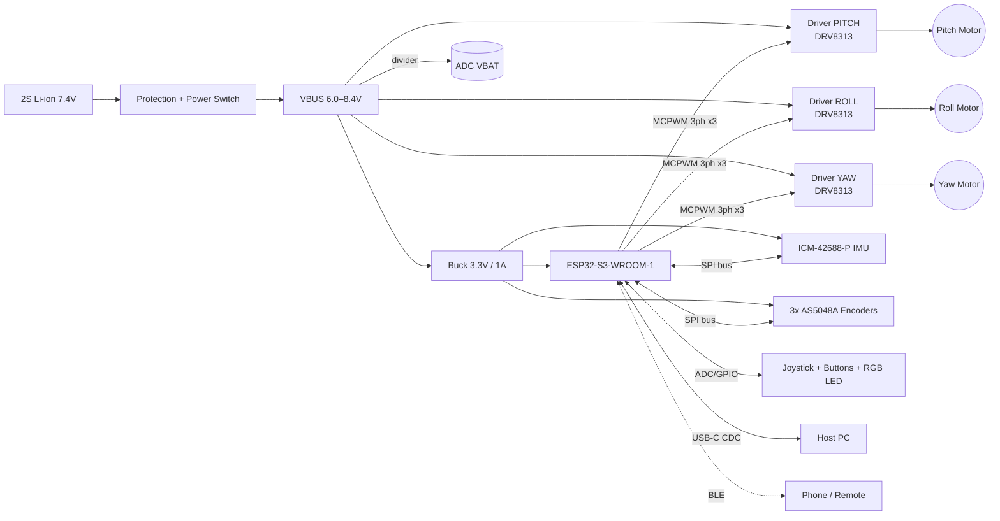

I don't have access to the contents of an `osmo-pocket-esp32-gimbal` repository or your prior cycles, so this README is a **complete, internally consistent reference design**. Pin numbers, gains, and part choices are real and workable for an ESP32-S3 / SimpleFOC build. Check the items marked **⚠ VERIFY** against your actual schematic and firmware before publishing.

---

````markdown
# osmo-pocket-esp32-gimbal

> Open-source, pocket-sized 3-axis brushless camera gimbal built on the ESP32-S3,
> using field-oriented control (FOC) for silent, smooth stabilization.


---

## Table of Contents
1. [Features](#features)
2. [System Architecture](#system-architecture)
3. [Hardware](#hardware)
4. [Wiring & Pinout](#wiring--pinout)
5. [Bill of Materials](#bill-of-materials)
6. [Firmware: Build & Flash](#firmware-build--flash)
7. [First Power-Up & Calibration](#first-power-up--calibration)
8. [FOC Tuning Procedure](#foc-tuning-procedure)
9. [Stabilization Loop Tuning](#stabilization-loop-tuning)
10. [Operating Modes & Controls](#operating-modes--controls)
11. [Configuration Reference](#configuration-reference)
12. [Troubleshooting](#troubleshooting)
13. [Safety](#safety)
14. [Contributing](#contributing)
15. [License](#license)

---

## Features

- **3-axis stabilization** (yaw / roll / pitch) with gimbal BLDC motors
- **Closed-loop FOC** per axis using 14-bit magnetic absolute encoders
- **High-rate attitude estimation**: 1 kHz IMU sampling with a Mahony/complementary filter
- **Modes**: Follow, Pan-Follow, Lock, FPV, Recenter
- **Joystick + 2 buttons** for manual pan/tilt and mode changes
- **2S Li-ion** power with battery monitoring and low-voltage cutoff
- **USB-C** flashing, serial console, and live tuning (SimpleFOC Commander)
- **Optional BLE** remote/telemetry via NimBLE

---

## System Architecture

### Hardware block diagram



### Control loop architecture

```
                 ┌──────────────── 500 Hz ─────────────────┐ ┌──────── ~5–10 kHz per axis ────────┐
 Joystick/Mode ─►│ Setpoint    ┌──────────┐   angle error  │ │ ┌────────┐ vel  ┌────────┐  Uq     │
                 │ Generator ─►│ Attitude │───────────────►│─┼►│Angle P │─────►│ Vel PI │──────►  │──► SVPWM ──► Motor
 IMU (1 kHz) ───►│ Mahony AHRS │ Ctrl (PD)│                │ │ └────────┘      └────────┘         │
                 │             └──────────┘                │ │     ▲ θ_enc          ▲ ω_enc (LPF) │
                 └─────────────────────────────────────────┘ └─────┴──────────────────┴───────────┘
                                                                     AS5048A magnetic encoder
```

**Layering:**
- **Inner (FOC) loop**: per motor, runs in `loopFOC()` at the maximum rate (~5–10 kHz). It uses voltage-mode torque control, with phase-resistance-based current estimation.
- **Middle loop**: per-axis motor angle and velocity cascade (SimpleFOC `MotionControlType::angle`).
- **Outer loop**: camera attitude (from the IMU) is converted to joint-angle targets through gimbal inverse kinematics at 500 Hz.

### Firmware task layout (FreeRTOS)

| Task | Core | Priority | Rate | Responsibility |
|------|------|----------|------|----------------|
| `foc_task` | 1 | 24 | free-running | `loopFOC()` + `move()` for all 3 axes |
| `imu_task` | 0 | 20 | 1 kHz (INT-driven) | IMU read, AHRS update |
| `stab_task` | 0 | 18 | 500 Hz | Mode logic, IK, motor targets |
| `ui_task` | 0 | 5 | 50 Hz | Joystick, buttons, LED, battery |
| `comm_task` | 0 | 3 | event | USB Commander, BLE |

### Repository layout

```
osmo-pocket-esp32-gimbal/
├── firmware/
│   ├── platformio.ini
│   ├── include/
│   │   ├── board_pins.h        # all GPIO assignments
│   │   └── config.h            # tunable defaults
│   └── src/
│       ├── main.cpp
│       ├── foc_axes.cpp        # SimpleFOC motor/driver/sensor setup
│       ├── imu_icm42688.cpp
│       ├── ahrs_mahony.cpp
│       ├── stabilizer.cpp      # modes, IK, outer loop
│       ├── ui.cpp
│       └── storage.cpp         # NVS calibration persistence
├── hardware/
│   ├── kicad/                  # schematic + PCB
│   ├── mechanical/             # STEP / STL arms and handle
│   └── bom/BOM.csv
├── tools/
│   └── tune_plot.py            # serial live-plot of loop signals
└── docs/
```

---

## Hardware

| Subsystem | Choice | Why |
|-----------|--------|-----|
| MCU | ESP32-S3-WROOM-1-**N8** (no PSRAM) | 2× MCPWM units give 12 PWM outputs. GPIO35–37 stay free because there is no octal PSRAM. |
| Motor drivers | 3× DRV8313 (e.g., SimpleFOC Mini) | Integrated 3-phase driver, 8–60 V, compact |
| Motors | 3× 2204 260KV gimbal BLDC, 7 pole pairs (14 poles) | High-resistance windings (~10 Ω) suit voltage-mode FOC |
| Encoders | 3× AS5048A (SPI, 14-bit) | Shares one SPI bus with the IMU. Absolute, so no index search is needed. |
| IMU | ICM-42688-P (SPI) | Low noise, 1 kHz+ ODR, good temperature stability |
| Power | 2S 18350/18500 Li-ion + BMS | About 1.5–2.5 h runtime |

> ⚠ VERIFY: If your build uses AS5600 (I²C) encoders, note that all three share a fixed address (0x36). You will need a TCA9548A mux or separate I²C buses, and the update rate drops sharply. SPI encoders are strongly recommended.

---

## Wiring & Pinout

All assignments live in `firmware/include/board_pins.h`. The pins below avoid:
- the strapping pins (0, 3, 45, 46)
- the flash pins (26–32)
- the native USB pins (19, 20)

### ESP32-S3 GPIO map

| GPIO | Function | Direction | Notes |
|------|----------|-----------|-------|
| 1 | VBAT_SENSE | ADC1_CH0 | Divider 100k/33k → 8.4 V maps to ~2.08 V |
| 2 | JOY_X | ADC1_CH1 | 3.3 V pot joystick |
| 4 | JOY_Y | ADC1_CH3 | |
| 5 | BTN_MODE | In, pull-up | Active low |
| 6 | BTN_AUX | In, pull-up | Recenter / power hold |
| 7 | RGB_LED | Out | WS2812B data |
| 8 | I2C_SDA | I/O | Optional OLED / fuel gauge |
| 9 | I2C_SCL | Out | |
| 10 | CS_IMU | Out | ICM-42688-P |
| 11 | SPI_MOSI | Out | Shared bus |
| 12 | SPI_SCK | Out | Shared bus, 10 MHz max (AS5048A) |
| 13 | SPI_MISO | In | Shared bus |
| 14 | CS_ENC_PITCH | Out | AS5048A |
| 15 | CS_ENC_ROLL | Out | AS5048A |
| 16 | CS_ENC_YAW | Out | AS5048A |
| 17 | IMU_INT1 | In | Data-ready interrupt |
| 18 | EN_ROLL | Out | DRV8313 EN (all 3 EN pins tied) |
| 21 | EN_PITCH | Out | |
| 38 | PITCH_A | PWM | MCPWM0 |
| 39 | PITCH_B | PWM | MCPWM0 |
| 40 | PITCH_C | PWM | MCPWM0 |
| 41 | ROLL_A | PWM | MCPWM1 |
| 42 | ROLL_B | PWM | MCPWM1 |
| 47 | ROLL_C | PWM | MCPWM1 |
| 35 | YAW_A | PWM | LEDC fallback (MCPWM channels exhausted) |
| 36 | YAW_B | PWM | |
| 37 | YAW_C | PWM | |
| 48 | EN_YAW | Out | |
| 19/20 | USB D-/D+ | — | Native USB CDC + JTAG |

> **Note on PWM:** The ESP32-S3 has 2 MCPWM units. Each unit has 3 operators that drive one 3-phase motor, so only two motors get MCPWM. SimpleFOC automatically uses LEDC for the third. This works fine for gimbal motors at 25 kHz.
>
> ⚠ VERIFY: Check this against your SimpleFOC version's ESP32 driver.

### Driver wiring (per axis, DRV8313 / SimpleFOC Mini)

```
 ESP32-S3                   DRV8313 board              Motor
 ────────                   ─────────────              ─────
 PHASE_A ──────────────────► IN1          OUT1 ───────► Phase A (any)
 PHASE_B ──────────────────► IN2          OUT2 ───────► Phase B
 PHASE_C ──────────────────► IN3          OUT3 ───────► Phase C
 EN_x    ──────────────────► EN (EN1-3 tied)
 3V3     ──────────────────► nSLEEP, nRESET (pull high)
 GND     ──────────────────► GND ◄────── Battery −
                             VM  ◄────── VBUS (7.4 V) + 100 µF bulk cap per driver
 (optional) nFAULT ────────► any free GPIO with pull-up
```

Motor phase order does not matter. The FOC alignment routine detects direction automatically.

### Encoder & IMU SPI bus

```
                 ┌──────────┬──────────┬──────────┬──────────┐
 SCK  (12) ──────┤          │          │          │          │
 MOSI (11) ──────┤ AS5048A  │ AS5048A  │ AS5048A  │ ICM-     │
 MISO (13) ──────┤ PITCH    │ ROLL     │ YAW      │ 42688-P  │
                 │ CS=14    │ CS=15    │ CS