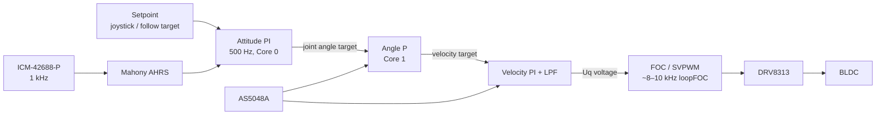

I don't have access to the contents of `osmo-pocket-esp32-gimbal`, so this README describes a **coherent reference design** built on common, well-documented parts: ESP32-S3, SimpleFOC, AS5048A encoders, DRV8313 drivers, and an ICM-42688-P IMU. Wherever your hardware or firmware differs, especially pin numbers, part choices, and default gains, replace my values with yours. The pin map has been checked against ESP32-S3 strapping, flash, and PSRAM constraints.

---

````markdown
# osmo-pocket-esp32-gimbal

> Open-source, 3-axis handheld camera stabilizer inspired by the DJI Osmo Pocket form factor.
> ESP32-S3 + Field-Oriented Control (SimpleFOC) + absolute magnetic encoders + 6-DoF IMU.


---

## Table of Contents

1. [Features](#features)
2. [Safety Notice](#safety-notice)
3. [System Overview](#system-overview)
4. [Hardware](#hardware)
5. [Wiring & Pinout](#wiring--pinout)
6. [Firmware Architecture](#firmware-architecture)
7. [Build & Flash](#build--flash)
8. [First Power-Up / Bring-Up Checklist](#first-power-up--bring-up-checklist)
9. [FOC Tuning Procedure](#foc-tuning-procedure)
10. [Stabilization Loop Tuning](#stabilization-loop-tuning)
11. [Operating Modes & Controls](#operating-modes--controls)
12. [Serial Command Reference](#serial-command-reference)
13. [Bill of Materials](#bill-of-materials)
14. [Troubleshooting](#troubleshooting)
15. [Roadmap](#roadmap)
16. [Contributing](#contributing)
17. [License](#license)

---

## Features

- **3-axis brushless stabilization** (yaw / pitch / roll) with closed-loop FOC on every axis
- **Absolute 14-bit encoders** (AS5048A, SPI). The gimbal knows its joint angles at power-on, so no homing sweep is needed
- **ICM-42688-P IMU** at 1 kHz with a Mahony attitude filter
- **Cascaded control:** IMU attitude loop → joint angle loop → velocity loop → FOC voltage/torque
- **Dual-core scheduling:** Core 1 runs the FOC inner loops and Core 0 runs attitude, UI, and telemetry
- **Modes:** Follow, Pan-Lock, FPV, Recenter, Motors-Off
- Thumb joystick + mode button, WS2812 status LED
- **Runtime tuning** over USB serial (SimpleFOC Commander), with parameters persisted to NVS
- **Battery monitoring** with under-voltage cutoff (3S LiPo)

---

## Safety Notice

> ⚠️ **Read before powering motors.**
>
> - Gimbal motors can heat to **>80 °C** within minutes if the voltage limit is set too high or the
>   sensor alignment is wrong. Start every new build with `voltage_limit ≤ 3 V`.
> - LiPo batteries can catch fire. Use a balance charger, never discharge below 3.0 V/cell, and
>   never leave the device charging unattended.
> - Keep fingers clear of the arms during first power-up. A wrong motor direction causes a
>   violent runaway.
> - Always connect battery **after** USB when debugging, and confirm that the `EN` pins default low.

---

## System Overview

### Block Diagram

```
                         ┌──────────────────────────────────────────────┐
   3S LiPo 11.1 V ──┬───►│ Power Board                                  │
   (450–850 mAh)    │    │  • Reverse-polarity P-FET                    │
                    │    │  • 5 A polyfuse                              │
                    │    │  • Buck 11.1 V → 5 V (MP1584 / TPS62933)     │
                    │    │  • LDO 5 V → 3.3 V (on ESP32 module board)   │
                    │    │  • VBAT divider 100k/22k → ADC               │
                    │    └───────┬──────────────────────┬───────────────┘
                    │            │ 3V3 / 5V             │ VMOT (11.1 V)
                    │            ▼                      ▼
                    │   ┌────────────────────┐  ┌───────────────────────┐
                    │   │   ESP32-S3-WROOM   │  │ 3× DRV8313 (SimpleFOC │
                    │   │       (N16R8)      │  │  Mini) 3-phase drivers│
                    │   │                    │  └──┬─────────┬────────┬─┘
                    │   │ Core 1: FOC ×3     │PWM │         │        │
                    │   │  (MCPWM0, MCPWM1,  ├────┘         │        │
                    │   │   LEDC)            │     ┌────────▼┐ ┌─────▼──┐ ┌────────┐
                    │   │ Core 0: IMU, AHRS, │     │ Yaw BLDC│ │Pitch   │ │ Roll   │
                    │   │  modes, UI, CLI    │     │ 2204    │ │ BLDC   │ │ BLDC   │
                    │   │                    │     └────┬────┘ └───┬────┘ └───┬────┘
                    │   │        FSPI bus ◄──┼──────────┴──────────┴──────────┘
                    │   │  (SCK/MOSI/MISO)   │     AS5048A encoders (3× CS)
                    │   │                    │◄──── ICM-42688-P IMU (CS + INT)
                    │   │                    │      mounted on camera plate
                    │   │  ADC ◄─ joystick   │
                    │   │  GPIO0 ◄─ mode btn │
                    │   │  GPIO48 ─► WS2812  │
                    │   │  USB-CDC ◄─► host  │
                    │   └────────────────────┘
```

### Control Loop Hierarchy



### Mechanical Axis Order

`Handle → Yaw (pan) motor → Roll motor → Pitch (tilt) motor → Camera plate + IMU`

The IMU **must** be rigidly mounted on the camera plate, after the last motor. It must not be mounted on the handle.

---

## Hardware

| Subsystem   | Part                                  | Why                                                     |
|-------------|---------------------------------------|---------------------------------------------------------|
| MCU         | ESP32-S3-WROOM-1 **N16R8**            | Dual core, 2× MCPWM units, native USB, FPU              |
| Motor driver| DRV8313 (SimpleFOC Mini v1.x) ×3      | 8–60 V, 2.5 A peak, tiny footprint, 3PWM + EN           |
| Motors      | 2204 260 KV gimbal BLDC, 12N14P (7 PP)| High-resistance winding (~10 Ω) suits voltage-mode FOC  |
| Encoders    | AS5048A (SPI, 14-bit) ×3              | Absolute, shared SPI bus, no I²C address conflicts      |
| IMU         | ICM-42688-P (SPI)                     | Low noise, 1–32 kHz ODR, good temp stability            |
| Battery     | 3S LiPo 450–850 mAh                   | DRV8313 needs ≥ 8 V; 2S sags below that under load      |

> **Why not AS5600?** The AS5600 has a fixed I²C address, so three of them would need an I²C mux. Its
> analog/I²C latency is also worse for 3 simultaneous FOC loops.

> **Why not 2S?** 2S cells reach 6.0 V near empty, which is below the DRV8313's 8 V UVLO. For a 2S
> build, use TMC6300 drivers (2–11 V). These need 6PWM, so the pinout must be redone.

---

## Wiring & Pinout

### ESP32-S3 Pin Map

Constraints respected: strapping pins **3, 45, 46** are unused. **0** (BOOT) is used only as an input after boot. Pins **26–37** are reserved for flash/octal PSRAM on N16R8, and **19/20** are reserved for native USB.

| Function              | GPIO | Peripheral      | Notes                                        |
|-----------------------|------|-----------------|----------------------------------------------|
| **Yaw** PWM A         | 4    | MCPWM0          |                                              |
| **Yaw** PWM B         | 5    | MCPWM0          |                                              |
| **Yaw** PWM C         | 6    | MCPWM0          |                                              |
| **Yaw** EN            | 7    | GPIO out        | 10 kΩ pull-down: motors off at reset         |
| **Pitch** PWM A       | 15   | MCPWM1          |                                              |
| **Pitch** PWM B       | 16   | MCPWM1          |                                              |
| **Pitch** PWM C       | 17   | MCPWM1          |                                              |
| **Pitch** EN          | 18   | GPIO out        | 10 kΩ pull-down                              |
| **Roll** PWM A        | 38   | LEDC            | Third motor falls back to LEDC (S3 has 2 MCPWM units) |
| **Roll** PWM B        | 39   | LEDC            |                                              |
| **Roll** PWM C        | 40   | LEDC            |                                              |
| **Roll** EN           | 41   | GPIO out        | 10 kΩ pull-down                              |
| SPI SCK               | 12   | FSPI            | Shared: 3 encoders + IMU                     |
| SPI MOSI              | 11   | FSPI            |                                              |
| SPI MISO              | 13   | FSPI            |                                              |
| C