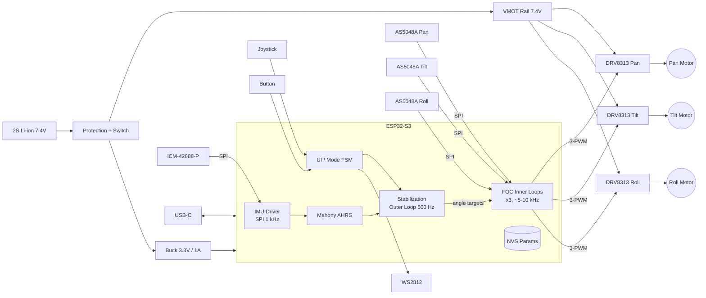

I don't have access to this repository's actual source, prior revisions, or the earlier "cycles," so this README is a complete reference design built on common, well-supported choices: ESP32-S3, SimpleFOC, DRV8313 drivers, AS5048A encoders, and an ICM-42688-P IMU. **Pin assignments, part numbers, and tuning values are working defaults.** Check them against your schematic and `config.h` before publishing.

---

````markdown
# osmo-pocket-esp32-gimbal

> Open-source, 3-axis handheld brushless gimbal inspired by the DJI Osmo Pocket form factor, built on the ESP32-S3 with field-oriented control (FOC) of three gimbal motors.


---

## Table of Contents

1. [Features](#features)
2. [System Architecture](#system-architecture)
3. [Hardware](#hardware)
4. [Wiring & Pinout](#wiring--pinout)
5. [Power System](#power-system)
6. [Firmware Build & Flash](#firmware-build--flash)
7. [First Power-Up Checklist](#first-power-up-checklist)
8. [FOC Tuning Procedure](#foc-tuning-procedure)
9. [Stabilization Loop Tuning](#stabilization-loop-tuning)
10. [Operating Modes & Controls](#operating-modes--controls)
11. [Serial Command Reference](#serial-command-reference)
12. [Bill of Materials](#bill-of-materials)
13. [Troubleshooting](#troubleshooting)
14. [Safety](#safety)
15. [Roadmap](#roadmap)
16. [Contributing](#contributing)
17. [License](#license)

---

## Features

- **3-axis stabilization** (pan / tilt / roll) using closed-loop FOC on each axis.
- **Absolute magnetic encoders** (14-bit AS5048A) on every motor, so commutation is smooth at near-zero speed.
- **6-DoF IMU fusion** (ICM-42688-P, Mahony filter, 1 kHz) for camera-frame attitude estimation.
- **Modes:** Follow, Pan-Follow, Lock, FPV, and Recenter.
- **Analog joystick + single button** UI, plus a WS2812 status LED.
- **USB-CDC serial console** with live tuning (SimpleFOC Commander) and parameters persisted to NVS.
- **Battery monitoring** with under-voltage cut-off.
- **Fault handling:** driver nFAULT, encoder CRC/parity errors, IMU timeout, and stall detection all disable the motors safely.

---

## System Architecture

### Block Diagram



### Control Loop Hierarchy

```
 ┌──────────────────────────── Core 1 ────────────────────────────┐
 │                                                                │
 │  IMU (1 kHz) ─► Mahony AHRS ─► camera attitude q_cam           │
 │                                     │                          │
 │  User setpoint (joystick/mode) ─► q_target                     │
 │                                     ▼                          │
 │        Stabilization PID per axis (500 Hz)                     │
 │                                     │  motor angle target      │
 │                                     ▼                          │
 │   ┌─────────── FOC loop per motor (loopFOC ~5–10 kHz) ───────┐ │
 │   │ angle P ─► velocity PI ─► voltage Uq ─► SVPWM ─► DRV8313 │ │
 │   │     ▲            ▲                                       │ │
 │   │     └── encoder ─┘  (AS5048A, 14-bit)                    │ │
 │   └──────────────────────────────────────────────────────────┘ │
 └────────────────────────────────────────────────────────────────┘
 ┌──────────────────────────── Core 0 ────────────────────────────┐
 │  USB console / Commander, UI FSM, battery monitor, NVS, LED    │
 └────────────────────────────────────────────────────────────────┘
```

### Kinematic Order

The axes are ordered **Pan (base, handle) → Roll → Tilt (camera)**. This matches the Osmo Pocket and avoids gimbal lock in normal handheld poses. If your mechanics use a different order, change `GIMBAL_AXIS_ORDER` in `config.h`.

---

## Hardware

| Subsystem | Default Part | Notes |
|---|---|---|
| MCU | ESP32-S3-WROOM-1 N8R8 | Dual-core 240 MHz, native USB. Octal PSRAM reserves GPIO 33–37. |
| Motor driver | TI DRV8313 (×3) | 3-phase, 2.5 A peak, 8–60 V, nFAULT output. |
| Motors | 2204 / 2804 gimbal BLDC (×3) | 7 pole pairs typical, roughly 10–15 Ω phase resistance. |
| Encoders | AS5048A (×3) | SPI, 14-bit. Diametric magnet on the motor shaft. |
| IMU | ICM-42688-P | SPI. Mount it rigidly on the **camera plate**, not the handle. |
| Battery | 2S 18650 or 2S LiPo (≥1500 mAh) | 6.0–8.4 V. |
| Camera | User payload | Up to ~80 g with stock motors. |

---

## Wiring & Pinout

### ESP32-S3 GPIO Assignment

> ⚠️ Do not use GPIO 26–37 (flash/PSRAM) or strapping pins 3, 45, and 46 for outputs. GPIO 19/20 are reserved for native USB.

| Function | GPIO | Dir | Notes |
|---|---|---|---|
| **Pan** PWM A / B / C | 5 / 6 / 7 | OUT | LEDC / MCPWM, 25 kHz |
| **Pan** EN (EN1–3 tied) | 15 | OUT | Active high |
| **Tilt** PWM A / B / C | 8 / 9 / 10 | OUT | |
| **Tilt** EN | 16 | OUT | |
| **Roll** PWM A / B / C | 11 / 12 / 13 | OUT | |
| **Roll** EN | 17 | OUT | |
| Driver nFAULT (wired-OR) | 14 | IN | Open-drain, 10 kΩ pull-up to 3V3 |
| SPI SCK | 18 | OUT | Shared bus, 10 MHz max (AS5048A) |
| SPI MOSI | 21 | OUT | |
| SPI MISO | 47 | IN | |
| CS – IMU | 38 | OUT | 10 kΩ pull-up |
| CS – Enc Pan | 39 | OUT | 10 kΩ pull-up |
| CS – Enc Tilt | 40 | OUT | 10 kΩ pull-up |
| CS – Enc Roll | 41 | OUT | 10 kΩ pull-up |
| IMU INT1 | 42 | IN | Data-ready interrupt |
| VBAT sense | 1 | ADC1_CH0 | Divider 100 k / 33 k |
| Joystick X | 2 | ADC1_CH1 | |
| Joystick Y | 4 | ADC1_CH3 | |
| Button | 0 | IN | Shared with BOOT, internal pull-up |
| Status LED (WS2812) | 48 | OUT | Onboard on DevKitC-1 |
| USB D− / D+ | 19 / 20 | — | Native USB-CDC |

### Driver Wiring (one DRV8313 per axis)

```
   ESP32-S3                  DRV8313                     Motor
 ┌──────────┐            ┌─────────────┐            ┌───────────┐
 │ PWM_A ───┼───────────►│ IN1    OUT1 ├───────────►│ Phase U   │
 │ PWM_B ───┼───────────►│ IN2    OUT2 ├───────────►│ Phase V   │
 │ PWM_C ───┼───────────►│ IN3    OUT3 ├───────────►│ Phase W   │
 │ EN    ───┼──┬────────►│ EN1         │            └───────────┘
 │          │  ├────────►│ EN2         │
 │          │  └────────►│ EN3         │
 │ 3V3   ───┼───────────►│ nRESET      │
 │ 3V3   ───┼───────────►│ nSLEEP      │
 │ nFAULT ◄─┼────────────┤ nFAULT      │ (open-drain, wired-OR all 3)
 │ GND   ───┼────────────┤ GND   VM ◄──┼── VMOT 7.4V (+ 100 µF + 0.1 µF)
 └──────────┘            └─────────────┘
```

### SPI Bus Topology

```
 SCK/MOSI/MISO ──┬───────────┬────────────┬────────────┐
                 │           │            │            │
            ICM-42688-P  AS5048A Pan  AS5048A Tilt  AS5048A Roll
              CS=38        CS=39        CS=40         CS=41
```

- Encoders on rotating axes connect through the motor slip path or flex cables. Keep each SPI run **under 15 cm** and use twisted pairs with GND.
- The IMU is read at 1 kHz, and the encoders are read on demand inside `loopFOC()`. A single SPI host (`SPI2_HOST`) with per-transaction mode switching is used, because the AS5048A uses SPI mode 1 and the ICM-42688 uses mode 0/3.

### Encoder Magnet Placement

- Use a diametrically magnetized 6×2.5 mm N35 magnet glued to the motor shaft end.
- Set the air gap to 0.5–2.0 mm and center it within ±0.25 mm.
- Check the AGC value (`ENC <axis> DIAG`). It should read 60–200. Values near 0 or 255 mean the magnet is too close or too far.

---

## Power System

```
 2S Battery ─► Protection (BMS/PTC) ─► Slide Switch ─┬─► VMOT (7.4 V) ─► DRV8313 ×3
                                                    │
                                                    └─► Buck 3.3 V/1 A ─► ESP32, IMU, Encoders
 VBAT ─► 100k ─┬─► GPIO1 (ADC)
               33k
               │
              GND
```

| Parameter | Value |
|---|---|
| Nominal VMOT | 7.4 V |
| Under-volt