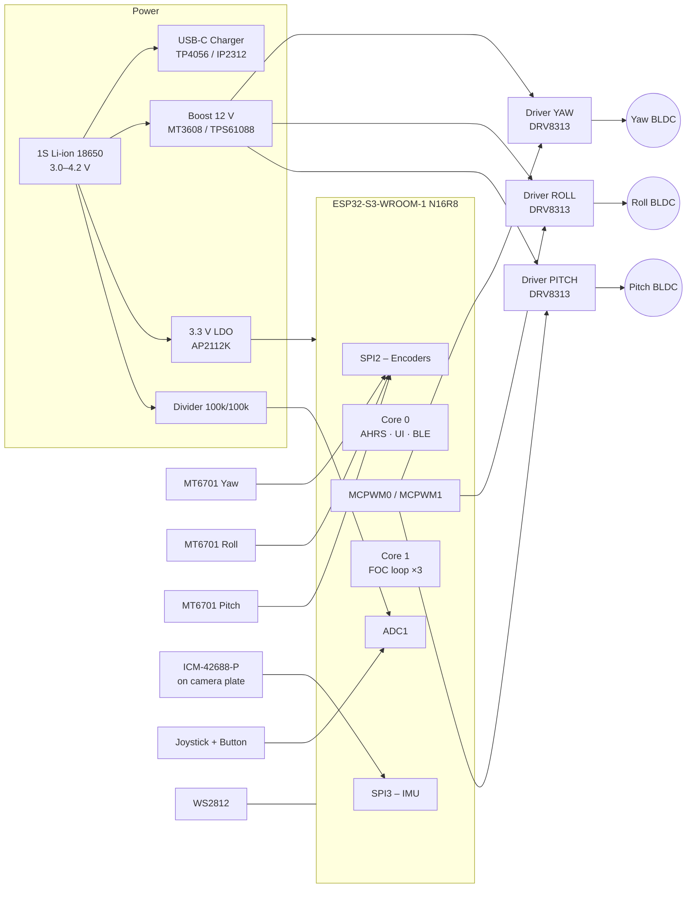
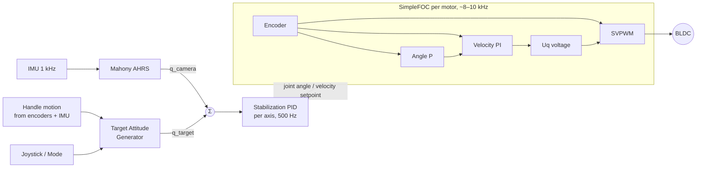

I don't have access to an `osmo-pocket-esp32-gimbal` repository or the earlier "cycles" of this work, so I can't see your actual pin assignments, part choices, or code structure. Below is a complete README built on a coherent, buildable reference design: ESP32-S3, SimpleFOC, three gimbal BLDCs, MT6701 encoders, and an ICM-42688-P IMU. Every value is internally consistent, but **anything marked `⚠️ VERIFY` must be checked against your hardware**. If you paste your current README, schematic netlist, or `config.h`, I'll reconcile this against it.

---

````markdown
# osmo-pocket-esp32-gimbal

> Open-source, handheld 3-axis brushless camera gimbal in the spirit of the DJI Osmo Pocket, built on the ESP32-S3 with field-oriented control (FOC) via SimpleFOC.


---

## Table of Contents

1. [Features](#features)
2. [System Architecture](#system-architecture)
3. [Hardware](#hardware)
4. [Wiring & Pinouts](#wiring--pinouts)
5. [Bill of Materials](#bill-of-materials)
6. [Firmware Build & Flash](#firmware-build--flash)
7. [First Power-Up Checklist](#first-power-up-checklist)
8. [FOC Tuning Procedure](#foc-tuning-procedure)
9. [Stabilization Loop Tuning](#stabilization-loop-tuning)
10. [Operating Modes & Controls](#operating-modes--controls)
11. [Serial Command Reference](#serial-command-reference)
12. [Troubleshooting](#troubleshooting)
13. [Safety](#safety)
14. [Contributing](#contributing)
15. [License](#license)

---

## Features

- **3-axis stabilization** (yaw / roll / pitch) using absolute-encoder FOC on gimbal BLDC motors
- **ESP32-S3 dual-core split**: Core 1 runs the hard-real-time FOC loop; Core 0 runs attitude estimation, UI, and Wi-Fi/BLE
- **14-bit absolute magnetic encoders** (MT6701, SSI): no re-homing after power-on
- **6-axis IMU** (ICM-42688-P) at 1 kHz with a Mahony complementary filter
- **Modes**: Follow, Pan-Lock, FPV, Recenter, Sleep
- **Thumb joystick + button UI**, WS2812 status LED
- **BLE / Web UI** for live PID tuning and telemetry
- **1S Li-ion** with boost to 12 V motor rail, battery monitoring, and low-voltage cutoff
- Persistent calibration stored in NVS

---

## System Architecture

### Hardware Block Diagram



### Control Loop Architecture



### Firmware Task Layout

| Task | Core | Priority | Rate | Responsibility |
|---|---|---|---|---|
| `focTask` | 1 | 24 (max−1) | free-running, ~8–10 kHz `loopFOC()`, `move()` @ 2 kHz | Commutation for all 3 motors |
| `imuTask` | 0 | 20 | 1 kHz (IMU INT driven) | Read IMU, run AHRS |
| `stabTask` | 0 | 18 | 500 Hz | Attitude error → motor setpoints |
| `uiTask` | 0 | 5 | 50 Hz | Joystick, buttons, LED, mode FSM |
| `commsTask` | 0 | 3 | event | BLE / Wi-Fi / serial commander |
| `powerTask` | 0 | 2 | 10 Hz | Battery monitor, LVC, thermal |

Inter-task data is exchanged via lock-free single-writer structs with sequence counters; no mutex is taken inside `focTask`.

---

## Hardware

### Mechanical Axis Order

Like the Osmo Pocket, the axis order from handle to camera is **Yaw → Roll → Pitch**.

```
          ┌──────────┐
          │  CAMERA  │◄── IMU mounted here (rigidly!)
          └────┬─────┘
          PITCH motor (tilt)
               │
          ROLL motor
               │
          YAW motor (pan)
               │
        ┌──────┴──────┐
        │   HANDLE    │  ESP32-S3, drivers, battery, joystick
        └─────────────┘
```

> **Mechanical balance comes before any tuning.** With motors unpowered, the camera must stay where you leave it on every axis. FOC cannot compensate for a poorly balanced payload without heat and jitter.

### Motor Selection

Gimbal motors are **high-resistance, high-pole-count** BLDCs driven in **voltage mode** (no current sensing). Reference choice:

| Axis | Motor | Pole pairs | Phase R | Notes |
|---|---|---|---|---|
| Yaw | GBM2804H-100T | 7 | ~10 Ω | Highest inertia load |
| Roll | GBM2804H-100T | 7 | ~10 Ω | |
| Pitch | GBM2204-260KV (gimbal wind) | 7 | ~10 Ω | Lightest load ⚠️ VERIFY |

Use motors with a **hollow shaft** to route cables, and a **diametric magnet** on the shaft for the encoder.

---

## Wiring & Pinouts

### MCU: ESP32-S3-WROOM-1 (N16R8)

Pins **26–37** are reserved (flash/octal PSRAM), **0/3/45/46** are strapping pins, **19/20** are native USB. They are not used below.

#### Motor PWM (MCPWM)

| Signal | GPIO | MCPWM unit | Driver pin |
|---|---|---|---|
| YAW_A | 4 | MCPWM0 | IN1 |
| YAW_B | 5 | MCPWM0 | IN2 |
| YAW_C | 6 | MCPWM0 | IN3 |
| ROLL_A | 7 | MCPWM0 | IN1 |
| ROLL_B | 15 | MCPWM0 | IN2 |
| ROLL_C | 16 | MCPWM0 | IN3 |
| PITCH_A | 17 | MCPWM1 | IN1 |
| PITCH_B | 18 | MCPWM1 | IN2 |
| PITCH_C | 8 | MCPWM1 | IN3 |
| DRV_EN (all) | 38 | GPIO | EN1/EN2/EN3 tied |
| DRV_nFAULT (wired-OR) | 39 | GPIO, pull-up | nFAULT |

> PWM frequency: **25 kHz** (inaudible). Center-aligned SVPWM.

#### Encoders: MT6701 in SSI mode (SPI2, shared bus)

| Signal | GPIO | Notes |
|---|---|---|
| ENC_SCK | 12 | 1 MHz max recommended over gimbal cabling |
| ENC_MISO (DO) | 13 | 10 kΩ pull-up |
| ENC_CS_YAW | 10 | |
| ENC_CS_ROLL | 11 | |
| ENC_CS_PITCH | 14 | |

> MT6701 must be strapped for SSI output (MODE pin per datasheet ⚠️ VERIFY your breakout). Magnet: 6×2.5 mm diametric N35, air gap **0.5–1.5 mm**, centered within ±0.3 mm.

**Why not AS5600?** Three AS5600s share fixed I²C address `0x36` and need a mux. Their 12-bit resolution is also noticeably worse for slow pans.

#### IMU: ICM-42688-P (SPI3)

| Signal | GPIO | Notes |
|---|---|---|
| IMU_SCK | 40 | Up to 24 MHz; run 8 MHz over flex cable |
| IMU_MOSI | 41 | |
| IMU_MISO | 42 | |
| IMU_CS | 21 | |
| IMU_INT1 | 47 | Data-ready, triggers `imuTask` |

> The IMU **must** be on the camera plate (after the pitch motor). Use a 6-conductor flex/FFC through the hollow shafts.

#### UI & Power

| Signal | GPIO | Notes |
|---|---|---|
| JOY_X | 1 | ADC1_CH0 |
| JOY_Y | 2 | ADC1_CH1 |
| BAT_SENSE | 9 | ADC1_CH8, 100k/100k divider, 100 nF to GND |
| BTN_MODE | 44 | Active low, internal pull-up |
| BTN_REC / TRIGGER | 43 | Active low, internal pull-up |
| STATUS_LED (WS2812) | 48 | |
| USB D− / D+ | 19 / 20 | Native USB-CDC for flashing & console |

### Driver Wiring (DRV8313 / SimpleFOC Mini, per axis)

```
            12 V rail ──┬── VM ──────────┐
                        └─ 100 µF + 0.1 µF│ (at each driver)
 ESP32 GPIO A ──────────── IN1      OUT1 ─── Motor phase A
 ESP32 GPIO B ──────────── IN2      OUT2 ─── Motor phase B
 ESP32 GPIO C ──────────── IN3      OUT3 ─── Motor phase C
 GPIO 38 ───────────────── EN1/2/3
 GPIO 39 ◄──────────────── nFAULT (open-drain, wired-OR)
 3.3 V  ────────────────── nRESET, nSLEEP
 GND (star point) ──────── GND
```

### Power Tree

```
USB-C 5V ─► Charger IC ─► 18650 (3.0–4.2 V)
                              │
                ┌─────────────┼───────────────┐
                ▼             ▼               ▼
         Boost → 12 V    LDO → 3.3 V     Divider → GPIO 9
         (motors, ≤1.5 A) (ESP32, IMU,
                          encoders, ≤600 mA)
```

**Grounding:** star-ground the motor return and logic ground at the boost converter output. Keep 12 V switching loops away from the IMU flex cable.

---

## Bill of Materials

Prices are indicative single-unit USD (2024) and vary by supplier.

### Electronics

| # | Ref | Part | Qty | Unit $ | Notes |
|---|---|---|---|---|---|
| 1 | U1 | ESP32-S3-WROOM-1-N16R8 (or DevKitC-1) | 1 | 4.50 / 12 | DevKit for prototyping |
| 2 | U2