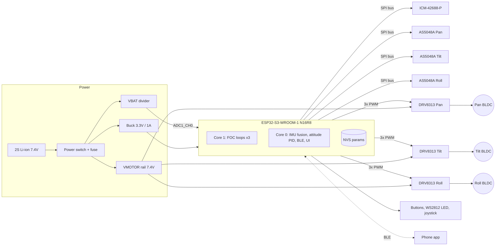

> **Note:** I don't have the repository contents or the outputs of Cycles 1–3. This README is built on a coherent reference design: ESP32-S3, three gimbal BLDCs, SimpleFOC, AS5048A encoders, and an ICM-42688-P IMU. Every pin, part number, and gain marked ⚙️ is a design assumption. Diff it against your schematic and firmware before merging.

---

```markdown
# osmo-pocket-esp32-gimbal

**An open-source, 3-axis handheld stabilizer in the Osmo-Pocket form factor, built on the ESP32-S3 and field-oriented control (FOC).**


> ⚠️ This is an independent hobby project. It is **not affiliated with, endorsed by, or derived from DJI**. "Osmo Pocket" is used only to describe the target form factor.

---

## Table of Contents

1. [Features](#features)
2. [System Architecture](#system-architecture)
3. [Hardware](#hardware)
4. [Wiring & Pinout](#wiring--pinout)
5. [Bill of Materials](#bill-of-materials)
6. [Firmware Build & Flash](#firmware-build--flash)
7. [First Power-On Checklist](#first-power-on-checklist)
8. [FOC Tuning Procedure](#foc-tuning-procedure)
9. [Stabilization Loop Tuning](#stabilization-loop-tuning)
10. [Serial Command Reference](#serial-command-reference)
11. [Troubleshooting](#troubleshooting)
12. [Safety](#safety)
13. [Roadmap](#roadmap)
14. [Contributing](#contributing)
15. [License](#license)

---

## Features

- **3-axis stabilization** (pan / tilt / roll) using closed-loop FOC on hollow-shaft gimbal BLDCs.
- **Absolute magnetic encoders** (14-bit AS5048A over SPI) on every axis, so there is no homing dance on boot.
- **High-rate IMU fusion**: ICM-42688-P at 1 kHz, with a Mahony filter running in a dedicated FreeRTOS task.
- **Dual-core scheduling**:
  - Core 1 runs the FOC inner loops (~8–10 kHz combined).
  - Core 0 runs IMU fusion, the attitude controller, BLE/Wi-Fi, and the UI.
- **Follow modes**: Lock, Pan-Follow, FPV (all-follow), and Recenter.
- **Live tuning** over USB-CDC with the SimpleFOC `Commander` and a persistent NVS parameter store.
- **2S Li-ion power path** with battery monitoring, low-voltage cutoff, and soft motor enable.
- **Optional BLE control** via joystick and mode switching from a phone.

---

## System Architecture

### Block diagram



### Control loop hierarchy

```
            ┌───────────────────── Core 0 (500 Hz – 1 kHz) ─────────────────────┐
 User/Mode ─►  Setpoint gen  ─►  Attitude PID (per axis)  ─► target angle/vel ──┼─┐
            │        ▲                    ▲                                    │ │
            │        │             IMU quaternion ◄── Mahony ◄── ICM-42688-P   │ │
            └────────┼───────────────────────────────────────────────────────┘ │
                     │                                                          │
            ┌────────┼────────────── Core 1 (≥ 2.5 kHz per motor) ────────────┐ │
            │        │                                                         │ │
            │   Angle P ─► Velocity PI ─► Uq (voltage-mode FOC) ─► SVPWM ─► DRV ◄┘
            │      ▲            ▲                                              │
            │      └──── AS5048A encoder (14-bit) ◄────────────────────────────┘
            └─────────────────────────────────────────────────────────────────┘
```

| Loop | Rate | Core | Owner |
|---|---|---|---|
| FOC commutation (`loopFOC`) | ≥ 2.5 kHz / motor | 1 | `src/foc/foc_task.cpp` |
| Motion control (`move`) | 1 kHz / motor | 1 | `src/foc/foc_task.cpp` |
| IMU read + Mahony | 1 kHz | 0 | `src/imu/imu_task.cpp` |
| Attitude controller | 500 Hz | 0 | `src/control/attitude.cpp` |
| UI / BLE / telemetry | 50 Hz | 0 | `src/app/` |

### Repository layout

```
├── hardware/
│   ├── kicad/            # Schematic + PCB (main board, motor flex)
│   ├── mechanical/       # STEP / STL for arms, handle, camera cradle
│   └── bom/              # BOM.csv (source of truth for the BOM table)
├── firmware/
│   ├── platformio.ini
│   ├── include/board_pins.h      # ← single source of truth for pinout
│   ├── src/
│   │   ├── foc/  imu/  control/  app/  util/
│   │   └── main.cpp
│   └── test/
├── tools/
│   ├── tune_plot.py      # Live plotting of Commander monitor output
│   └── calib_imu.py      # 6-point accelerometer calibration
└── docs/
```

---

## Hardware

| Subsystem | Choice | Rationale |
|---|---|---|
| MCU | ESP32-S3-WROOM-1-N16R8 | Dual core, MCPWM ×2 (12 outputs), native USB, BLE 5 |
| Motor driver | TI DRV8313 (×3) | 3-phase half-bridge, 8–60 V, integrated, small QFN/HTSSOP |
| Motors | 2204 260KV hollow-shaft gimbal (pan/tilt), 2206 for pan if payload > 120 g | High-resistance windings, so voltage-mode FOC works without current sensing |
| Encoders | AS5048A (SPI, 14-bit) | Absolute angle, SPI shares a bus with the IMU, no I²C address clash |
| IMU | ICM-42688-P | Low noise, 32 kHz ODR capable, SPI |
| Battery | 2S 18350 or 2S 1000 mAh LiPo | ~7.4 V nominal suits gimbal motors at 10–12 Ω |

> **Why voltage-mode FOC?** Gimbal motors have a high phase resistance (~10 Ω), so current ≈ Uq / R is predictable. That lets us skip phase-current sensing, which saves board area and ADC pins. Current sensing is on the [roadmap](#roadmap).

---

## Wiring & Pinout

> The canonical pin map lives in `firmware/include/board_pins.h`. **If this table and that header disagree, the header wins.** Please open a PR to fix the README.

### ESP32-S3 pin assignment ⚙️

Pins to avoid on the S3:

- **Strapping pins**: GPIO 0, 3, 45, 46.
- **Native USB**: GPIO 19 and 20.
- **Flash and octal PSRAM** on N16R8 modules: GPIO 26–37.

| Function | Signal | GPIO | Notes |
|---|---|---|---|
| **Pan motor** | PWM A / B / C | 4 / 5 / 6 | MCPWM0 |
| **Tilt motor** | PWM A / B / C | 7 / 15 / 16 | MCPWM0 |
| **Roll motor** | PWM A / B / C | 17 / 18 / 8 | MCPWM1 |
| Motor drivers | nEN (shared) / nSLEEP | 9 | 10 kΩ pulldown, so motors are off on reset |
| Motor drivers | nFAULT (wired-OR) | 2 | 10 kΩ pull-up to 3V3 |
| **SPI bus** | SCK / MOSI / MISO | 12 / 11 / 13 | 10 MHz (AS5048A max 10 MHz) |
| Encoder Pan | CS | 10 | |
| Encoder Tilt | CS | 14 | |
| Encoder Roll | CS | 21 | |
| IMU | CS / INT1 | 38 / 39 | INT1 = data-ready |
| Battery sense | VBAT_ADC | 1 | ADC1_CH0, 100k/33k divider |
| UI | Button MODE / REC | 40 / 41 | Active-low, internal pull-up |
| UI | Joystick X / Y | — | Optional: use GPIO 1-adjacent ADC1 pins if added |
| UI | WS2812 data | 48 | |
| Debug | USB D− / D+ | 19 / 20 | Native USB-CDC + JTAG |
| Debug | UART0 TX / RX | 43 / 44 | Boot log |

### Driver wiring (one of three, DRV8313)

```
 ESP32-S3                 DRV8313                      Gimbal motor
 ────────                 ───────                      ────────────
 PWM_A ───────────────►  IN1        OUT1 ─────────────► Phase A
 PWM_B ───────────────►  IN2        OUT2 ─────────────► Phase B
 PWM_C ───────────────►  IN3        OUT3 ─────────────► Phase C
 3V3   ───────────────►  EN1/EN2/EN3 (tied high)
 GPIO9 (nEN) ─────────►  nSLEEP + nRESET
 GPIO2  ◄──────────────  nFAULT (open-drain)
                         VM  ◄── VMOTOR (7.4 V) ── 10 µF X7R + 100 µF bulk
                         V3P3OUT ── 1 µF (do NOT use to power MCU)
                         CPL/CPH ── 0.01 µF; VCP ── 0.1 µF to VM
```

### Encoder wiring (AS5048A)

```
 AS5048A pin   →  Connection
 VDD5V, VDD3V  →  3V3 (bridge both for 3.3 V operation)
 GND           →  GND
 CSn           →  per-axis CS GPIO
 CLK / MOSI / MISO → shared SPI bus
```

- **Magnet**: diametrically magnetized, 6 × 2.5 mm.
- **Air gap**: 0.5–2.0 mm, centred on the motor shaft within ±0.25 mm.

### Power

```
 BAT+ ──[PTC 2A]──[slide switch]──┬── VMOTOR (to 3x DRV8313 VM)
                                  ├── Buck (TPS62162 / MP2359) ── 3V3 (ESP32, IMU, encoders)
                                  └── 100k ──┬── 33k ── GND
                                             └── GPIO1 (VBAT_ADC)  [Vadc = Vbat × 0.248]
```

### Connectors & cable colours (convention)

| Cable | Colour | Signals |
|---|---|---|
| Motor | Black / Red / Yellow | A / B / C |
| Encoder (6-pin JST-SH) | — | 3V3, GND, SCK, MOSI, MISO, CS |

Any motor-wire order works. If the motor turns the wrong way, swap two phases *or* let the alignment step detect the direction.

---

## Bill of Materials

> Prices are indicative single-unit USD (2024) ⚙️. `hardware/bom/BOM.csv` is authoritative and includes MPNs and LCSC/Digi-Key numbers.

### Electronics

| # | Qty | Part | Example MPN | Function | ~Unit $ |
|---|---|---|---|---|---|
| 1 | 1 | ESP32-S3 module | ESP32-S3-WROOM-1-N16R8 | MCU | 4.50 |
| 2 | 3 | 3-phase motor driver | DRV8313PWPR | Motor drive | 2.80 |
| 3 | 3 | Magnetic encoder | AS5048A-HTSP | Absolute angle | 6.50 |
| 4 | 3 | Diametric magnet 6×2.5 mm | N35 diametric | Encoder target | 0.40 |
| 5 | 1 | 6-axis IMU | ICM-42688-P | Attitude | 3.20 |
| 6 | 1 | Buck regulator 3.3 V 1 A | TPS62162DSGR | Logic rail | 1.40 |
| 7