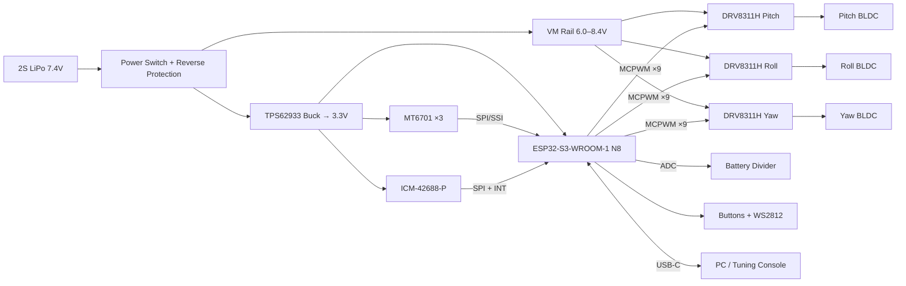

> **Note:** I don't have access to the contents of the `osmo-pocket-esp32-gimbal` repository or the outputs of earlier cycles. This README is a complete reference design built on common, verifiable parts (ESP32-S3, DRV8311H, MT6701, ICM-42688-P, SimpleFOC-style FOC). Before merging, check every pin number, part number, and gain value against your schematic and firmware. Items that most need checking are marked **⚠ VERIFY**.

---

```markdown
# osmo-pocket-esp32-gimbal

An open-source 3-axis handheld gimbal in a pocket form factor. It runs on an ESP32-S3
and uses field-oriented control (FOC) of brushless gimbal motors with absolute
magnetic encoders and a high-rate IMU.


---

## Table of Contents
1. [Features](#features)
2. [System Architecture](#system-architecture)
3. [Hardware](#hardware)
4. [Wiring & Pinouts](#wiring--pinouts)
5. [Bill of Materials](#bill-of-materials)
6. [Firmware: Build & Flash](#firmware-build--flash)
7. [First Power-On & Bring-Up](#first-power-on--bring-up)
8. [FOC Tuning Procedure](#foc-tuning-procedure)
9. [Stabilization Loop Tuning](#stabilization-loop-tuning)
10. [Operating Modes & Controls](#operating-modes--controls)
11. [Telemetry & Commands](#telemetry--commands)
12. [Troubleshooting](#troubleshooting)
13. [Safety](#safety)
14. [Repository Layout](#repository-layout)
15. [Contributing & License](#contributing--license)

---

## Features
- 3-axis stabilization (pan/yaw, tilt/pitch, roll).
- Voltage-mode FOC with SVPWM at 20 kHz.
  - Current loop: 10 kHz.
  - Position loop: 2 kHz.
- 14-bit absolute magnetic encoder on every axis. No homing sweep is needed at boot.
- ICM-42688-P IMU sampled at 2 kHz with a Mahony attitude filter.
- Follow, Lock, and FPV modes. Recenter on double-click.
- 2S LiPo supply with battery voltage monitoring and low-voltage cutoff.
- USB-C for flashing, CDC telemetry, and a live tuning console.
- Optional BLE remote control (NimBLE).
- Fault handling:
  - driver nFAULT
  - encoder CRC errors
  - IMU timeout
  - stall detection
  - thermal derate

---

## System Architecture

### Block Diagram



### Control Loop Hierarchy

```
 Setpoint (mode/joystick)
        │
        ▼
 ┌──────────────────────┐  500 Hz
 │ Attitude Controller  │  IMU quaternion error → per-axis angle target
 └──────────┬───────────┘
            ▼
 ┌──────────────────────┐  2 kHz
 │ Angle Loop (P)       │  encoder angle error → velocity target
 └──────────┬───────────┘
            ▼
 ┌──────────────────────┐  2 kHz
 │ Velocity Loop (PI)   │  velocity error → Uq (voltage)
 └──────────┬───────────┘
            ▼
 ┌──────────────────────┐  10 kHz
 │ FOC / SVPWM          │  Uq, θ_elec → 3-phase duty (MCPWM 20 kHz)
 └──────────────────────┘
```

### Firmware Task Map (FreeRTOS, dual-core)

| Core | Task | Rate | Priority | Notes |
|---|---|---|---|---|
| 1 | `foc_task` | 10 kHz (timer ISR → notify) | 24 | Encoder read, Park/Clarke, SVPWM |
| 1 | `ctrl_task` | 2 kHz | 22 | Angle and velocity loops |
| 0 | `imu_task` | 2 kHz (INT-driven) | 20 | FIFO read, Mahony filter |
| 0 | `attitude_task` | 500 Hz | 18 | Mode logic, setpoint generation |
| 0 | `ui_task` | 50 Hz | 5 | Buttons, LED, battery |
| 0 | `comms_task` | event | 4 | USB CDC console, BLE |

---

## Hardware

| Subsystem | Part | Key Spec |
|---|---|---|
| MCU | ESP32-S3-WROOM-1-N8 | 240 MHz dual-core, 2× MCPWM (12 outputs) |
| Motor driver | TI DRV8311H ×3 | 3–20 V, 5 A peak, 3x-PWM mode |
| Motor | 2204 260KV gimbal BLDC ×3 (pitch/roll); 2806 for yaw optional | 7 pole pairs, ~10 Ω phase |
| Encoder | MagnTek MT6701 ×3 | 14-bit, SSI, diametric magnet 6×2.5 mm |
| IMU | TDK ICM-42688-P | SPI 24 MHz, ±2000 dps |
| Regulator | TI TPS62933 | 3.8–30 V in, 3.3 V / 2 A out |
| Battery | 2S LiPo 450–800 mAh, JST-XH balance | 6.0–8.4 V |

**⚠ VERIFY:** Confirm the DRV8311H PWM mode strap resistor value for 3x-PWM against the current TI datasheet.

---

## Wiring & Pinouts

### ESP32-S3 Pin Assignment

These pins avoid the following:
- strapping pins (GPIO0, 3, 45, 46)
- flash/PSRAM pins (GPIO26–37)
- native USB pins (GPIO19, 20)

| GPIO | Function | Peripheral | Direction | Notes |
|---|---|---|---|---|
| 4 | PITCH_PWM_A | MCPWM0 OP0 A | Out | |
| 5 | PITCH_PWM_B | MCPWM0 OP1 A | Out | |
| 6 | PITCH_PWM_C | MCPWM0 OP2 A | Out | |
| 7 | ROLL_PWM_A | MCPWM1 OP0 A | Out | |
| 15 | ROLL_PWM_B | MCPWM1 OP1 A | Out | |
| 16 | ROLL_PWM_C | MCPWM1 OP2 A | Out | |
| 17 | YAW_PWM_A | MCPWM0 OP0 B | Out | Shares timer with pitch (synchronous) |
| 18 | YAW_PWM_B | MCPWM0 OP1 B | Out | |
| 8 | YAW_PWM_C | MCPWM0 OP2 B | Out | |
| 21 | DRV_nSLEEP | GPIO | Out | Common to all 3 drivers, 10 k pulldown |
| 9 | DRV_nFAULT | GPIO (IRQ) | In | Wired-OR open-drain, 10 k pullup |
| 12 | SPI_SCLK | SPI2 (FSPI) | Out | Shared bus |
| 11 | SPI_MOSI | SPI2 | Out | |
| 13 | SPI_MISO | SPI2 | In | |
| 10 | CS_IMU | GPIO | Out | |
| 14 | CS_ENC_PITCH | GPIO | Out | |
| 47 | CS_ENC_ROLL | GPIO | Out | |
| 48 | CS_ENC_YAW | GPIO | Out | |
| 1 | IMU_INT1 | GPIO (IRQ) | In | Data-ready / FIFO watermark |
| 2 | VBAT_SENSE | ADC1_CH1 | Analog | Divider 100 k / 33 k → 8.4 V ≈ 2.08 V |
| 38 | BTN_MAIN | GPIO | In | Active-low, internal pullup |
| 39 | BTN_MODE | GPIO | In | Active-low |
| 40 | LED_DATA | RMT | Out | WS2812B-2020 |
| 41 | AUX_SDA | I2C0 | I/O | Expansion header |
| 42 | AUX_SCL | I2C0 | Out | Expansion header |
| 43/44 | UART0 TX/RX | UART0 | — | Debug header (boot log) |
| 19/20 | USB D−/D+ | USB-OTG/JTAG | — | USB-C |

> **MCPWM note:** Yaw uses the B generators of MCPWM0. Pitch and yaw therefore share
> carrier timers. This is intentional because it phase-locks their PWM. If you move
> yaw to its own timer, update `board_pins.h` and `mcpwm_init()`.

### Motor Driver Connections (per axis)

```
 ESP32-S3                 DRV8311H                    Motor
 ─────────                ────────                    ─────
 PWM_A  ─────────────────► INHA      OUTA ───────────► Phase U
 PWM_B  ─────────────────► INHB      OUTB ───────────► Phase V
 PWM_C  ─────────────────► INHC      OUTC ───────────► Phase W
 DRV_nSLEEP ─────────────► nSLEEP
 DRV_nFAULT ◄──────────── nFAULT (open-drain)
                           MODE  ── strap for 3x-PWM (⚠ VERIFY)
 VM (6–8.4V) ────────────► VM   + 10 µF X7R + 0.1 µF at pin
 GND ────────────────────► GND / PGND (star at bulk cap)
```

### Encoder (MT6701) Connections

| MT6701 Pin | Connect To | Notes |
|---|---|---|
| VDD | 3.3 V | 100 nF decoupling at pin |
| CSN | CS_ENC_x | |
| CLK | SPI_SCLK | SSI mode, ≤ 15.6 MHz; firmware uses 4 MHz |
| DO | SPI_MISO | 22 Ω series resistor at the encoder |
| MODE | GND | Selects SSI interface (⚠ VERIFY on the package variant) |
| GND | GND | |

**Encoder magnet placement:**
- Use a diametrically magnetized magnet.
- Keep the air gap at 0.5–2.0 mm.
- Center the magnet within ±0.3 mm.
- Read the field strength flag at boot. Firmware rejects readings when the field is out of range.

### IMU (ICM-42688-P) Connections

| IMU Pin | Connect To |
|---|---|
| VDD, VDDIO | 3.3 V (separate 100 nF + 2.2 µF) |
| CS | CS_IMU |
| SCLK / SDI / SDO | SPI_SCLK / MOS