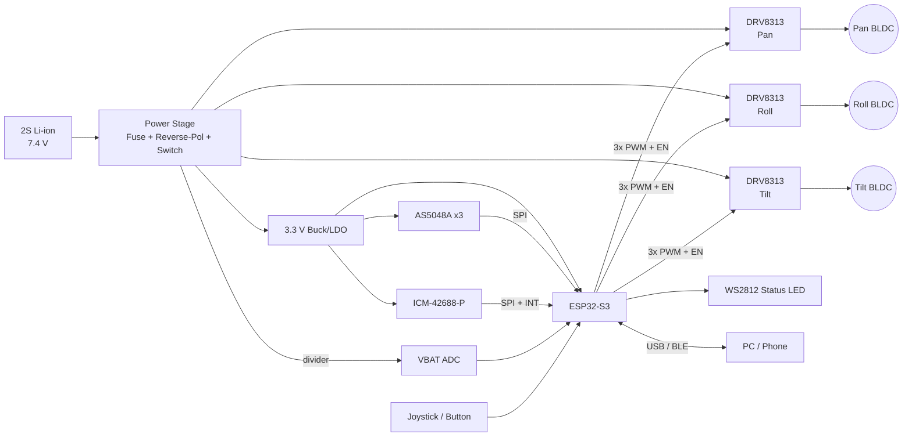
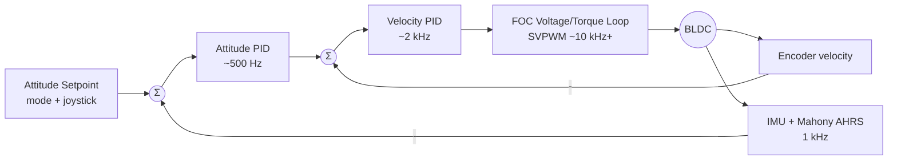

I don't have access to the `osmo-pocket-esp32-gimbal` repository or the earlier "cycles," so I can't confirm its actual pin assignments, part choices, or firmware structure. The README below assumes a typical design: an ESP32-S3, three gimbal BLDC motors, SimpleFOC, AS5048A encoders, and an ICM-42688-P IMU. Values marked **⚠️ VERIFY** must be checked against your schematic and code before publishing. If you share the existing README, schematic, or `pins.h`, I can align this exactly.

---

````markdown
# osmo-pocket-esp32-gimbal

> A compact, open-source 3-axis brushless gimbal for Osmo Pocket–class camera payloads,
> built on the ESP32-S3 with Field-Oriented Control (FOC) on every axis.


---

## Table of Contents

1. [Features](#features)
2. [System Architecture](#system-architecture)
3. [Hardware](#hardware)
4. [Wiring & Pinout](#wiring--pinout)
5. [Bill of Materials](#bill-of-materials)
6. [Firmware Build & Flash](#firmware-build--flash)
7. [First Power-Up Checklist](#first-power-up-checklist)
8. [FOC Tuning Procedure](#foc-tuning-procedure)
9. [Stabilization Loop Tuning](#stabilization-loop-tuning)
10. [Operating Modes & Controls](#operating-modes--controls)
11. [Telemetry & Configuration](#telemetry--configuration)
12. [Troubleshooting](#troubleshooting)
13. [Safety](#safety)
14. [Roadmap](#roadmap)
15. [Contributing](#contributing)
16. [License](#license)

---

## Features

- **3-axis stabilization** (pan / roll / tilt) with closed-loop FOC on each motor
- **Absolute magnetic encoders** (AS5048A, 14-bit). No homing sweep is needed at boot.
- **High-rate IMU fusion**: ICM-42688-P sampled at 1 kHz, with a Mahony filter producing a quaternion attitude estimate
- **Cascaded control**: attitude PID → velocity PID → FOC voltage/torque loop
- **Modes**: Follow, Pan-Follow, Lock, FPV, Recenter
- **Runtime tuning** over USB serial (SimpleFOC Commander) or BLE
- **Persistent config** in NVS (pole pairs, sensor offsets, PIDs, limits)
- **Protections**: under-voltage cutoff, motor stall detection, IMU watchdog, soft-start

---

## System Architecture

### Top-Level Block Diagram



### Control Loop Structure



### Firmware Task Layout (FreeRTOS)

| Task           | Core | Rate      | Priority | Responsibility                              |
|----------------|------|-----------|----------|---------------------------------------------|
| `foc_task`     | 1    | as fast as possible (target ≥10 kHz per motor) | 24 | `loopFOC()` + `move()` ×3 |
| `imu_task`     | 0    | 1 kHz (INT-driven) | 20 | IMU read, AHRS update                 |
| `control_task` | 0    | 500 Hz    | 18       | Mode logic, attitude PID, setpoints        |
| `io_task`      | 0    | 50 Hz     | 5        | Buttons, LED, VBAT, protections            |
| `comm_task`    | 0    | event     | 3        | Commander CLI, BLE, telemetry              |

> Core 1 is dedicated to FOC. Never run blocking I/O (Serial prints, NVS writes) on core 1.

### Repository Layout

```
.
├── firmware/
│   ├── platformio.ini
│   ├── include/
│   │   ├── pins.h            # All pin assignments (single source of truth)
│   │   └── config.h          # Default tuning constants
│   └── src/
│       ├── main.cpp
│       ├── foc/              # Motor + driver + sensor setup
│       ├── ahrs/             # IMU driver + Mahony filter
│       ├── control/          # Attitude PIDs, modes
│       ├── io/               # Buttons, LED, battery, protections
│       └── comm/             # Commander, BLE, telemetry
├── hardware/
│   ├── kicad/                # Schematic + PCB
│   ├── cad/                  # STEP/STL for arms and mounts
│   └── bom/bom.csv
├── tools/
│   └── tune_plot.py          # Live telemetry plotter
└── docs/
```

---

## Hardware

| Subsystem   | Part                                  | Notes                                     |
|-------------|---------------------------------------|-------------------------------------------|
| MCU         | ESP32-S3-WROOM-1 (N8R2 or N16R8)       | Dual-core 240 MHz, MCPWM ×2               |
| Motor driver| TI DRV8313 ×3 (or SimpleFOC Mini)      | 8–60 V, 2.5 A peak/phase                  |
| Motors      | 2204 260KV gimbal BLDC ×3 ⚠️ VERIFY    | 7 pole pairs typical (12N14P)             |
| Encoders    | AS5048A (SPI) ×3                       | Diametric magnet on motor shaft           |
| IMU         | ICM-42688-P                            | Mounted on the **camera plate**, not the handle |
| Power       | 2S 18650 (7.4 V nominal)               | 3.3 V via buck converter                  |

**Why SPI encoders instead of AS5600?** The AS5600 has a fixed I²C address, so three of them would need a mux. They are also slower and noisier. With AS5048A parts, each encoder sits on the shared SPI bus with its own chip-select line.

---

## Wiring & Pinout

> ⚠️ VERIFY against `firmware/include/pins.h`. That file is the source of truth.
> These assignments avoid ESP32-S3 strapping pins (0, 3, 45, 46), the USB pins (19, 20), and the
> octal-PSRAM pins (35–37 on N16R8 modules).

### ESP32-S3 Pin Map

| Function            | GPIO | Direction | Connected To            | Notes                       |
|---------------------|------|-----------|-------------------------|-----------------------------|
| **Pan PWM A**       | 4    | OUT       | DRV8313 #1 IN1          | MCPWM0                      |
| **Pan PWM B**       | 5    | OUT       | DRV8313 #1 IN2          | MCPWM0                      |
| **Pan PWM C**       | 6    | OUT       | DRV8313 #1 IN3          | MCPWM0                      |
| Pan EN              | 21   | OUT       | DRV8313 #1 EN1/2/3      | Tie ENx together            |
| **Roll PWM A**      | 7    | OUT       | DRV8313 #2 IN1          | MCPWM1                      |
| **Roll PWM B**      | 15   | OUT       | DRV8313 #2 IN2          | MCPWM1                      |
| **Roll PWM C**      | 16   | OUT       | DRV8313 #2 IN3          | MCPWM1                      |
| Roll EN             | 47   | OUT       | DRV8313 #2 EN           |                             |
| **Tilt PWM A**      | 17   | OUT       | DRV8313 #3 IN1          | LEDC fallback if MCPWM exhausted |
| **Tilt PWM B**      | 18   | OUT       | DRV8313 #3 IN2          |                             |
| **Tilt PWM C**      | 8    | OUT       | DRV8313 #3 IN3          |                             |
| Tilt EN             | 42   | OUT       | DRV8313 #3 EN           |                             |
| SPI SCK             | 12   | OUT       | AS5048A ×3, IMU         | FSPI                        |
| SPI MOSI            | 11   | OUT       | AS5048A ×3, IMU         |                             |
| SPI MISO            | 13   | IN        | AS5048A ×3, IMU         |                             |
| CS Pan encoder      | 10   | OUT       | AS5048A #1 CSn          | 10 kΩ pull-up               |
| CS Roll encoder     | 9    | OUT       | AS5048A #2 CSn          | 10 kΩ pull-up               |
| CS Tilt encoder     | 14   | OUT       | AS5048A #3 CSn          | 10 kΩ pull-up               |
| CS IMU              | 39   | OUT       | ICM-42688-P CS          | 10 kΩ pull-up               |
| IMU INT1            | 40   | IN        | ICM-42688-P INT1        | Data-ready interrupt        |
| VBAT sense          | 1    | ADC1_CH0  | Divider 100k/22k        | ADC1 only (ADC2 conflicts with Wi-Fi/BLE) |
| Mode button         | 2    | IN        | Button to GND           | Internal pull-up            |
| Joystick X          | 4→ see note | ADC | —                    | Optional; reassign if used  |
| Status LED          | 38   | OUT       | WS2812                  | DevKitC-1 v1.1 onboard LED  |
| USB D− / D+         | 19 / 20 | —      | USB-C                   | Native USB CDC              |

> **Joystick note:** if you add an analog joystick, use free ADC1 pins (GPIO 1–10). This means
> moving a PWM line, because ADC1 overlaps the Pan PWM pins above.

### DRV8313 Wiring (per axis)

```
            DRV8313
 VBAT ──┬── VM          OUT1 ── Motor phase A
        └─ 100µF + 0.1µF │ OUT2 ── Motor phase B
 GPIO ───── IN1          OUT3 ── Motor phase C
 GPIO ───── IN2
 GPIO ───── IN3          nSLEEP ─ 3.3 V (or GPIO)
 GPIO EN ── EN1,EN2,EN3  nRESET ─ 3.3 V
 GND  ───── GND/PGND     nFAULT ─ 10k pull-up → (optional GPIO)
```

### Encoder Magnet Placement

- Use a 6 × 2.5 mm **diametrically** magnetized N35+ magnet, glued to the shaft end.
- Keep an air gap of **0.5–2.0 mm** and center the magnet within ±0.25 mm.
- Read the AGC/diagnostic register at boot. Firmware logs a warning if the magnet is out of range.

### Power Wiring

```
2S Pack ─► 5A fuse ─► P-FET reverse-polarity ─► Power switch ─┬─► VM bus (DRV8313 ×3)
                                                            ├─► Buck → 3.3 V (≥600 mA)
                                                            └─► 100k/22k divider → GPIO1
```

- Put **≥220 µF of bulk capacitance** on the VM bus close to the drivers.
- Use a star ground: route motor-driver PGND separately and join it at the battery negative.

---

## Bill of Materials

> Prices are approximate single-unit USD values (⚠️ VERIFY). The full sourcing list is in `hardware/bom/bom.csv`.

| #  | Qty | Part                          | Example MPN / Source            | Unit $ | Ext $  |
|----|-----|-------------------------------|---------------------