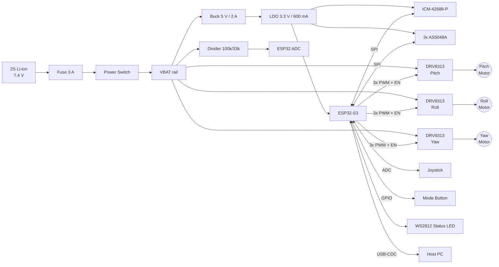

I can't see the `osmo-pocket-esp32-gimbal` repository or your earlier cycles, so this README is built on a reasonable reference design: an ESP32-S3 with 3× BLDC gimbal motors, SimpleFOC, SPI magnetic encoders, an ICM-42688-P IMU, and 2S Li-ion power. Every assumption is marked with `<!-- VERIFY -->` or listed in the Assumptions block, so you can reconcile it with your actual hardware and firmware.

---

````markdown
# osmo-pocket-esp32-gimbal

> Open-source, Osmo-Pocket-style 3-axis handheld stabilizer built on the ESP32-S3, with
> field-oriented control (FOC) of three BLDC gimbal motors, absolute magnetic encoders,
> and a high-rate IMU attitude loop.


<!-- VERIFY: Assumptions in this document
  - MCU: ESP32-S3-WROOM-1-N16R8 (octal PSRAM, so GPIO33–37 are reserved)
  - Motors: 3x 2204 260KV gimbal BLDC, 7 pole pairs (12N14P)
  - Drivers: 3x DRV8313-based boards (e.g., SimpleFOC Mini v1.x)
  - Encoders: 3x AS5048A (SPI, 14-bit) on a shared SPI bus
  - IMU: ICM-42688-P on the same SPI bus
  - Power: 2S Li-ion (7.4 V nominal, 8.4 V max)
  - Firmware: Arduino-ESP32 2.0.x + SimpleFOC 2.3.x via PlatformIO
-->

---

## Table of Contents

1. [Features](#features)
2. [Safety Warnings](#safety-warnings)
3. [System Architecture](#system-architecture)
4. [Hardware](#hardware)
5. [Wiring & Pinout](#wiring--pinout)
6. [Bill of Materials](#bill-of-materials)
7. [Firmware: Build & Flash](#firmware-build--flash)
8. [First Power-Up & Calibration](#first-power-up--calibration)
9. [FOC Tuning Procedure](#foc-tuning-procedure)
10. [Stabilization Loop Tuning](#stabilization-loop-tuning)
11. [Operating Modes & Controls](#operating-modes--controls)
12. [Serial Command Reference](#serial-command-reference)
13. [Troubleshooting](#troubleshooting)
14. [Repository Layout](#repository-layout)
15. [Contributing](#contributing)
16. [License](#license)

---

## Features

- **3-axis stabilization** (yaw / roll / pitch) with cascaded IMU attitude → FOC position → FOC velocity loops
- **Sinusoidal / SVPWM FOC** via [SimpleFOC](https://simplefoc.com), driven by absolute 14-bit encoders, so there is no startup jerk after the initial alignment is stored
- **1 kHz attitude loop** using a Mahony filter on ICM-42688-P data (2 kHz ODR)
- **Modes:** Follow (yaw+pitch), Lock (FPV-disabled), FPV (all-axis follow), Recenter, Sleep
- **Persistent calibration** in NVS: encoder zero offsets, motor direction, IMU bias, PID gains
- **Live tuning** over USB-CDC serial (SimpleFOC Commander) and optional BLE
- **Protection:** undervoltage cutoff, motor stall detection, driver over-temperature, IMU watchdog

---

## Safety Warnings

> ⚠️ **Read before powering anything.**

- **Li-ion cells** can cause fires if they are shorted, over-discharged, or punctured. Use protected cells or a BMS, and never leave the device charging unattended.
- **Start every motor test at `voltage_limit = 1.0 V`.** A mistuned gimbal motor at full voltage overheats within seconds and can demagnetize or melt its windings.
- **Gimbal arms move violently** when a sign is wrong in a control loop. Keep fingers and the payload clear during tuning. Tune each axis with the other two motors disabled.
- Always connect drivers to the battery **through the power switch and fuse**. Do not hot-plug motor phases while drivers are enabled.

---

## System Architecture

### Hardware Block Diagram



### Control Loop Architecture

```
            ┌────────────────────── ESP32-S3 Core 1 (pinned) ──────────────────────┐
            │                                                                      │
 Joystick ─►│ Setpoint    ┌──────────┐ θ_ref ┌─────────┐ ω_ref ┌─────────┐ Uq     │
 Mode    ──►│ Generator ─►│ Attitude │──────►│ Angle P │──────►│ Vel. PI │───┐    │
            │ (follow LPF)│ PID      │       │ (FOC)   │       │ (FOC)   │   │    │
            │             └────▲─────┘       └────▲────┘       └────▲────┘   ▼    │
            │                  │                  │                 │   ┌───────┐ │
            │           Mahony │           Encoder│angle     Encoder│ω  │ SVPWM │─┼─► DRV8313
            │           filter │                  │                 │   └───────┘ │
            │       ┌──────────┴─┐          ┌─────┴─────────────────┴┐            │
            │       │ ICM-42688-P│          │      AS5048A (SPI)     │            │
            │       │ 2 kHz ODR  │          │  per-axis, ~10 kHz     │            │
            │       └────────────┘          └────────────────────────┘            │
            │                                                                      │
            │  Loop rates:  FOC loopFOC() ≈ 8–12 kHz   |  move() ≈ 2 kHz           │
            │               Attitude/IMU    = 1 kHz     |  UI/Telemetry = 50 Hz     │
            └──────────────────────────────────────────────────────────────────────┘
              Core 0: USB-CDC Commander, BLE (optional), battery monitor, LED, NVS
```

### Firmware Task Map

| Task              | Core | Priority | Rate         | Responsibility                               |
|-------------------|------|----------|--------------|----------------------------------------------|
| `foc_task`        | 1    | 24 (max) | free-running | `loopFOC()` + `move()` for all three motors  |
| `attitude_task`   | 1    | 22       | 1 kHz        | IMU read, Mahony update, attitude PID        |
| `ui_task`         | 0    | 5        | 50 Hz        | Joystick, button FSM, LED, mode changes      |
| `comms_task`      | 0    | 4        | event        | Commander serial / BLE                       |
| `monitor_task`    | 0    | 3        | 10 Hz        | VBAT, temperatures, fault aggregation        |

---

## Hardware

### Mechanical Axis Order

The axes are ordered as in the DJI Osmo Pocket, from the handle to the payload:

```
Handle ──► Yaw motor ──► Roll motor ──► Pitch motor ──► Camera/payload
```

The IMU **must be mounted on the payload side of the pitch motor** (camera frame). Align its axes to the camera axes. The firmware also supports remapping in `config/imu_orientation.h`.

### Payload Balance

FOC can compensate for imbalance, but it does so by spending current and heat on it. Balance the payload mechanically so that each axis holds any position **with motors disabled**. Do this before tuning.

---

## Wiring & Pinout

> Pin choices avoid the ESP32-S3 strapping pins (0, 3, 45, 46), the USB pins (19, 20), and the
> octal-PSRAM pins (33–37). <!-- VERIFY against your module variant -->

### ESP32-S3 Pin Assignment

| Function              | GPIO | Peripheral      | Notes                                   |
|-----------------------|------|-----------------|-----------------------------------------|
| **Pitch** PWM A       | 4    | MCPWM0          |                                         |
| **Pitch** PWM B       | 5    | MCPWM0          |                                         |
| **Pitch** PWM C       | 6    | MCPWM0          |                                         |
| **Pitch** EN          | 7    | GPIO            | Driver enable (active high)             |
| **Roll** PWM A        | 15   | MCPWM1          |                                         |
| **Roll** PWM B        | 16   | MCPWM1          |                                         |
| **Roll** PWM C        | 17   | MCPWM1          |                                         |
| **Roll** EN           | 18   | GPIO            |                                         |
| **Yaw** PWM A         | 38   | LEDC*           | *See MCPWM note below                   |
| **Yaw** PWM B         | 39   | LEDC*           |                                         |
| **Yaw** PWM C         | 40   | LEDC*           |                                         |
| **Yaw** EN            | 41   | GPIO            |                                         |
| SPI SCK               | 12   | FSPI (IOMUX)    | Shared: IMU + 3 encoders                |
| SPI MOSI              | 11   | FSPI (IOMUX)    |                                         |
| SPI MISO              | 13   | FSPI (IOMUX)    |                                         |
| CS – IMU              | 10   | GPIO            | 10 kΩ pull-up                           |
| CS – Enc Pitch        | 14   | GPIO            | 10 kΩ pull-up                           |
| CS – Enc Roll         | 21   | GPIO            | 10 kΩ pull-up                           |
| CS – Enc Yaw          | 47   | GPIO            | 10 kΩ pull-up                           |
| IMU INT1 (data-ready) | 48   | GPIO (IRQ)      |                                         |
| VBAT sense            | 1    | ADC1_CH0        | 100k/33k divider; 100 nF to GND         |
| Joystick X            | 8    | ADC1_CH7        |                                         |
| Joystick Y            | 9    | ADC1_CH8        |                                         |
| Mode button           | 2    | GPIO            | Internal pull-up, active low            |
| Status LED (WS2812)   | 42   | RMT             |                                         |
| USB D− / D+           | 19/20| USB-CDC         | Flashing + Commander                    |
| UART0 TX / RX         | 43/44| UART0           | Debug log                               |

> **MCPWM note:** The ESP32-S3 has two MCPWM units. Arduino-ESP32 / SimpleFOC typically assigns one
> unit per 3-PWM motor, so the third motor falls back to **LEDC**. LEDC works, but its phase PWM is
> not center-aligned. If you see more audible noise on yaw, either raise
> `driver.pwm_frequency` to 25 kHz or assign the quietest-required axis (usually pitch) to MCPWM.
> <!-- VERIFY with your SimpleFOC version's ESP32 driver selection -->

### Driver Board Wiring (per axis, DRV8313 / SimpleFOC Mini)

```
 ESP32-S3                 DRV8313 board                Gimbal motor
 ────────                 ─────────────                ────────────
 PWM A  ───────────────►  IN1          OUT1  ─────────► Phase A
 PWM B  ───────────────►  IN2          OUT2  ─────────►