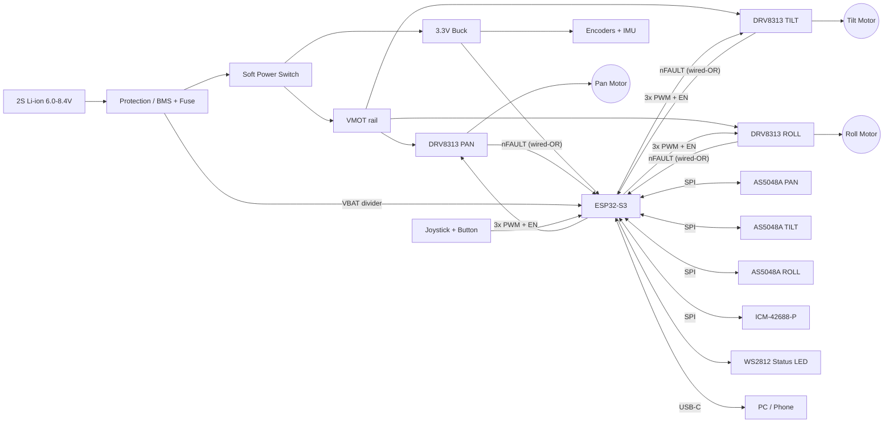

**Note:** I don't have access to an existing `osmo-pocket-esp32-gimbal` repository or the output of your previous seven cycles, so I can't reproduce their exact decisions. Below is a complete, self-consistent README built on a sensible reference design: ESP32-S3, three DRV8313 drivers, AS5048A encoders, an ICM-42688-P IMU, and SimpleFOC. Places where your hardware may differ are marked `⚠️ VERIFY`. If you paste your prior README or schematic, I'll reconcile this against it.

---

````markdown
# osmo-pocket-esp32-gimbal

> Open-source, Osmo-Pocket-style 3-axis handheld camera gimbal built on the ESP32-S3,
> with field-oriented control (FOC) of brushless gimbal motors, SPI magnetic encoders,
> a high-rate IMU, and BLE/USB control.


---

## Table of Contents

1. [Features](#features)
2. [System Overview](#system-overview)
3. [Block Diagrams](#block-diagrams)
4. [Hardware](#hardware)
5. [Wiring & Pinout](#wiring--pinout)
6. [Power System](#power-system)
7. [Firmware Architecture](#firmware-architecture)
8. [Build & Flash](#build--flash)
9. [First Power-Up Checklist](#first-power-up-checklist)
10. [FOC Tuning Procedure](#foc-tuning-procedure)
11. [Stabilization Loop Tuning](#stabilization-loop-tuning)
12. [Control Interfaces](#control-interfaces)
13. [Bill of Materials](#bill-of-materials)
14. [Troubleshooting](#troubleshooting)
15. [Safety](#safety)
16. [Roadmap](#roadmap)
17. [Contributing](#contributing)
18. [License](#license)

---

## Features

- **3-axis stabilization** (pan / tilt / roll) with closed-loop FOC on every axis
- **Absolute 14-bit magnetic encoders** (AS5048A, SPI). No homing sweep is needed at boot.
- **ICM-42688-P IMU** at 1 kHz with a Mahony attitude filter
- **Cascaded control:** attitude → angle → velocity → voltage-mode FOC
- **Modes:** Follow, Pan-Follow, Lock, FPV, Recenter, Sleep
- **Interfaces:** thumb joystick, multi-function button, BLE GATT, USB-CDC serial console
- **Safety:** driver fault monitoring, stall detection, under-voltage cutoff, thermal derating
- **Persistent calibration** stored in NVS. Encoder offsets and PID gains survive reboot.

---

## System Overview

| Parameter              | Value                                        |
|------------------------|----------------------------------------------|
| MCU                    | ESP32-S3-WROOM-1-N8R8 (dual-core LX7 @ 240 MHz) |
| Motor drivers          | 3 × TI DRV8313 (integrated 3-phase, 8–60 V)  |
| Motors                 | 3 × 2204/2206 gimbal BLDC, 12N14P (7 pole pairs) ⚠️ VERIFY |
| Encoders               | 3 × AS5048A (SPI, 14-bit absolute)           |
| IMU                    | TDK ICM-42688-P (SPI)                        |
| Supply                 | 2S Li-ion (6.0–8.4 V), 18650 or 21700        |
| FOC loop rate          | ~8–10 kHz per axis (`loopFOC`)               |
| Motion/attitude loop   | 1 kHz                                        |
| Typical current        | 150–400 mA idle-stabilizing, < 1.2 A peak    |

---

## Block Diagrams

### Hardware Topology



### Control Cascade (per axis)

```
                 ┌────────────┐   θ_ref    ┌───────────┐  ω_ref  ┌───────────┐  Uq   ┌────────┐
 User / Mode ──► │  Attitude  │ ─────────► │  Angle P  │ ──────► │ Velocity  │ ────► │  FOC   │──► Motor
 (joystick,BLE)  │  Planner   │            │ (motor θ) │         │    PI     │       │ SVPWM  │
                 └─────▲──────┘            └─────▲─────┘         └─────▲─────┘       └────────┘
                       │ camera attitude         │ θ_enc               │ ω_enc (LPF)
                 ┌─────┴──────┐            ┌─────┴─────────────────────┴────┐
                 │ IMU + AHRS │            │         AS5048A encoder        │
                 │  (Mahony)  │            └────────────────────────────────┘
                 └────────────┘
     1 kHz (Core 0)                 1 kHz move()                     ~10 kHz loopFOC() (Core 1)
```

### Firmware Task Map

```
Core 1 (real-time)                     Core 0 (system)
───────────────────                    ────────────────────────────
foc_task  [prio 24, no yield]          imu_task      [prio 20, 1 kHz, IMU INT]
  loop: loopFOC() x3                   ctrl_task     [prio 18, 1 kHz] attitude → setpoints
        move()    x3 @ 1 kHz           safety_task   [prio 15, 100 Hz] VBAT, nFAULT, stall, temp
                                       ui_task       [prio 5,  50 Hz] joystick, button, LED
                                       ble_task      [NimBLE]
                                       console_task  [USB-CDC Commander]
```

Setpoints cross cores through a lock-free double buffer (`shared_setpoint_t`, sequence-counter protected).

---

## Hardware

### Mechanical

- Axis order (base → camera): **Pan → Roll → Tilt** ⚠️ VERIFY against your CAD
- Each encoder magnet (diametric, 6×2.5 mm) is glued centered on the motor shaft end. Keep the air gap at 0.5–2.0 mm.
- **Balance the camera payload mechanically before tuning.** FOC compensates for imbalance, but it costs current, heat, and battery life.
- CAD lives in `/mechanical` (STEP and STL). Print the arms in PETG or PA-CF. PLA creeps near warm motors.

### Electronics

- KiCad 8 project in `/hardware/kicad`
- 4-layer board (SIG / GND / PWR / SIG), 1 oz copper
- Motor flex and slip-ring wiring is documented in `/hardware/harness.md`

---

## Wiring & Pinout

### ESP32-S3 Pin Assignment

These pins avoid strapping pins (GPIO 3, 45, 46), the octal-PSRAM pins (GPIO 35–37 on N8R8), and native USB (GPIO 19/20). All analog inputs use **ADC1**, because ADC2 conflicts with the radio.

| GPIO | Function          | Dir | Connected To              | Notes                                 |
|-----:|-------------------|-----|---------------------------|---------------------------------------|
| 0    | BTN_USER          | In  | Multi-function button     | Also BOOT. Internal pull-up, active-low |
| 1    | VBAT_SENSE        | AI  | 100k/33k divider          | ADC1_CH0, 11 dB attenuation           |
| 2    | JOY_X             | AI  | Joystick X                | ADC1_CH1                              |
| 4    | JOY_Y             | AI  | Joystick Y                | ADC1_CH3                              |
| 5    | SPI_SCK           | Out | Encoders + IMU            | FSPI, 8 MHz (IMU up to 24 MHz)        |
| 6    | SPI_MOSI          | Out | Encoders + IMU            |                                       |
| 7    | SPI_MISO          | In  | Encoders + IMU            |                                       |
| 8    | CS_ENC_PAN        | Out | AS5048A #1                | 10k pull-up                           |
| 9    | CS_ENC_TILT       | Out | AS5048A #2                | 10k pull-up                           |
| 10   | CS_ENC_ROLL       | Out | AS5048A #3                | 10k pull-up                           |
| 11   | PAN_IN1           | Out | DRV8313 #1 IN1            | MCPWM0                                |
| 12   | PAN_IN2           | Out | DRV8313 #1 IN2            | MCPWM0                                |
| 13   | PAN_IN3           | Out | DRV8313 #1 IN3            | MCPWM0                                |
| 14   | TILT_IN1          | Out | DRV8313 #2 IN1            | MCPWM1                                |
| 15   | TILT_IN2          | Out | DRV8313 #2 IN2            | MCPWM1                                |
| 16   | TILT_IN3          | Out | DRV8313 #2 IN3            | MCPWM1                                |
| 17   | ROLL_IN1          | Out | DRV8313 #3 IN1            | LEDC (see note)                       |
| 18   | ROLL_IN2          | Out | DRV8313 #3 IN2            | LEDC                                  |
| 21   | ROLL_IN3          | Out | DRV8313 #3 IN3            | LEDC                                  |
| 38   | EN_PAN            | Out | DRV8313 #1 EN1/2/3        | Tie the three ENx together            |
| 39   | EN_TILT           | Out | DRV8313 #2 EN1/2/3        |                                       |
| 40   | EN_ROLL           | Out | DRV8313 #3 EN1/2/3        |                                       |
| 41   | CS_IMU            | Out | ICM-42688-P CS            | 10k pull-up                           |
| 42   | IMU_INT1          | In  | ICM-42688-P INT1          | Data-ready, push-pull                 |
| 47   | nFAULT            | In  | All DRV8313 nFAULT        | Open-drain wired-OR, 10k pull-up      |
| 48   | LED_DATA          | Out | WS2812B                   | 330 Ω series                          |
| 19/20| USB D-/D+         | —   | USB-C                     | Native USB-CDC + flashing             |
| 43/44| UART0 TX/RX       | —   | Debug header              | Optional                              |

> **PWM note:** The ESP32-S3 has two MCPWM units, which gives two fully synchronized
> 3-phase out